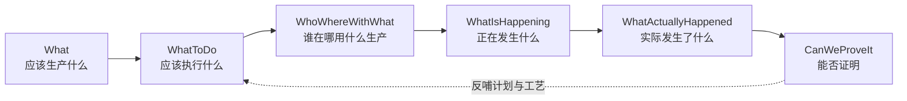

# 00.2 MES 六问模型

> 所属篇章：00_MES业务建模总纲 ｜ 状态：⏳ 骨架（待填充）

## 本篇要回答的业务问题

- 用什么框架保证建模「不重不漏」地覆盖 MES 业务？
- 六问之间如何衔接成一个执行闭环？
- 六问与传统 5W1H / ISA-95 层级如何对应？

## 1. 六问总览

| # | 问题 | 追问 | 核心对象 | 目录 |
| --- | --- | --- | --- | --- |
| 01 | What | 应该生产什么？ | Product / BOM / Material / Spec | 01 |
| 02 | WhatToDo | 应该执行什么？ | WorkOrder / Routing / Operation | 02 |
| 03 | WhoWhereWithWhat | 谁在哪里用什么生产？ | Factory / Line / Station / Person / Equipment / 5M1E | 03 |
| 04 | WhatIsHappening | 现在正在发生什么？ | WIP / SerialUnit / Operation 执行 | 04 |
| 05 | WhatActuallyHappened | 实际发生了什么？ | ManufacturingEvent / TestRecord / NC | 05 |
| 06 | CanWeProveIt | 能否证明？ | Traceability / Genealogy / 证据链 | 06 |

## 2. 六问构成的执行闭环

<!-- 待填充：
- 前三问是「事前」（定义与计划），第四问是「事中」（执行与管控），后两问是「事后」（记录与证明）
- 与「先记录、再约束、后分析」原则的对应：MVP 阶段 05/06 先落地，02 的强约束随后收紧
-->

## 3. 与 5W1H、ISA-95 的映射

<!-- 待填充：映射表，说明六问是对 5W1H 的制造域具体化 -->

| 5W1H | 六问 | 说明 |
| --- | --- | --- |
| What | 01 / 05 | 计划生产什么 vs 实际产出什么 |
| Who / Where | 03 | 人、组织、物理位置 |
| When | 04 / 05 | 执行时点与事件时间 |
| Why / How | 02 / 05 | 工艺方法与实际过程 |
| How much | 05 / 06 | 实测参数与判定结果 |

- ISA-95 对照：六问全部落在 L3（MES）层，向上承接 L4（ERP 计划），向下约束 L2（SCADA/设备）

## 4. 六问 → 追溯问题清单

六问的最终检验是第 06 问。参考 [`MES系统概览学习.md`](../MES系统概览学习.md) 的问题清单：

> 是谁做的？什么时候做的？哪个工厂 / 线 / 工位？用了什么设备？什么原材料？哪个 Lot？哪个 Recipe？哪个 Software Version？哪个 Test Template？测了哪些参数？环境是什么？Quality 结果是什么？返修过没有？谁批准的？最终去了哪里？

<!-- 待填充：把每个问题映射到六问中的某一问及对应模型篇目 -->

## 关联文档

- 上游：[00.1_为什么要对MES业务建模](00.1_为什么要对MES业务建模.md)
- 平行：[00.4_MES核心业务对象地图](00.4_MES核心业务对象地图.md)
- 应用：[07.1_一个产品的一生](../07_综合案例/07.1_一个产品的一生.md)（六问的案例串联）
