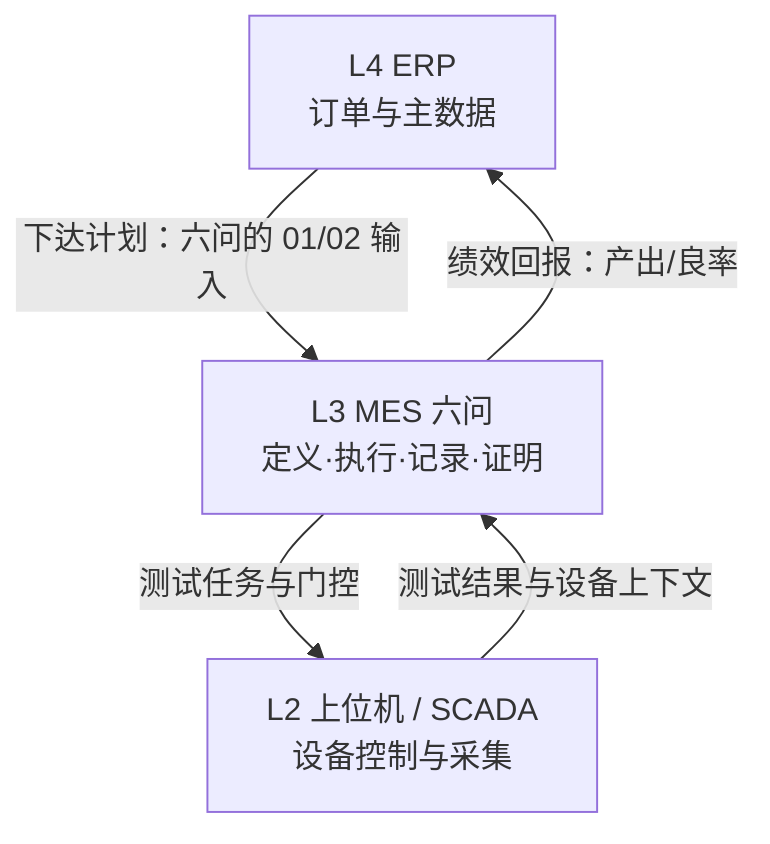

# 00.2 MES 六问模型

> 所属篇章：00_MES业务建模总纲 ｜ 状态：✅ 已完成

## 本篇要回答的业务问题

- 用什么框架保证建模「不重不漏」地覆盖 MES 业务？
- 六问之间如何衔接成一个执行闭环？
- 六问与传统 5W1H / ISA-95 层级如何对应？

## 1. 六问总览

| # | 问题 | 追问 | 核心对象 | 目录 |
| --- | --- | --- | --- | --- |
| 01 | What | 应该生产什么？ | Product / BOM / Material / Spec | 01 |
| 02 | WhatToDo | 应该执行什么？ | WorkOrder / Routing / Operation | 02 |
| 03 | WhoWhereWithWhat | 谁在哪里用什么生产？ | Factory / Line / Station / Person / Equipment / 5M1E | 03 |
| 04 | WhatIsHappening | 现在正在发生什么？ | WIP / SerialUnit / Operation 执行 | 04 |
| 05 | WhatActuallyHappened | 实际发生了什么？ | ManufacturingEvent / TestRecord / NC | 05 |
| 06 | CanWeProveIt | 能否证明？ | Traceability / Genealogy / 证据链 | 06 |

六问的设计动机：5W2H 是通用提问工具，但直接用它组织 MES 会过于发散（Why、How 在制造现场有多重含义）。六问把 5W2H **具体化到制造执行域**，每一问都对应一组明确的业务对象，使「提问题」和「建模型」一一挂钩。

## 2. 六问构成的执行闭环

六问在时间轴上有清晰的「事前 / 事中 / 事后」结构：

| 阶段 | 六问 | 性质 | 数据特征 |
| --- | --- | --- | --- |
| 事前（定义与计划） | 01 What / 02 WhatToDo / 03 WhoWhereWithWhat | 「应该」的世界 | 主数据，可版本化、可变更，但变更需受控 |
| 事中（执行与管控） | 04 WhatIsHappening | 「正在」的世界 | 执行状态，随生产实时变化 |
| 事后（记录与证明） | 05 WhatActuallyHappened / 06 CanWeProveIt | 「实际」的世界 | 事实数据，只追加、不静默改写 |

与「先记录、再约束、后分析」原则的对应：

- **先记录**：MVP 阶段优先落地 05/06——先把 TestRecord、TraceEvent 的事实链做实（MIMS 阶段的核心）；
- **再约束**：随后收紧 02 的强门控——防跳站、防漏测、Fail 未处置拦截（`MES-4002` 等）；
- **后分析**：SPC 与看板建立在可信事实层之上（M2–M3）。

这不是六问顺序的颠倒，而是**建设顺序与逻辑顺序的分离**：逻辑上前三问定义世界，建设上先从第五问的事实采集切入（光通信工厂「测试 + 上位机 + 数据」最强能力所在），再回填门控与分析。

## 3. 与 5W1H、ISA-95 的映射

六问是对 5W1H 的制造域具体化，同时补上了 5W1H 缺失的一个关键维度——**证明（Can we prove it）**：

| 5W1H | 六问 | 说明 |
| --- | --- | --- |
| What | 01 / 05 | 计划生产什么 vs 实际产出什么（期望与实际的成对建模） |
| Who / Where | 03 | 人、组织、物理位置（工站层级与 5M1E 中的人、机、环） |
| When | 04 / 05 | 执行时点与事件时间（状态是「现在」的摘要，事件是「过去」的事实） |
| Why / How | 02 / 05 | 工艺方法与实际过程（Routing 定义 How，事件记录实际 How） |
| How much | 05 / 06 | 实测参数与判定结果（Metrics + 规格判定） |
| （5W1H 无对应） | 06 | 「能否证明」——制造业特有的证据与合规要求（审计、客诉、召回） |

ISA-95 对照：六问全部落在 **L3（MOM/MES）层**，向上承接 L4（ERP 计划），向下约束 L2（SCADA/设备）：

判断一个需求归属的标尺：回答「谁在什么时刻允许做什么、做完留什么证据」属于六问（L3）；「下一小时排哪张工单」是 APS（L4），「这台仪器的毫秒级采样」是 L2。

## 4. 六问 → 追溯问题清单

六问的最终检验是第 06 问。参考 [`MES系统概览学习.md`](../MES系统概览学习.md) 的问题清单：

> 是谁做的？什么时候做的？哪个工厂 / 线 / 工位？用了什么设备？什么原材料？哪个 Lot？哪个 Recipe？哪个 Software Version？哪个 Test Template？测了哪些参数？环境是什么？Quality 结果是什么？返修过没有？谁批准的？最终去了哪里？

逐问映射到六问与模型篇目：

| 追溯问题 | 六问归属 | 模型篇目 |
| --- | --- | --- |
| 是谁做的？ | 03 Who | [03.2 人员与技能](../03_WhoWhereWithWhat_谁在哪里用什么生产/03.2_人员与技能模型.md) |
| 什么时候做的？ | 05 When | [05.1 制造事件](../05_WhatActuallyHappened_实际发生了什么/05.1_ManufacturingEvent制造事件.md) |
| 哪个工厂 / 线 / 工位？ | 03 Where | [03.1 物理工厂](../03_WhoWhereWithWhat_谁在哪里用什么生产/03.1_制造组织与物理工厂模型.md) |
| 用了什么设备？ | 03 WithWhat | [03.3 设备工具](../03_WhoWhereWithWhat_谁在哪里用什么生产/03.3_设备工具物料资源模型.md) |
| 什么原材料？哪个 Lot？ | 01 What + 06 | [01.2 BOM与物料](../01_What_应该生产什么/01.2_BOM与物料模型.md) / [06.2 谱系](../06_CanWeProveIt_能否证明/06.2_Genealogy谱系模型.md) |
| 哪个 Recipe / Software Version / Test Template？ | 03 WithWhat | [03.3 设备工具](../03_WhoWhereWithWhat_谁在哪里用什么生产/03.3_设备工具物料资源模型.md) |
| 测了哪些参数？环境是什么？ | 05 How much / 03 环 | [05.2 Expected与Actual](../05_WhatActuallyHappened_实际发生了什么/05.2_Expected与Actual模型.md) / [03.4 5M1E](../03_WhoWhereWithWhat_谁在哪里用什么生产/03.4_5M1E制造上下文模型.md) |
| Quality 结果是什么？返修过没有？ | 05 What | [05.3 质量与异常](../05_WhatActuallyHappened_实际发生了什么/05.3_质量与异常业务模型.md) / [05.4 处置状态](../05_WhatActuallyHappened_实际发生了什么/05.4_Hold_Rework_Retest_Scrap状态模型.md) |
| 谁批准的？ | 05 + 06 | [03.2 人员与技能](../03_WhoWhereWithWhat_谁在哪里用什么生产/03.2_人员与技能模型.md) / [06.4 证据链](../06_CanWeProveIt_能否证明/06.4_制造证据链模型.md) |
| 最终去了哪里？ | 06（边界外） | [06.1 追溯业务模型](../06_CanWeProveIt_能否证明/06.1_Traceability业务模型.md)（完整性边界一节） |

这个映射表的用法：**任何一问回答不了，就指向一个缺失或断链的模型篇目**。它是建模完成度的检验器（详见 [08.4 检查清单](../08_MES业务全景/08.4_MES业务建模方法论.md)）。

## 关联文档

- 上游：[00.1_为什么要对MES业务建模](00.1_为什么要对MES业务建模.md)
- 平行：[00.4_MES核心业务对象地图](00.4_MES核心业务对象地图.md)
- 应用：[07.1_一个产品的一生](../07_综合案例/07.1_一个产品的一生.md)（六问的案例串联）
