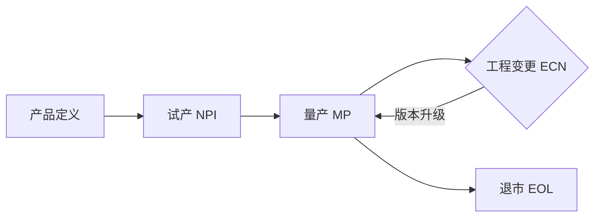

# 00.3 产品生命周期模型

> 所属篇章：00_MES业务建模总纲 ｜ 状态：⏳ 骨架（待填充）

## 本篇要回答的业务问题

- 一个产品从定义到退市的生命周期中，MES 在哪些阶段介入、各阶段关注什么？
- 产品 / 工艺 / 测试流程的版本如何随生命周期演进？
- 生命周期切换时，在制品（WIP）如何处理？

## 1. 生命周期阶段总览

<!-- 待填充：各阶段说明 -->

| 阶段 | MES 关注点 |
| --- | --- |
| 产品定义 | Product / BOM / 规格（Spec）建立 |
| 试产 NPI（EVT/DVT/PVT） | 全面采集数据、弱约束、允许试错 |
| 量产 MP | 强约束（防跳站、防漏测）、效率、SPC |
| 工程变更 ECN | 版本切换、在制品处置策略 |
| 退市 EOL | 追溯数据保留期限、归档 |

## 2. 版本演进模型

<!-- 待填充 -->

- ProductVersion：产品版本
- RoutingVersion / TestFlowVersion：工艺与测试流程版本，同产品仅一个「启用」版本
- 版本切换的三要素：生效时间、切换点（按 SN / 按工单）、在制品归属
- 对照本项目：`POST /api/test-flows/{flowCode}/activate`（同产品其余置为 inactive）

## 3. 生命周期与在制品

<!-- 待填充：ECN 生效时，产线上已投产的 SN 走旧版还是新版？ -->

- 策略选项：按工单切割 / 按 SN 切割 / 混合
- 决策依据：变更是否影响测试规格与判定

## 4. 与综合案例的衔接

- [07.2_VOA产品生命周期业务建模](../07_综合案例/07.2_VOA产品生命周期业务建模.md) 是本篇的实例化

## 关联文档

- 上游：[00.2_MES六问模型](00.2_MES六问模型.md)
- 下游：[01.1_产品Product模型](../01_What_应该生产什么/01.1_产品Product模型.md)、[02.2_Routing与Operation模型](../02_WhatToDo_应该执行什么/02.2_Routing与Operation模型.md)
