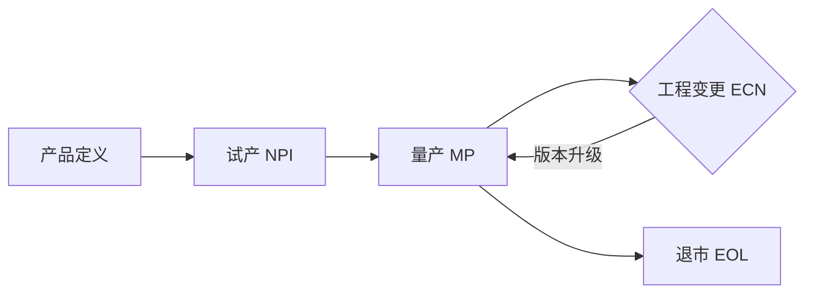
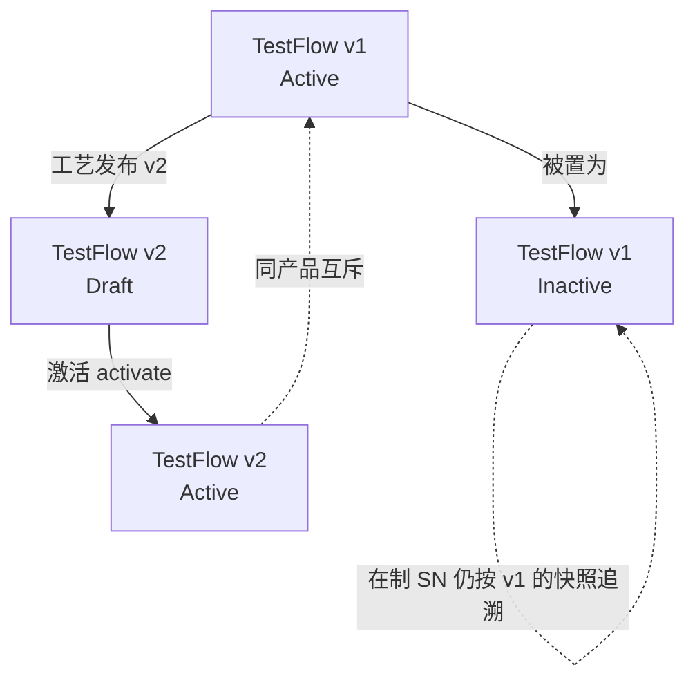

# 00.3 产品生命周期模型

> 所属篇章：00_MES业务建模总纲 ｜ 状态：✅ 已完成

## 本篇要回答的业务问题

- 一个产品从定义到退市的生命周期中，MES 在哪些阶段介入、各阶段关注什么？
- 产品 / 工艺 / 测试流程的版本如何随生命周期演进？
- 生命周期切换时，在制品（WIP）如何处理？

## 1. 生命周期阶段总览

各阶段说明与 MES 介入方式：

| 阶段 | MES 关注点 | 详细说明 |
| --- | --- | --- |
| 产品定义 | Product / BOM / 规格（Spec）建立 | 建立产品身份、物料结构与测试规格的「第 0 版」；此时数据不全没关系，关键是**从第一件开始就留事实** |
| 试产 NPI（EVT/DVT/PVT） | 全面采集数据、弱约束、允许试错 | 工程验证（EVT）→ 设计验证（DVT）→ 生产验证（PVT）；此阶段流程定义频繁变更，MES 以「记录」为主、门控放宽（或仅提示不拦截），让工程师快速试错并积累数据 |
| 量产 MP | 强约束（防跳站、防漏测）、效率、SPC | 流程冻结，门控收紧；FPY、节拍、SPC 成为日常管理指标；流程版本变更必须走受控发布 |
| 工程变更 ECN | 版本切换、在制品处置策略 | 见 §3；核心矛盾是「新版本何时生效、旧在制品走哪版」 |
| 退市 EOL | 追溯数据保留期限、归档 | 产品停产后，追溯数据仍需按客户/法规要求保留（光通信行业常见数年）；归档策略影响存储设计（冷热分层） |

一个关键认识：**生命周期阶段与 MES 建设阶段（M1→M2→M3）是两个维度**。前者是单个产品的旅程，后者是 MES 能力的成熟度；但两者共享同一个原则——试产期的 MES 与 MVP 期的 MES 一样，都是「先记录、再约束、后分析」。

## 2. 版本演进模型

- **ProductVersion**：产品版本（如硬件改版 A → B）。重大改版通常伴随 BOM 变更与规格变更。
- **RoutingVersion / TestFlowVersion**：工艺与测试流程版本，**同产品仅一个「启用」版本**。
- **SpecVersion**：测试规格版本（上下限调整）。规格变更不影响流程结构，但影响判定结果。

版本切换的三要素——缺一不可，否则切换现场必然混乱：

| 要素 | 说明 | 决策问题 |
| --- | --- | --- |
| 生效时间 | 新版本从何时起可用 | 立即？次日班次？指定日期？ |
| 切换点 | 新版本适用于哪些对象 | 按工单切割（新工单用新版）还是按 SN 切割（新投产 SN 用新版）？ |
| 在制品归属 | 已投产对象走哪版 | 在制 SN 继续走旧版（多数情况）还是强制迁移？ |

对照本项目：`POST /api/test-flows/{flowCode}/activate` 将同产品其余流程置为 inactive——这是「同产品互斥启用」的最小实现。更完整的版本治理（生效时间、按工单锁定版本快照）属于 M2 流程版本治理的范畴（见 [08.2](../08_MES业务全景/08.2_MES端到端业务活动图.md) 里程碑标注）。

版本演进的健康模式：

注意 inactive 不等于删除：**历史工单 / 历史事件对流程版本的引用必须仍然可解析**（通过版本快照或引用，见 [03.4 上下文快照](../03_WhoWhereWithWhat_谁在哪里用什么生产/03.4_5M1E制造上下文模型.md)），否则追溯会「看着当前主数据解释历史」。

## 3. 生命周期与在制品

ECN 生效时，产线上已投产的 SN 走旧版还是新版？这是每个工厂都会遇到的实操问题：

| 策略 | 规则 | 适用场景 | 风险 |
| --- | --- | --- | --- |
| 按工单切割 | ECN 只对「ECN 生效后新建的工单」生效，在制工单整体走旧版 | 变更不影响质量判定（如包装改版、标签变更） | 在制工单数量大时，旧版料/流程使用期被拉长 |
| 按 SN 切割 | ECN 生效时刻之后**投产的 SN** 走新版，之前的走旧版 | 变更影响物料或测试规格，且新旧件不可混装 | 需要 SN 级版本标记，系统复杂度高 |
| 混合 | 结构性变更按工单切割，规格性变更按 SN 切割 | 大多数实际工厂 | 需要明确的决策表，避免现场自由裁量 |

**决策依据：变更是否影响测试规格与判定。**

- 若 ECN 只改外观/包装 → 按工单切割即可；
- 若 ECN 改了衰减芯片供应商（关键料）或插损规格限值 → 必须按 SN 切割，且旧版在制品的谱系数据要能区分新旧料（否则正反向追溯会把两个版本混在一起，见 [06.3](../06_CanWeProveIt_能否证明/06.3_正向与反向追溯.md)）；
- 无论哪种切割，**切换点前后各生产了什么，必须可从事件时间线还原**——这就是为什么版本切换本身也应留下事件（AuditEvent，见 [05.1](../05_WhatActuallyHappened_实际发生了什么/05.1_ManufacturingEvent制造事件.md)）。

## 4. 与综合案例的衔接

- [07.2_VOA产品生命周期业务建模](../07_综合案例/07.2_VOA产品生命周期业务建模.md) 是本篇的实例化：VOA 从试产到量产、经历关键料变更的完整生命周期演练。

## 关联文档

- 上游：[00.2_MES六问模型](00.2_MES六问模型.md)
- 下游：[01.1_产品Product模型](../01_What_应该生产什么/01.1_产品Product模型.md)、[02.2_Routing与Operation模型](../02_WhatToDo_应该执行什么/02.2_Routing与Operation模型.md)
