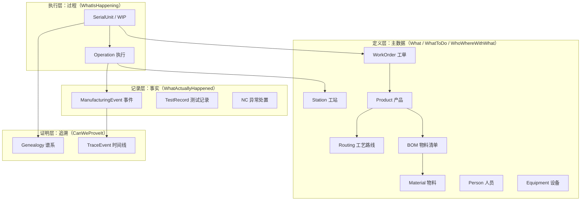

# 00.4 MES 核心业务对象地图

> 所属篇章：00_MES业务建模总纲 ｜ 状态：✅ 已完成

## 本篇要回答的业务问题

- MES 领域一共有哪些核心业务对象？彼此什么关系？
- 每个对象归属六问中的哪一问？
- 对象与对象之间：谁定义（主数据）、谁执行（过程）、谁记录（事实）？

## 1. 对象总览图

图中的关系逐层说明——**依赖方向是单向的：定义层 → 执行层 → 记录层 → 证明层，绝不反向**：

| 关系 | 语义 | 关键点 |
| --- | --- | --- |
| Product → BOM → Material | 产品定义其组成，组成指向物料主数据 | 定义层内部关系；BOM 是「应该用什么」 |
| Product → Routing | 产品定义其工艺路线 | 「应该怎么走」 |
| WorkOrder → Product | 工单锚定产品（+数量+交期） | 计划执行的最小单元 |
| SN → WorkOrder | 每个单件在制品归属一张工单 | 执行层从工单「实例化」出来 |
| SN → Operation | SN 的每个步骤对应一次工序执行 | 一个 SN × 一个 RouteStep = 一个执行实例 |
| Operation → Station / Person / Equipment | 执行发生在具体工站，占用资源 | 5M1E 上下文在此挂载（03.4） |
| Operation → Event | 每次执行产生事实事件 | **执行可被撤销，事实不可** |
| Event → Trace / SN → Genealogy | 事件流构成时间线；上料事实构成谱系 | 证明层只是记录层的「投影与聚合」，不产生新事实 |

这张分层图回答了第三个业务问题：**定义（主数据）、执行（过程）、记录（事实）的分离**，是整个 MES 模型的第一设计决策。它带来三条推论：

1. **主数据变更不影响历史事实**——历史事件须带版本快照或可解析的版本引用（03.4）；
2. **执行状态可以重算**——状态是事件的投影，事件流在，状态就能重建（事件溯源思想，05.1）；
3. **证明层零写入特权**——追溯视图、谱系树全部由记录层推导，不允许「直接改追溯结果」。

## 2. 对象清单与六问映射

| 业务对象 | 一句话说明 | 六问 | 详见 |
| --- | --- | --- | --- |
| Product / ProductVersion | 生产什么的定义 | 01 | [01.1](../01_What_应该生产什么/01.1_产品Product模型.md) |
| BOM / BOMLine / Material / Lot | 用什么料、按什么结构 | 01 | [01.2](../01_What_应该生产什么/01.2_BOM与物料模型.md) |
| WorkOrder | 执行多少、为谁执行 | 02 | [02.1](../02_WhatToDo_应该执行什么/02.1_生产订单模型.md) |
| Routing / Operation / RouteStep | 按什么步骤执行 | 02 | [02.2](../02_WhatToDo_应该执行什么/02.2_Routing与Operation模型.md) |
| Factory / Line / Station | 在哪里执行 | 03 | [03.1](../03_WhoWhereWithWhat_谁在哪里用什么生产/03.1_制造组织与物理工厂模型.md) |
| Person / Skill | 谁执行、有无资质 | 03 | [03.2](../03_WhoWhereWithWhat_谁在哪里用什么生产/03.2_人员与技能模型.md) |
| Equipment / Tool / Recipe | 用什么设备与程序 | 03 | [03.3](../03_WhoWhereWithWhat_谁在哪里用什么生产/03.3_设备工具物料资源模型.md) |
| SerialUnit（WIP） | 单件在制品实例 | 04 | [04.1](../04_WhatIsHappening_现在正在发生什么/04.1_WIP业务模型.md) / [04.2](../04_WhatIsHappening_现在正在发生什么/04.2_SN生命周期状态机.md) |
| ManufacturingEvent / TestRecord | 发生了什么事实 | 05 | [05.1](../05_WhatActuallyHappened_实际发生了什么/05.1_ManufacturingEvent制造事件.md) / [05.2](../05_WhatActuallyHappened_实际发生了什么/05.2_Expected与Actual模型.md) |
| NC / Hold / Rework / Scrap | 异常与处置 | 05 | [05.3](../05_WhatActuallyHappened_实际发生了什么/05.3_质量与异常业务模型.md) / [05.4](../05_WhatActuallyHappened_实际发生了什么/05.4_Hold_Rework_Retest_Scrap状态模型.md) |
| TraceEvent / Genealogy | 如何证明 | 06 | [06.1](../06_CanWeProveIt_能否证明/06.1_Traceability业务模型.md) / [06.2](../06_CanWeProveIt_能否证明/06.2_Genealogy谱系模型.md) |

使用这张表的正确方式：拿到任何业务需求，先问「它改变了哪个对象、发生在哪一层」。一个动作如果同时想改两层（例如上传测试结果时顺手改产品规格），说明用例切分有问题。

## 3. 与仓库实现的映射

本地图对象与 `AGENTS.md`「核心领域概念」表逐一对照：

| 对象地图 | 仓库实现 | 状态 | 说明 |
| --- | --- | --- | --- |
| WorkOrder | `WorkOrder` | ✅ 已实现（内存） | 编号、产品、计划数量、状态、绑定测试流程 |
| Routing / Operation | `TestFlow` / `RouteStep` | ✅ 已实现（内存） | 本阶段以「测试流程」承载工艺路线；步骤区分过站 / 测试 |
| Station | `Station` | ✅ 已实现（内存） | 编码、线体、是否测试站 |
| SerialUnit | `SerialUnit` | ✅ 已实现（内存） | SN、当前工站、状态、已完成/待测步骤序号 |
| ManufacturingEvent / TraceEvent | `TraceEvent` | ✅ 已实现（内存） | 事件类型、人员、工站、时间、上下文 |
| TestRecord | `TestRecord` | ✅ 已实现（内存） | SN + 工站 + 批次，幂等；Metrics + RawPayload |
| Product | （以 ProductCode 字符串引用） | ⏳ 简化 | 尚无独立 Product 主数据实体 |
| BOM / Material / Lot | — | ⏳ 待实现 | 谱系数据源，待 M2+ |
| Genealogy | — | ⏳ 待实现 | 依赖上料记录 |
| NC 处置 / Hold / Rework | `SerialStatus` 中的 Rework / Scrapped 枚举值 | ⏳ 部分 | 完整处置工作流（审批、处置事件）待实现 |
| Person / Skill | `OperatorId` 字符串 | ⏳ 简化 | 人员主数据与 RBAC 待实现 |
| Equipment / Recipe | — | ⏳ 待实现 | 事件上下文中预留 |

映射原则：**实现可以滞后于模型，但不能偏离模型**。上表中所有「简化 / 待实现」项都不与对象地图冲突，只是投影的裁剪；后续里程碑沿模型补齐即可，无需重构。

## 关联文档

- 上游：[00.2_MES六问模型](00.2_MES六问模型.md)
- 全景版：[08.1_MES核心Domain_Model](../08_MES业务全景/08.1_MES核心Domain_Model.md)
- 实现参照：[`AGENTS.md`](../../../AGENTS.md) 核心领域概念表
