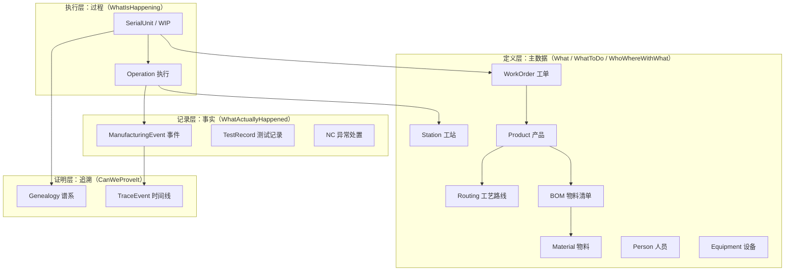

# 00.4 MES 核心业务对象地图

> 所属篇章：00_MES业务建模总纲 ｜ 状态：⏳ 骨架（待填充）

## 本篇要回答的业务问题

- MES 领域一共有哪些核心业务对象？彼此什么关系？
- 每个对象归属六问中的哪一问？
- 对象与对象之间：谁定义（主数据）、谁执行（过程）、谁记录（事实）？

## 1. 对象总览图

<!-- 待填充：图中关系逐一说明（定义 → 执行 → 记录 → 证明 的单向依赖） -->

## 2. 对象清单与六问映射

| 业务对象 | 一句话说明 | 六问 | 详见 |
| --- | --- | --- | --- |
| Product / ProductVersion | 生产什么的定义 | 01 | [01.1](../01_What_应该生产什么/01.1_产品Product模型.md) |
| BOM / BOMLine / Material / Lot | 用什么料、按什么结构 | 01 | [01.2](../01_What_应该生产什么/01.2_BOM与物料模型.md) |
| WorkOrder | 执行多少、为谁执行 | 02 | [02.1](../02_WhatToDo_应该执行什么/02.1_生产订单模型.md) |
| Routing / Operation / RouteStep | 按什么步骤执行 | 02 | [02.2](../02_WhatToDo_应该执行什么/02.2_Routing与Operation模型.md) |
| Factory / Line / Station | 在哪里执行 | 03 | [03.1](../03_WhoWhereWithWhat_谁在哪里用什么生产/03.1_制造组织与物理工厂模型.md) |
| Person / Skill | 谁执行、有无资质 | 03 | [03.2](../03_WhoWhereWithWhat_谁在哪里用什么生产/03.2_人员与技能模型.md) |
| Equipment / Tool / Recipe | 用什么设备与程序 | 03 | [03.3](../03_WhoWhereWithWhat_谁在哪里用什么生产/03.3_设备工具物料资源模型.md) |
| SerialUnit（WIP） | 单件在制品实例 | 04 | [04.1](../04_WhatIsHappening_现在正在发生什么/04.1_WIP业务模型.md) / [04.2](../04_WhatIsHappening_现在正在发生什么/04.2_SN生命周期状态机.md) |
| ManufacturingEvent / TestRecord | 发生了什么事实 | 05 | [05.1](../05_WhatActuallyHappened_实际发生了什么/05.1_ManufacturingEvent制造事件.md) / [05.2](../05_WhatActuallyHappened_实际发生了什么/05.2_Expected与Actual模型.md) |
| NC / Hold / Rework / Scrap | 异常与处置 | 05 | [05.3](../05_WhatActuallyHappened_实际发生了什么/05.3_质量与异常业务模型.md) / [05.4](../05_WhatActuallyHappened_实际发生了什么/05.4_Hold_Rework_Retest_Scrap状态模型.md) |
| TraceEvent / Genealogy | 如何证明 | 06 | [06.1](../06_CanWeProveIt_能否证明/06.1_Traceability业务模型.md) / [06.2](../06_CanWeProveIt_能否证明/06.2_Genealogy谱系模型.md) |

## 3. 与仓库实现的映射

<!-- 待填充：本地图对象与 AGENTS.md「核心领域概念」表逐一对照，说明当前已实现 / 计划中 -->

- 已实现：WorkOrder、Station、TestFlow、RouteStep、SerialUnit、TestRecord、TraceEvent
- 待实现：BOM / Material / Genealogy / NC 处置 / 人员技能

## 关联文档

- 上游：[00.2_MES六问模型](00.2_MES六问模型.md)
- 全景版：[08.1_MES核心Domain_Model](../08_MES业务全景/08.1_MES核心Domain_Model.md)
- 实现参照：[`AGENTS.md`](../../../AGENTS.md) 核心领域概念表
