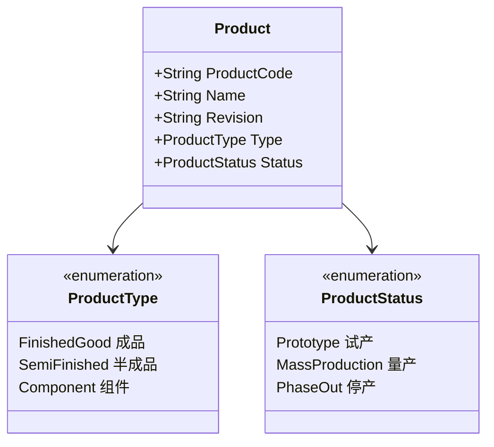
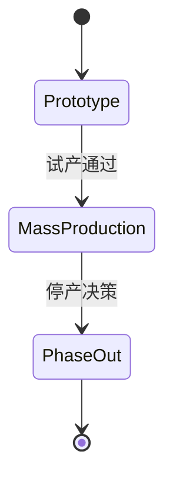

# 01.1 产品 Product 模型

> 所属篇章：01_What 应该生产什么 ｜ 状态：✅ 已完成

## 本篇要回答的业务问题

- 「产品」在 MES 中如何标识？（料号 PartNumber / 型号 / 版本 Revision）
- 产品如何与工艺路线、测试流程绑定？一个产品能否对应多个版本？
- 产品主数据状态如何管理（试产 / 量产 / 停用）？谁维护？

## 1. Product 的标识与属性

### 1.1 标识规则

| 标识 | 作用 | 示例 | 说明 |
| --- | --- | --- | --- |
| ProductCode（料号 / Part Number） | 全局唯一的产品身份 | `VOA-100G-C` | 通常继承 ERP / PLM 的料号体系；MES 不自造一套，避免双源不一致 |
| Revision（版本） | 同一料号的工程改版 | `A` / `B` / `C` | 硬件结构或关键料的变更载体；版本变更常伴随 BOM / Spec 变更 |
| Name（名称） | 人类可读 | `100G 可调光衰减器 C 型` | 仅用于展示，不参与业务键 |

**ProductCode + Revision 才构成完整的业务身份**：`VOA-100G-C B` 版与 A 版在追溯意义上是不同的产品（用料不同、规格可能不同）。工厂实践中常见的坑是只用料号不用版本做键——一旦改版，历史追溯立即混乱。

### 1.2 命名约定与主数据同步边界

- 命名建议：`{产品族}-{速率/规格}-{变体}`，如 `VOA-100G-C`；分隔符避免使用系统保留字符。
- **主数据归属**：Product 是典型的 L4 主数据（ERP/PLM 是源头），MES 是消费方。第一阶段（见 `design.md` §2.2）ERP 仅预留接口、不做双向闭环，因此本仓库当前以 `ProductCode` 字符串形式引用产品（`WorkOrder.ProductCode`、`TestFlow.ProductCode`），**暂不建独立 Product 实体**——这是「先小后大」原则下的刻意裁剪：先保证执行闭环跑通，主数据治理随后接入。
- 接入 ERP 后的同步策略：产品主数据单向同步（ERP → MES），MES 不回写产品定义；同步需保留生效时间与版本，供历史事件解析（见 [00.3 版本演进](../00_MES业务建模总纲/00.3_产品生命周期模型.md)）。

### 1.3 谁维护

| 动作 | 责任角色 | MES 侧要求 |
| --- | --- | --- |
| 新建 / 改版产品 | 工艺工程师（源头在 ERP/PLM） | 接收同步，不提供创建界面 |
| 状态切换（试产→量产→停产） | 工艺 + 质量联合评审 | 切换须留审计事件（AuditEvent） |
| 停用产品 | 工艺工程师 | 停用不影响在制工单执行，只阻止新工单引用 |

## 2. 产品与流程的绑定

- 一个 Product → 多个 Routing 版本 / TestFlow 版本，但**同一时刻只有一个「启用」版本**。
- 绑定关系的基数：Product 1 ── * Routing；Product 1 ── * TestFlow。

为什么必须互斥启用？因为「下一步去哪站」只能有唯一答案。若同产品存在两个 active 流程，SN 过站校验（`MES-4002`）将无法判定「正确」的含义。

对照本项目：`TestFlow` 与产品绑定，`activate` 接口将同产品其余流程置为 inactive；工单创建时校验产品存在启用流程，否则拒绝投产（`MES-4004` 产品无启用测试流程）。绑定关系汇总：

| 关系 | 基数 | 生效规则 | 违反时 |
| --- | --- | --- | --- |
| Product → TestFlow | 1 : * | 同产品至多 1 个 active | 新建工单时 `MES-4004` |
| Product → BOM | 1 : *（按版本） | 与 ProductVersion 绑定 | — |
| Product → Spec | 1 : *（按版本） | 供测试判定引用 | 判定缺失需降级处理 |
| WorkOrder → Product | * : 1 | 创建时锁定产品（+流程版本） | — |

## 3. 产品状态机

状态切换的审批与对在制品的影响：

| 迁移 | 触发条件 | 审批要求 | 对在制品的影响 |
| --- | --- | --- | --- |
| → Prototype | 产品定义建立（NPI 启动） | 工艺立项评审 | 无（尚无在制） |
| Prototype → MassProduction | 试产验证通过（PVT 良率达标） | 工艺 + 质量联合签核 | 试产在制品可按既定流程走完；新工单按量产门控执行 |
| MassProduction → PhaseOut | 停产决策（需求终止 / 替代料切换） | 管理层批准 | **在制品不受影响**——已投产 SN 允许走完流程；仅阻止新工单创建引用该产品 |

注意产品状态机与 [00.3 产品生命周期](../00_MES业务建模总纲/00.3_产品生命周期模型.md)的对应：Prototype ≈ NPI 阶段，MassProduction ≈ MP，PhaseOut ≈ EOL。状态机的每次迁移都应有审批留痕（谁、何时、为什么），这也是第 06 问「能否证明」在主数据治理上的体现。

## 4. 半成品与组件

ProductType 三分的业务含义：

| 类型 | 业务含义 | 谱系角色（06.2） | 举例（光通信） |
| --- | --- | --- | --- |
| FinishedGood 成品 | 最终交付物，有自己的完整流程与 SN | 谱系树的**根**（父） | VOA 模块成品 |
| SemiFinished 半成品 | 有独立制造过程、可入库、后续被装配 | 既是父（相对其组件）又是**子**（相对成品） | 调谐好的组件 |
| Component 组件 | 外购或自制、被装配进半成品/成品 | 谱系树的**叶子**（子） | 准直器、衰减芯片、连接器 |

对谱系模型的影响：**半成品的存在使谱系树是多层的（一般 2–4 层）**，且同一对象在不同层扮演双重角色。这就是 [06.2](../06_CanWeProveIt_能否证明/06.2_Genealogy谱系模型.md) 采用 `GenealogyLink`（ParentSN → ChildRef）邻接表而非固定两栏表的原因——邻接表天然支持任意深度。

另一个影响：半成品单独过站、单独测试时，它自己也是「一个 SN」，拥有完整的 WIP 生命周期（04.2）；被装配进成品后，其履历通过谱系并入成品追溯。**单件追溯与谱系追溯由此打通。**

## 关联文档

- 上游：[00.3_产品生命周期模型](../00_MES业务建模总纲/00.3_产品生命周期模型.md)
- 平行：[01.2_BOM与物料模型](01.2_BOM与物料模型.md)、[02.2_Routing与Operation模型](../02_WhatToDo_应该执行什么/02.2_Routing与Operation模型.md)
- 汇总：[01.3_产品定义UML类图](01.3_产品定义UML类图.md)
