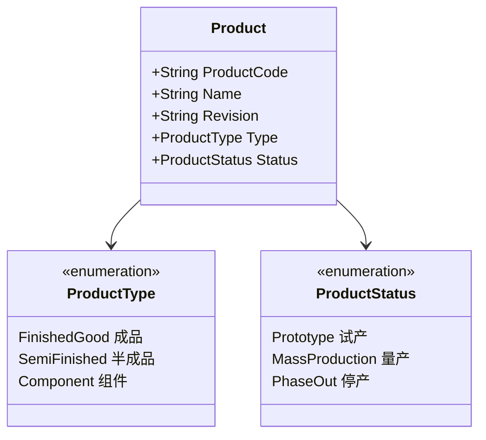
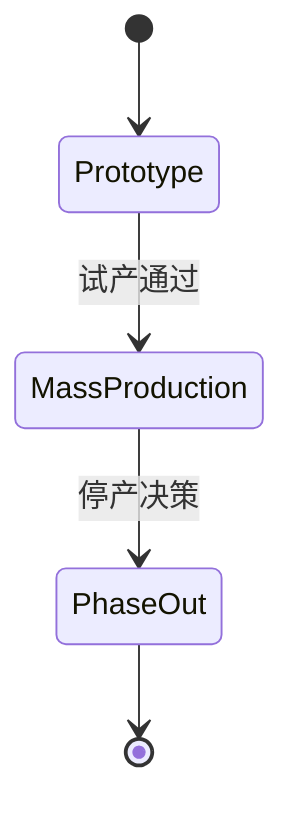

# 01.1 产品 Product 模型

> 所属篇章：01_What 应该生产什么 ｜ 状态：⏳ 骨架（待填充）

## 本篇要回答的业务问题

- 「产品」在 MES 中如何标识？（料号 PartNumber / 型号 / 版本 Revision）
- 产品如何与工艺路线、测试流程绑定？一个产品能否对应多个版本？
- 产品主数据状态如何管理（试产 / 量产 / 停用）？谁维护？

## 1. Product 的标识与属性

<!-- 待填充：标识规则、命名约定、与 ERP 主数据的同步边界（第一阶段仅预留接口） -->

## 2. 产品与流程的绑定

<!-- 待填充 -->

- 一个 Product → 多个 Routing 版本 / TestFlow 版本，但同一时刻只有一个「启用」版本
- 绑定关系的基数：Product 1 ── * Routing；Product 1 ── * TestFlow
- 对照本项目：`TestFlow` 与产品绑定，`activate` 接口将同产品其余流程置为 inactive（`MES-4004` 产品无启用测试流程）

## 3. 产品状态机

<!-- 待填充：状态切换的审批与对在制品的影响（关联 00.3 产品生命周期） -->

## 4. 半成品与组件

<!-- 待填充：成品 / 半成品 / 组件的区分，及对谱系模型（06.2）的影响 -->

## 关联文档

- 上游：[00.3_产品生命周期模型](../00_MES业务建模总纲/00.3_产品生命周期模型.md)
- 平行：[01.2_BOM与物料模型](01.2_BOM与物料模型.md)、[02.2_Routing与Operation模型](../02_WhatToDo_应该执行什么/02.2_Routing与Operation模型.md)
- 汇总：[01.3_产品定义UML类图](01.3_产品定义UML类图.md)
