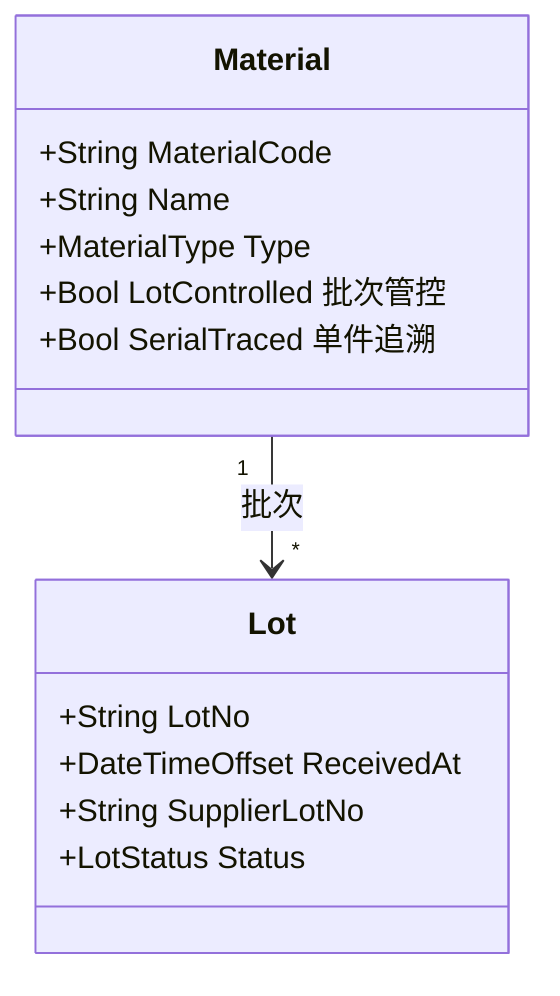

# 01.2 BOM 与物料模型

> 所属篇章：01_What 应该生产什么 ｜ 状态：⏳ 骨架（待填充）

## 本篇要回答的业务问题

- 物料主数据 Material 管什么？物料批次 Lot 与 SN 是什么关系？
- BOM 表达「应该用什么」（as-designed），上料记录表达「实际用了什么」（as-built），两者如何区分？
- 替代料、关键料、批次管控怎么建模？

## 1. Material 物料主数据

<!-- 待填充：物料分类（原材料 / 辅料 / 包装）、供应商信息、检验状态（IQC） -->

## 2. BOM 结构

<!-- 待填充 -->

- E-BOM（设计）与 M-BOM（制造）的区别
- BOMLine：父项 + 子项 + 用量（QtyPer）+ 损耗率 + 位号（光通信器件的通道/位置）
- 版本化：BOM 与 ProductVersion 绑定

## 3. 上料与实际消耗

<!-- 待填充 -->

- MaterialIssue / LoadingRecord：哪个工站、什么时间、上了哪个 Lot
- 上料记录是谱系（06.2）的数据来源：SN × 工站 × Lot
- 追溯问题对照：「用了什么原材料？用了哪个 Lot？」

## 4. 替代料与关键料

<!-- 待填充：替代组、优先级、关键料的强制追溯 -->

## 关联文档

- 上游：[01.1_产品Product模型](01.1_产品Product模型.md)
- 汇总：[01.3_产品定义UML类图](01.3_产品定义UML类图.md)
- 下游：[06.2_Genealogy谱系模型](../06_CanWeProveIt_能否证明/06.2_Genealogy谱系模型.md)（as-built 的来源）
- 案例参照：[07.2_VOA产品生命周期业务建模](../07_综合案例/07.2_VOA产品生命周期业务建模.md)
