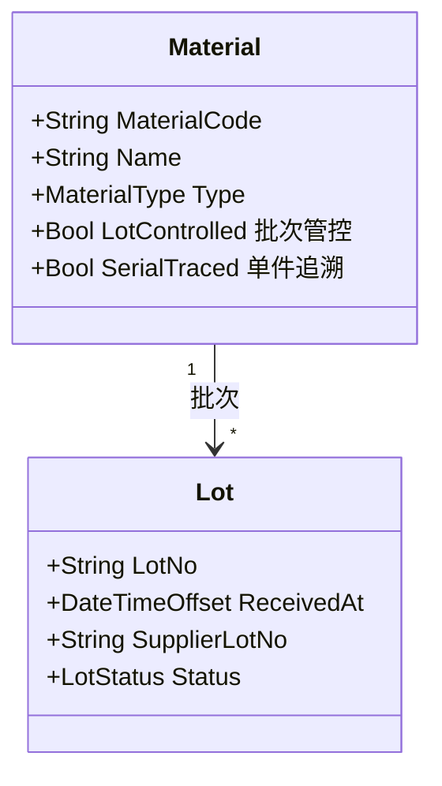
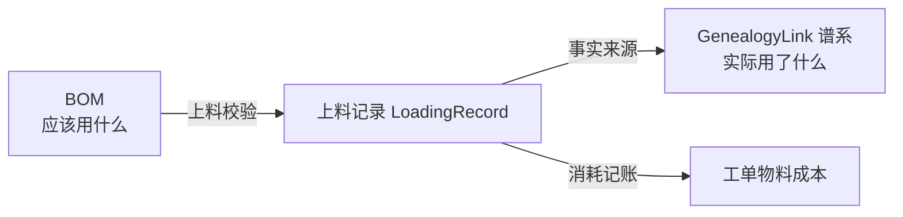
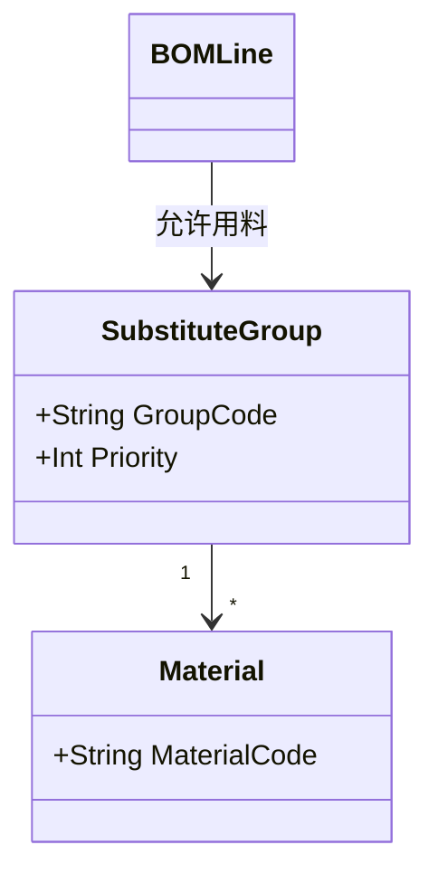

# 01.2 BOM 与物料模型

> 所属篇章：01_What 应该生产什么 ｜ 状态：✅ 已完成

## 本篇要回答的业务问题

- 物料主数据 Material 管什么？物料批次 Lot 与 SN 是什么关系？
- BOM 表达「应该用什么」（as-designed），上料记录表达「实际用了什么」（as-built），两者如何区分？
- 替代料、关键料、批次管控怎么建模？

## 1. Material 物料主数据

### 1.1 物料分类与管控属性

| 物料类型 | 举例（光通信） | 追溯粒度 | 管控原因 |
| --- | --- | --- | --- |
| 原材料 / 关键器件 | 衰减芯片、准直器、光缆 | 批次（Lot）或单件（SN） | 直接影响光性能参数，客诉必查 |
| 辅料 | 胶水、清洁剂、标签 | 批次 | 有有效期与工艺窗口 |
| 包装材料 | 包材、防静电袋 | 可不管控 | 低风险 |

两个管控开关的业务含义：

- **LotControlled（批次管控）**：进出库、上料都以批次为单位记账。绝大多数原材料开此开关。
- **SerialTraced（单件追溯）**：关键子件（如带独立 SN 的模块）以单件绑定进谱系。开了它，上料记录记的是子件 SN 而非 LotNo——对应 [06.2 GenealogyLink](../06_CanWeProveIt_能否证明/06.2_Genealogy谱系模型.md) 的 `ChildType` 两种取值。

### 1.2 Lot 与 SN 的关系

| 维度 | Lot 批次 | SN 序列号 |
| --- | --- | --- |
| 标识对象 | 一**群**同质物料（同供应商、同生产条件） | 一**件**产品实例 |
| 生命周期 | 收货 → IQC → 合格 → 上线消耗 / 退回 | 生成 → 在制 → 完工/报废 → 交付 |
| 追溯角色 | 正向追溯（召回）的扩散单位 | 反向追溯（客诉）的入口 |
| 本仓库实现 | ⏳ 待实现 | ✅ `SerialUnit` |

关系一句话：**Lot 回答「这批料去了哪些产品」，SN 回答「这个产品用了哪批料」**——同一份谱系数据的两个查询方向（06.3）。

### 1.3 供应商与 IQC

Lot 上的 `SupplierLotNo`（供应商批次号）与 MES 内部 `LotNo` 分开保存：客诉时需要向供应商引用**他们的**批次号。IQC（来料检验）状态是 Lot 的门控属性：未检验 / 合格 / 不合格 / 让步接收——**IQC 不合格的批次不允许上料**（上线校验，第二阶段约束）。

## 2. BOM 结构

- **E-BOM（设计）与 M-BOM（制造）的区别**：E-BOM 来自 PLM/设计工具，反映设计意图（原理连接）；M-BOM 由工艺转化而来，反映**制造装配顺序与用量**（含辅料、耗材）。MES 消费的是 M-BOM。
- **BOMLine 字段语义**：

| 字段 | 语义 | 光通信场景举例 |
| --- | --- | --- |
| 父项 / 子项 | 装配关系 | VOA → 准直器 |
| QtyPer 用量 | 单台数量 | 每通道 1 颗，4 通道 = 4 |
| ScrapRate 损耗率 | 补料计算 | 精密贴装损耗 2% |
| Position 位号 | 装配位置 | **通道 1 / 通道 2 / CH3**——光通信器件的通道位置敏感，插错通道 = 性能失效 |

- **版本化**：BOM 与 ProductVersion 绑定（见 [01.1 §2](01.1_产品Product模型.md)）。BOM 变更走 ECN，不允许直接改已发布 BOM 的行——只能发新版本。

位号（Position）建模是光通信 BOM 的特色：同一种子件用在不同通道，其失效模式（如某通道插损超标）需要定位到「哪颗料在哪个位置」。**缺陷位置（05.3 DefectRecord.Location）与 BOM 位号使用同一套位置编码**，分析时才能对上。

## 3. 上料与实际消耗

- MaterialIssue / LoadingRecord（上料记录）：哪个工站、什么时间、上了哪个 Lot（或哪个子件 SN）。
- 上料记录是谱系（06.2）的数据来源：**SN × 工站 × Lot** 三元组就是一条 GenealogyLink 的事实来源。

- **上料校验**：所上之料必须在 BOM 允许范围内（物料编码 + 替代组 + 有效期），否则拒绝（第二阶段约束；第一阶段可先记录不拦截——「先记录、再约束」）。
- 追溯问题对照：「用了什么原材料？用了哪个 Lot？」——查询路径：SN → GenealogyLink（反向）→ Lot 集合。

## 4. 替代料与关键料

### 4.1 替代组

- 建模方式：BOMLine 不直接指向单一 Material，而是指向**替代组**（组内多个料号按优先级排序）。
- 上料时校验：实际所上之料 ∈ 替代组成员。
- 谱系意义：替代料的存在使「同一产品版本用了不同供应商的料」成为常态——**这正是召回场景必须依赖 as-built 而非 as-designed 的原因**（见 [06.2](../06_CanWeProveIt_能否证明/06.2_Genealogy谱系模型.md)）。

### 4.2 关键料的强制追溯

| 料类 | 定义 | 建模要求 |
| --- | --- | --- |
| 关键料 | 客户或法规要求必须可追溯到批次/单件的料（光通信中典型：衰减芯片、激光器芯片） | `LotControlled` 或 `SerialTraced` 强制开启；上料记录不可跳过；谱系查询必须包含 |
| 普通料 | 低风险、低价值 | 可简化（记到物料编码即可），按追溯成本与风险权衡 |

**取舍原则：追溯范围由质量风险决定，不为「字段齐全」无差别加表单**（与 5M1E 采集的取舍一致，见 [03.4](../03_WhoWhereWithWhat_谁在哪里用什么生产/03.4_5M1E制造上下文模型.md)）。

## 关联文档

- 上游：[01.1_产品Product模型](01.1_产品Product模型.md)
- 汇总：[01.3_产品定义UML类图](01.3_产品定义UML类图.md)
- 下游：[06.2_Genealogy谱系模型](../06_CanWeProveIt_能否证明/06.2_Genealogy谱系模型.md)（as-built 的来源）
- 案例参照：[07.2_VOA产品生命周期业务建模](../07_综合案例/07.2_VOA产品生命周期业务建模.md)
