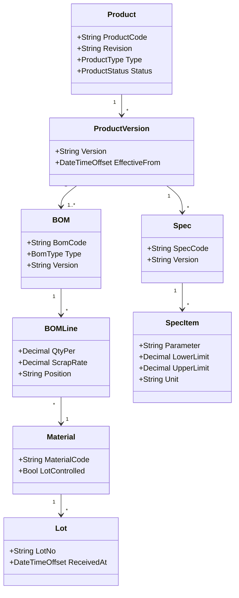

# 01.3 产品定义 UML 类图

> 所属篇章：01_What 应该生产什么 ｜ 状态：⏳ 骨架（待填充）

## 本篇要回答的业务问题

- 产品定义域（What）的对象关系如何用一张类图完整表达？
- 各对象的基数（1:1 / 1:N / M:N）与关键不变量是什么？

## 1. 产品定义域类图

<!-- 待填充：
- 逐个关系的设计理由
- 不变量示例：启用版本的 BOM 必须存在；BOMLine 的 Material 必须有效
-->

## 2. 类图与实现的映射

<!-- 待填充：哪些类已有对应实现，哪些是计划中（对照 AGENTS.md 领域概念表） -->

## 关联文档

- 前置：[01.1_产品Product模型](01.1_产品Product模型.md)、[01.2_BOM与物料模型](01.2_BOM与物料模型.md)
- 全景版：[08.1_MES核心Domain_Model](../08_MES业务全景/08.1_MES核心Domain_Model.md)
- 实现参照：`Spec` 部分对应 `TestFlow` / 测试参数上下限（`design.md` §5.3 SPC 规则）
