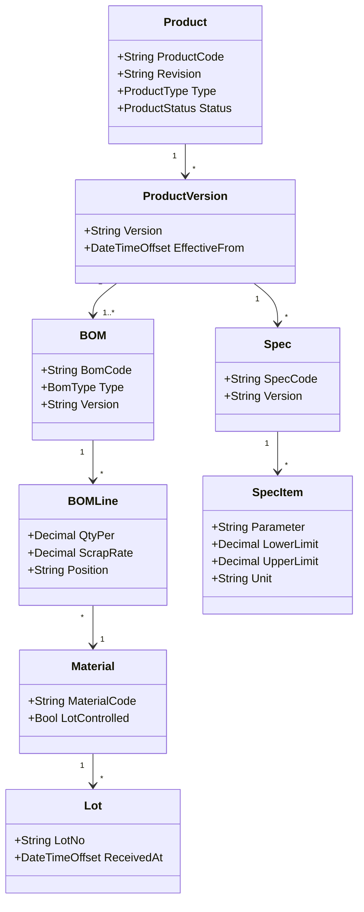

# 01.3 产品定义 UML 类图

> 所属篇章：01_What 应该生产什么 ｜ 状态：✅ 已完成

## 本篇要回答的业务问题

- 产品定义域（What）的对象关系如何用一张类图完整表达？
- 各对象的基数（1:1 / 1:N / M:N）与关键不变量是什么？

## 1. 产品定义域类图

### 1.1 逐个关系的设计理由

| 关系 | 基数 | 设计理由 |
| --- | --- | --- |
| Product → ProductVersion | 1 : * | 版本是改版的载体；追溯历史必须能解析「当时的版本」（[00.3](../00_MES业务建模总纲/00.3_产品生命周期模型.md)） |
| ProductVersion → BOM | 1 : 1..* | 一个产品版本必须至少有一份有效 BOM（结构保证）；E-BOM/M-BOM 可并存多份时上界放宽 |
| BOM → BOMLine | 1 : * | 行是 BOM 的组成部分，随 BOM 整体发布、整体版本化（聚合内成员） |
| BOMLine → Material | * : 1（或替代组） | 每行指向一种物料（启用替代料时指向 SubstituteGroup，见 [01.2 §4](01.2_BOM与物料模型.md)） |
| Material → Lot | 1 : * | 批次是物料的实例化；IQC 状态挂在 Lot 上 |
| ProductVersion → Spec | 1 : * | 规格（插损限值、衰减精度等）与产品版本绑定；不同测试站可用不同 Spec |
| Spec → SpecItem | 1 : * | 每个参数一条上下限；参数名对齐指标字典（`TxPower`、`IL`、`RL`…），是 SPC 与跨型号对标的前提 |

### 1.2 关键不变量

不变量 = 违反即 Bug（或拒绝写入）的业务规则：

| # | 不变量 | 违反后果 |
| --- | --- | --- |
| INV-1 | 处于量产状态（MassProduction）的 ProductVersion，其启用的 BOM 必须存在且已发布 | 工单创建时拒绝 |
| INV-2 | BOMLine 引用的 Material 必须有效（非停用状态） | BOM 发布校验失败 |
| INV-3 | BOMLine 引用的关键料 Material，`LotControlled` 或 `SerialTraced` 必须为真 | 主数据治理校验失败 |
| INV-4 | SpecItem 的 UpperLimit ≥ LowerLimit，且 Unit 必须非空 | 规格发布校验失败 |
| INV-5 | 已被历史工单引用的 Spec / BOM 版本不可物理删除，只能失效 | 保护追溯可解析性 |
| INV-6 | SpecItem.Parameter 必须属于受控指标字典（禁止「每个上位机一个私有字段名」） | 保证 SPC 可聚合 |

INV-6 的来源是战略文档（[从MIMS到MES](../../从MIMS到MES-光通信制造信息化战略思考.md) §5.1-D）：指标字典是 SPC 与跨型号对标的前提，应尽早治理。

## 2. 类图与实现的映射

对照 `AGENTS.md` 领域概念表的实现状态：

| 类 | 本仓库实现 | 状态 | 映射说明 |
| --- | --- | --- | --- |
| Product / ProductVersion | `ProductCode` 字符串（`WorkOrder` / `TestFlow` 上） | ⏳ 简化 | 无独立实体；产品身份以字符串引用，主数据治理后接入 |
| BOM / BOMLine / Material / Lot | — | ⏳ 待实现 | 依赖 M2+ 物料与谱系能力 |
| Spec / SpecItem | `TestFlow`（流程承载规格绑定）+ SPC 规则（`SpcRule`：指标名、控制上下限、告警策略） | ⏳ 部分 | `SpcRule` 的控制限承担了 SpecItem 的监控职能；完整规格判定随 M2 测试流程引擎落地 |
| 指标字典 | `TestRecord.Metrics`（`Dictionary<string, double>`） | ✅ 已实现 | 参数名即字典使用点——命名规范从此处开始约束 |

映射说明的要点：**当前实现是这张类图的「测试流程子集」**——M1 只需要 ProductCode + TestFlow 即可跑通执行闭环；BOM / Spec / Material 是模型上的预留位，按里程碑补齐。这正是「模型先行、实现渐进」的实践（[00.4 §3](../00_MES业务建模总纲/00.4_MES核心业务对象地图.md)）。

## 关联文档

- 前置：[01.1_产品Product模型](01.1_产品Product模型.md)、[01.2_BOM与物料模型](01.2_BOM与物料模型.md)
- 全景版：[08.1_MES核心Domain_Model](../08_MES业务全景/08.1_MES核心Domain_Model.md)
- 实现参照：`Spec` 部分对应 `TestFlow` / 测试参数上下限（`design.md` §5.3 SPC 规则）
