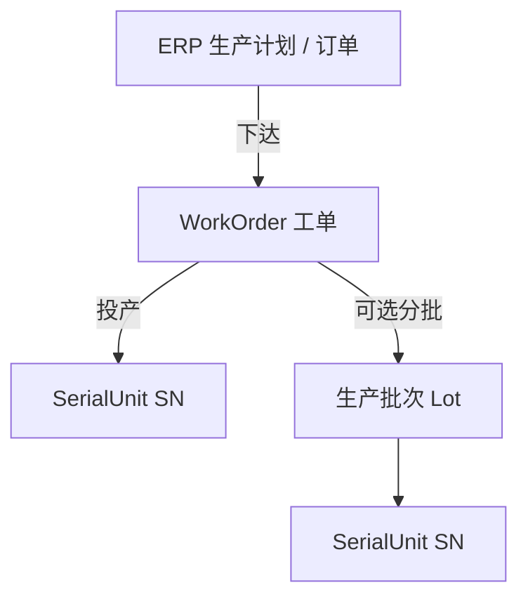
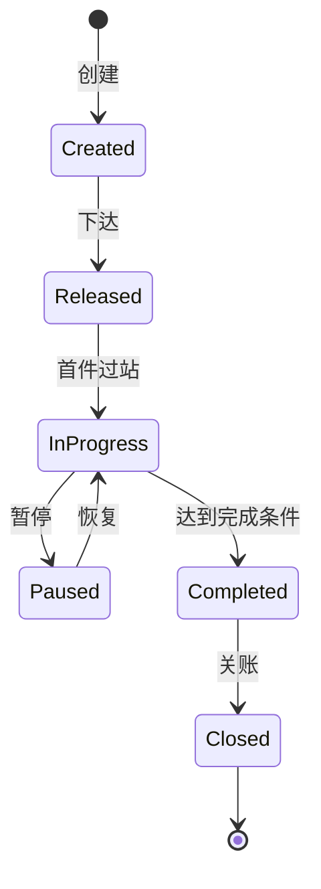

# 02.1 生产订单模型

> 所属篇章：02_WhatToDo 应该执行什么 ｜ 状态：⏳ 骨架（待填充）

## 本篇要回答的业务问题

- ERP 订单、MES 工单、批次 / Lot 的层级关系是什么？
- 工单状态如何流转？暂停 / 恢复 / 关闭的规则是什么？
- 计划数量与完成数量、不良数、报废数如何对账？

## 1. 订单层级

<!-- 待填充：
- 第一阶段 ERP 仅预留接口，不做双向业务闭环（design.md §2.2）
- 工单是 MES 执行的最小计划单元：编号、产品、计划数量、状态、绑定测试流程
-->

## 2. WorkOrder 状态机

<!-- 待填充：对照 design.md §4.2；每步流转的触发者与前置条件（重复创建 → MES-4091） -->

## 3. 数量模型

<!-- 待填充 -->

| 数量 | 含义 | 更新时机 |
| --- | --- | --- |
| PlannedQty | 计划数量 | 创建时 |
| CompletedQty | 完工数 | 末站过站 / 完工判定 |
| FailQty | 不良数 | 测试失败 |
| ScrapQty | 报废数 | 报废处置（05.4） |

- 不变量：CompletedQty + FailQty(未处置) + 在制数 ≤ PlannedQty

## 4. 工单与 SN 的关系

<!-- 待填充：SN 何时生成（开工 / 首站）、SN 与工单 1:N、超产策略 -->

## 关联文档

- 上游：[01.1_产品Product模型](../01_What_应该生产什么/01.1_产品Product模型.md)
- 平行：[02.2_Routing与Operation模型](02.2_Routing与Operation模型.md)
- 下游：[04.1_WIP业务模型](../04_WhatIsHappening_现在正在发生什么/04.1_WIP业务模型.md)
- 实现参照：`WorkOrder` + `POST /api/work-orders`（重复创建返回 `MES-4091`）
