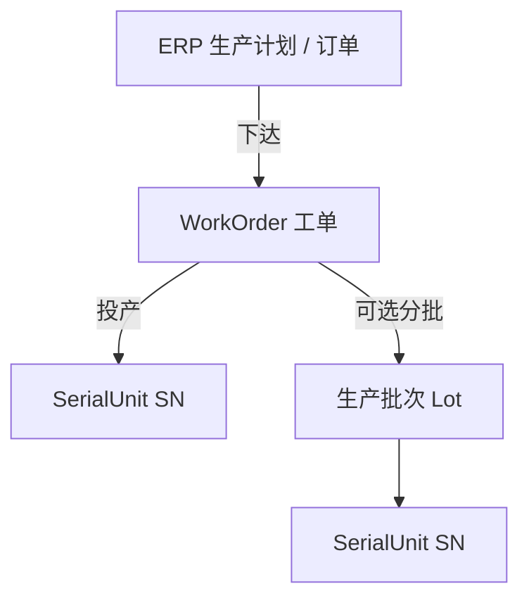
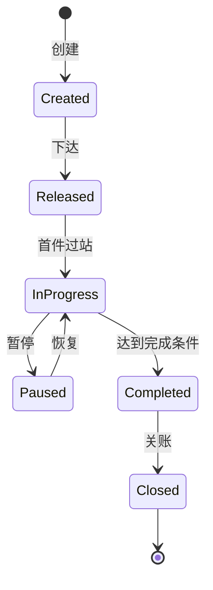

# 02.1 生产订单模型

> 所属篇章：02_WhatToDo 应该执行什么 ｜ 状态：✅ 已完成

## 本篇要回答的业务问题

- ERP 订单、MES 工单、批次 / Lot 的层级关系是什么？
- 工单状态如何流转？暂停 / 恢复 / 关闭的规则是什么？
- 计划数量与完成数量、不良数、报废数如何对账？

## 1. 订单层级



层级语义与边界：

| 层级 | 系统 | 职责 | 时间尺度 |
| --- | --- | --- | --- |
| ERP 生产计划 / 订单 | L4 | 需求来源：卖什么、造多少、何时交 | 周 / 月 |
| WorkOrder 工单 | L3 | **MES 执行的最小计划单元**：编号、产品、计划数量、状态、绑定测试流程 | 天 / 班次 |
| 生产批次 Lot（可选） | L3 | 大批量场景下对工单分批投产 | 班次 / 小时 |
| SerialUnit SN | L3 | 单件执行与追溯的载体 | 分钟 / 秒 |

- 第一阶段 ERP 仅预留接口，不做双向业务闭环（`design.md` §2.2）：本仓库当前工单由 `POST /api/work-orders` 手工创建，未来承接 ERP 下达。
- 工单是 MES 执行的最小计划单元——「最小」的含义：再往下切分就不再有计划语义（SN 是执行实例，不是计划）。工单携带的核心信息：编号、产品（ProductCode）、计划数量、状态、绑定的测试流程。
- 生产批次（Lot）是可选层：本仓库采用**单件流（SN 级）模型**，不建生产批次层（`design.md` 以单线体验证闭环；分批投产是多线体 / 大批量时的扩展）。

## 2. WorkOrder 状态机



对照 `design.md` §4.2，每步流转的触发者与前置条件：

| 迁移 | 触发者 | 前置条件 | 副作用 |
| --- | --- | --- | --- |
| → Created | 计划员 / ERP | 产品有启用的 TestFlow（否则 `MES-4004`）；工单号未占用（重复创建 → `MES-4091`） | 锁定产品与流程版本引用 |
| Created → Released | 计划员 | 主数据齐备（工站、流程已激活） | 允许过站；SN 可投产 |
| Released → InProgress | 系统（隐式） | 首件 SN 过站成功 | 状态自动推进，无需人工 |
| InProgress ↔ Paused | 计划员 / 管理员 | 暂停原因记录（缺料 / 设备故障 / 质量事件） | **暂停时在制 SN 是否拦截过站需明确**——本仓库 M1 不实现暂停，规则预留 |
| InProgress → Completed | 系统（隐式） | 完成条件满足（见下） | 停止新 SN 投产 |
| Completed → Closed | 计划员 | 数量对账完成、遗留异常处置完毕 | 关账后不可再追加事件（只读归档） |

完成条件有两种口径，需按工厂约定二选一：

1. **数量口径**：CompletedQty + ScrapQty = PlannedQty（含报废的全部有了着落）；
2. **SN 终态口径**：全部已投产 SN 到达终态（Done / Scrapped）——本仓库采用此口径（见 [08.3 全局不变量](../08_MES业务全景/08.3_MES全局状态模型.md)）。

## 3. 数量模型

| 数量 | 含义 | 更新时机 |
| --- | --- | --- |
| PlannedQty | 计划数量 | 创建时 |
| CompletedQty | 完工数 | 末站过站 / 完工判定 |
| FailQty | 不良数 | 测试失败 |
| ScrapQty | 报废数 | 报废处置（05.4） |

对账关系与不变量：

```text
PlannedQty（计划）
 ├── CompletedQty（已完工，终态 Done）
 ├── ScrapQty（已报废，终态 Scrapped）
 └── WIPQty（在制，含 Fail 未处置）
不变量：CompletedQty + ScrapQty + WIPQty ≤ PlannedQty（投产不得超计划）
```

注意事项：

- FailQty 不是终态数量——失败的 SN 最终会走向返工后完工、报废或放行。**不良数是过程指标，不是对账科目**；对账只看终态（Done / Scrapped）。
- 超产策略：`>` PlannedQty 时禁止新 SN 投产（严格模式）；或允许比例内超产（宽松模式，需记录偏差原因）。工单模型必须显式声明采用哪种，不允许现场默认。
- 关账（Closed）时的对账检查：三者相加应等于 PlannedQty（或有留档的差异说明），否则关账被拒绝。

## 4. 工单与 SN 的关系

- **SN 何时生成**：两种时机——开工时一次性批量生成（计划驱动，SN 规则如 `WO 前缀 + 流水号`），或首站过站时逐件生成（执行驱动）。本仓库采用**过站时按工单生成**（`SerialUnit` 在首次过站时创建并绑定 `WorkOrderNo`）。
- **基数**：工单 1 : N SN。每个 SN 终身归属唯一工单（返工不换工单，报废不释放 SN 编号）。
- **超产**：见 §3——超出计划数量的 SN 拒绝生成（严格模式）。
- **工单暂停对 SN 的影响**：暂停语义若是「冻结新投产」，在制 SN 继续走完；若是「全面冻结」，过站被拦截（返回 `MES-4002` 类业务错误）。两种语义都对，但必须在工单模型中定义清楚——这是「规则显式化」的典型例子。

## 关联文档

- 上游：[01.1_产品Product模型](../01_What_应该生产什么/01.1_产品Product模型.md)
- 平行：[02.2_Routing与Operation模型](02.2_Routing与Operation模型.md)
- 下游：[04.1_WIP业务模型](../04_WhatIsHappening_现在正在发生什么/04.1_WIP业务模型.md)
- 实现参照：`WorkOrder` + `POST /api/work-orders`（重复创建返回 `MES-4091`）
