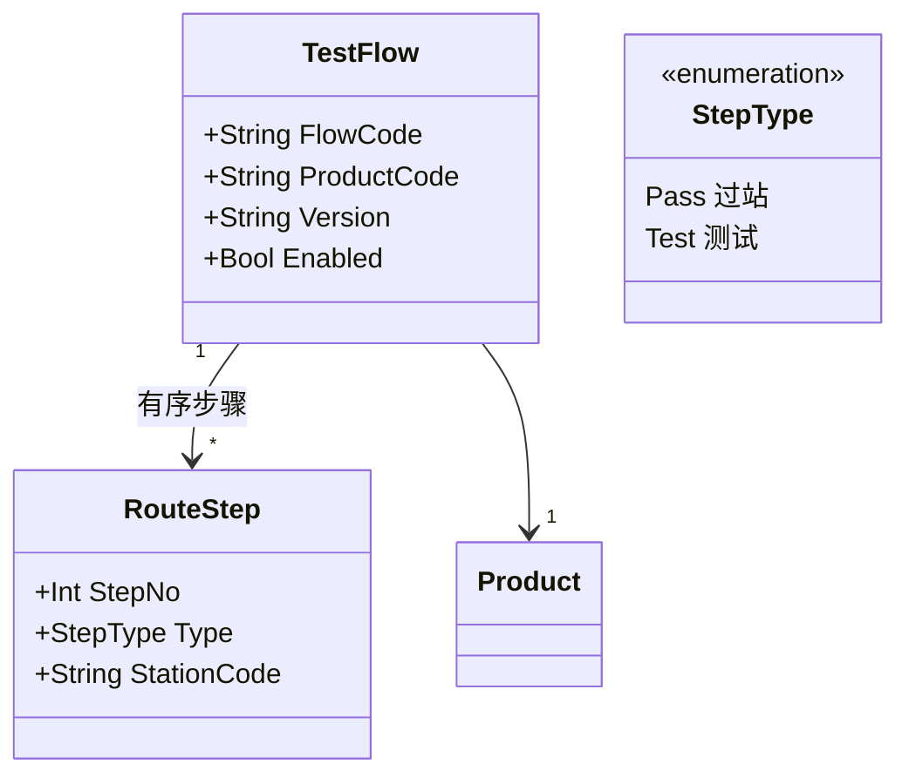

# 02.2 Routing 与 Operation 模型

> 所属篇章：02_WhatToDo 应该执行什么 ｜ 状态：⏳ 骨架（待填充）

## 本篇要回答的业务问题

- 工艺路线 Routing 与工序 Operation（本项目 RouteStep）是什么关系？
- 工序类型如何划分（加工 / 测试 / 检验）？「过站」与「测试」步骤的差异？
- 顺序约束（跳站 / 漏站）与工站授权规则在哪里定义？
- 同一产品为何需要多版本路线？返工路线如何表达？

## 1. Routing 结构

<!-- 待填充：Routing（全工艺路线）与 TestFlow（本阶段测试流程）的关系与裁剪 -->

## 2. 步骤类型与语义

<!-- 待填充 -->

| 步骤类型 | 语义 | 校验 |
| --- | --- | --- |
| Pass 过站 | 只记录经过，产出 TraceEvent | 工序顺序 + 工站授权 |
| Test 测试 | 必须先过站，之后上传结果 | 过站前置 + 结果门控 |

- 核心约束：**SN 必须先过站至测试站才能上传测试结果**（不可为演示绕过）

## 3. 顺序与校验规则

<!-- 待填充 -->

- 序号推进规则：已完成步骤集合 vs 待测步骤序号（对照 `SerialUnit`）
- 跳站 / 漏站 → `MES-4002`；工站与步骤类型不符 / 不存在 → `MES-4003`
- 规则归属：Domain 层，不放 Api 层（对照 AGENTS.md 分层规则）

## 4. 版本与替代路线

<!-- 待填充 -->

- 同产品多版本，仅一个启用（`activate` 语义，`MES-4004` 无启用流程）
- 返工路线（Rework Routing）：返回指定工序重走（关联 05.4）

## 关联文档

- 上游：[02.1_生产订单模型](02.1_生产订单模型.md)
- 下游：[02.3_产品制造流程UML活动图](02.3_产品制造流程UML活动图.md)、[04.3_Operation执行状态机](../04_WhatIsHappening_现在正在发生什么/04.3_Operation执行状态机.md)
- 实现参照：`TestFlow` / `RouteStep` + `/api/test-flows`（AGENTS.md API 表）
