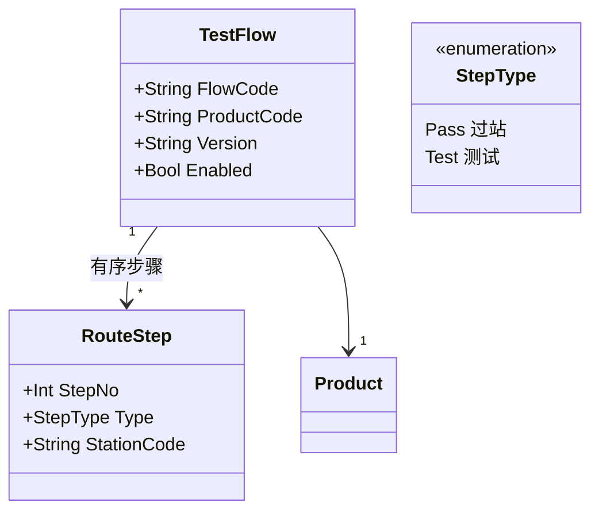
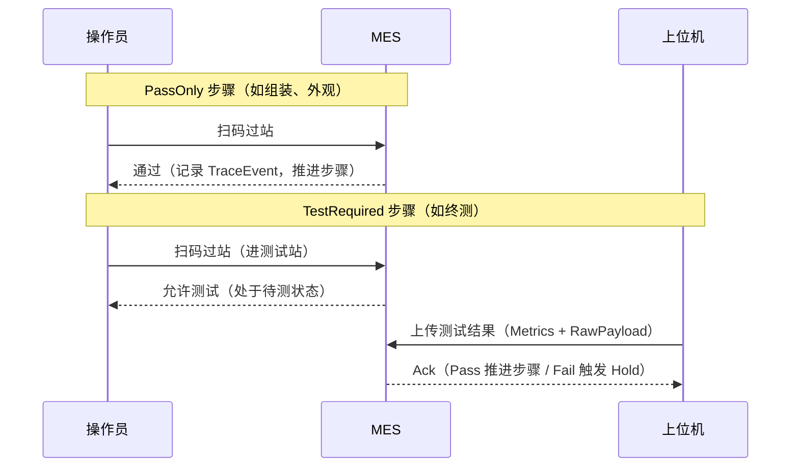
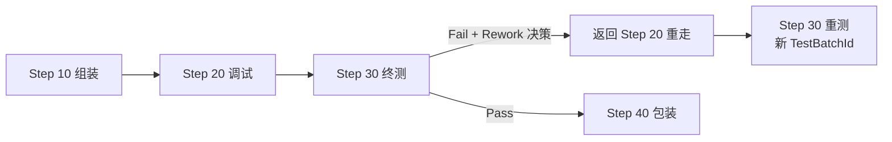

# 02.2 Routing 与 Operation 模型

> 所属篇章：02_WhatToDo 应该执行什么 ｜ 状态：✅ 已完成

## 本篇要回答的业务问题

- 工艺路线 Routing 与工序 Operation（本项目 RouteStep）是什么关系？
- 工序类型如何划分（加工 / 测试 / 检验）？「过站」与「测试」步骤的差异？
- 顺序约束（跳站 / 漏站）与工站授权规则在哪里定义？
- 同一产品为何需要多版本路线？返工路线如何表达？

## 1. Routing 结构

**Routing（全工艺路线）与 TestFlow（本阶段测试流程）的关系与裁剪**：

| 概念 | 通用 MES 术语 | 本仓库实现 | 关系 |
| --- | --- | --- | --- |
| Routing 工艺路线 | 产品制造经过的全部工序（加工/装配/检验/测试/包装） | `TestFlow` | TestFlow 是 Routing 的**子集裁剪**：聚焦测试与过站步骤 |
| Operation / RouteStep | 路线中的一道工序定义 | `RouteStep` | 同构；RouteStep 用 `StepNo` 表达顺序 |
| StepType | 加工 / 装配 / 检验 / 测试 / 包装… | `PassOnly` / `TestRequired` 两类 | 裁剪为两类的理由：M1 执行闭环只需要「是否需要测试结果」这一个分叉 |

为什么这样裁剪？光通信工厂的执行主矛盾在测试站（见 [从MIMS到MES](../../从MIMS到MES-光通信制造信息化战略思考.md) §2.1：测试工位占比高、节拍受仪器约束）。TestFlow 先把「过站 + 测试」这条主链做实，其余工序类型（加工、检验细分）在多线体扩展时再补——**TestFlow 与工艺路线的边界须在试点中与工艺确认**（`MES系统概览学习.md`「建模时需要持续澄清的边界」问题 1）。

## 2. 步骤类型与语义

| 步骤类型 | 语义 | 校验 |
| --- | --- | --- |
| Pass 过站 | 只记录经过，产出 TraceEvent | 工序顺序 + 工站授权 |
| Test 测试 | 必须先过站，之后上传结果 | 过站前置 + 结果门控 |

两类步骤的执行差异（对照代码 `StepType.PassOnly` / `StepType.TestRequired`）：

- 核心约束：**SN 必须先过站至测试站才能上传测试结果**（不可为演示绕过——`AGENTS.md` Things to Avoid 明令禁止）。这条约束保证「测试结果」永远有明确的执行上下文（哪站、谁、何时），否则测试记录成为无源之水。
- TestRequired 步骤的完成 = 过站 + 结果上传两步合计；只过站未上传，SN 停在「待测」状态。

## 3. 顺序与校验规则

- **序号推进规则**：`RouteStep.StepNo` 全局有序（同流程内唯一递增）。`SerialUnit` 维护 `CompletedStepSequence`（已完成步骤序号）与 `PendingStepSequence`（待测步骤序号）——过站校验即「请求的工站必须对应下一个未完成步骤」。
- 校验失败与错误码的对应：

| 违规情形 | 错误码 | 业务含义 |
| --- | --- | --- |
| 跳站 / 漏站（请求步骤 > 待执行步骤） | `MES-4002` | 工序不匹配 |
| 未进站即上传结果 / SN 不存在 | `MES-4002` | 业务不匹配（SN 未进站） |
| 工站不存在或与步骤类型不符 | `MES-4003` | 工站未授权 |
| 失败品未处置仍过站 | `MES-4002` | 失败品未处置（不可弱化） |
| 产品无启用测试流程 | `MES-4004` | 流程不可用 |
| 重复上传测试结果 | `MES-4091` | 幂等冲突 |

- **规则归属**：Domain 层（`TestFlowValidator`），不放 Api 层（对照 `AGENTS.md` 分层规则——Api 只做 HTTP 映射、鉴权、参数校验）。顺序校验是业务规则，属于 Domain；这一归属决策保证规则可被单元测试直接覆盖（`tests/MES.Domain.Tests`）。

## 4. 版本与替代路线

- **同产品多版本，仅一个启用**：`activate` 接口将同产品其余流程置为 inactive（`MES-4004` 提示无启用流程）。版本切换策略（生效时间 / 切换点 / 在制品归属）见 [00.3 §2](../00_MES业务建模总纲/00.3_产品生命周期模型.md)。
- **返工路线（Rework Routing）**：返工不是新流程，而是**在既有流程上定义「回退点」**：

  返工路线的建模要点：
  - 返工目标步骤由处置决策指定（05.4），不写死在流程定义里；
  - 重走的步骤重新执行过站与测试（生成**新的** TraceEvent 与 TestRecord，旧记录不覆盖）；
  - `RouteStep` 上的「是否可返工」标记控制哪些步骤允许作为返工入口（如终测可以重测，包装完成后不允许返工）；
  - 第二阶段扩展项：并行站、可选站（`design.md` 首期串行流程）。

## 关联文档

- 上游：[02.1_生产订单模型](02.1_生产订单模型.md)
- 下游：[02.3_产品制造流程UML活动图](02.3_产品制造流程UML活动图.md)、[04.3_Operation执行状态机](../04_WhatIsHappening_现在正在发生什么/04.3_Operation执行状态机.md)
- 实现参照：`TestFlow` / `RouteStep` + `/api/test-flows`（AGENTS.md API 表）
