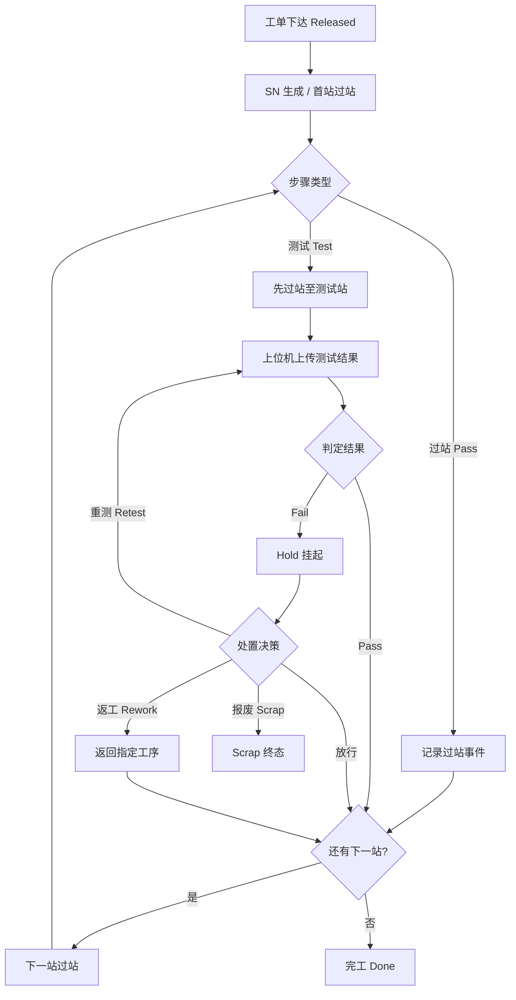

# 02.3 产品制造流程 UML 活动图

> 所属篇章：02_WhatToDo 应该执行什么 ｜ 状态：✅ 已完成

## 本篇要回答的业务问题

- 从工单下发到完工，主流程 + 异常分支如何用一张活动图表达？
- 判定节点（测试 Pass / Fail）之后的分支各走什么路径？
- 哪些活动是「记录」，哪些是「约束」？（对照：先记录、再约束、后分析）

## 1. 主流程活动图



### 1.1 每个节点的执行角色

| 节点 | 执行角色 | 系统动作 |
| --- | --- | --- |
| 工单下达 | 计划员 / ERP | 校验产品 + 启用流程（`MES-4004` / `MES-4091`） |
| SN 生成 / 首站过站 | 操作员（扫码） | 创建 `SerialUnit`、校验顺序（`MES-4002`）与工站授权（`MES-4003`） |
| 步骤类型判定 | MES（路由） | 按 `RouteStep.StepType` 分叉 |
| 记录过站事件 | MES | 写 `TraceEvent`、推进 `CompletedStepSequence` |
| 先过站至测试站 | 操作员 | SN 进入待测状态（`PendingStepSequence`） |
| 上传测试结果 | 上位机 | 幂等校验（`MES-4091`）、写 `TestRecord` |
| 判定结果 | MES（Domain） | 按 `Passed` 更新 `SerialUnit.Status` |
| Hold / 处置决策 | 质量工程师 | 处置事件 + 审批留痕（05.4） |
| 完工 Done | MES | 末步完成，SN 进入终态 |

### 1.2 M1 阶段先落地的路径

M1（执行闭环）打通的是**主干 Happy Path**：

```text
B（SN 生成/首站过站）→ C → D（过站）或 E→F（测试+上传）→ G（Pass）→ H → N（Done）
```

M2 收紧约束（Fail Hold 拦截、处置闭环、SPC 告警），M3 叠加分析（时间线聚合、看板）。这符合「先记录、再约束、后分析」——先把主干事实记全，再逐步启用分支治理。

### 1.3 哪些活动是「记录」，哪些是「约束」

| 活动节点 | 类型 | 说明 |
| --- | --- | --- |
| 记录过站事件 / 上传测试结果 | **记录** | 事实采集，M1 核心 |
| 校验工序顺序 / 工站授权 | **约束** | 门控（M1 已实现：`MES-4002` / `MES-4003`） |
| Fail → Hold 拦截 | **约束** | 失败品未处置不得过站（M1 已实现，**不可弱化**） |
| 处置决策（放行/返工/报废） | **约束 + 记录** | 决策改变状态，同时生成处置事件（M2 完整化） |
| SPC 越界告警 | **分析** | 建立在记录之上（M2） |

判别法：**记录活动失败 = 事实丢失（不可接受，需幂等与补传兜底）；约束活动失败 = 行为被拦截（返回错误码，属正常业务分支）**。

## 2. 异常分支说明

Hold / Rework / Retest / Scrap 的详细流转见 [05.4_Hold_Rework_Retest_Scrap状态模型](../05_WhatActuallyHappened_实际发生了什么/05.4_Hold_Rework_Retest_Scrap状态模型.md)。此处补充活动图视角的三个要点：

1. **Hold 是「暂停」不是「终点」**：活动图上 Hold 节点有出边（处置决策），SN 冻结在当前步骤等待人工指令——机器不擅自决定。
2. **Retest 回到 F（上传）而非 E（过站）**：重测不回退步骤、不重复过站，只是原工站再来一次（新 `TestBatchId` 生成新记录）。**Rework 回到指定工序**（K 节点），步骤序号回退、重新过站。两者不可混用（详见 05.4 §2 对比表）。
3. **Scrap 是唯一进入终态的异常分支**：放行/返工/重测都回到主循环 H——只有报废把 SN 带离制造流程。

## 3. 与时序图的分工

- 本图回答「流程与分支」：节点是业务活动，边是流转条件，适合与工艺/质量评审整体流程；
- 参与者协作时序见 [04.4_MoveIn到MoveOut时序图](../04_WhatIsHappening_现在正在发生什么/04.4_MoveIn到MoveOut时序图.md)：同一个「过站 + 上传」动作，时序图展开为操作员 / UI / API / Domain / DB 的消息序列。
- 经验法则：**和业务评审流程用活动图；和开发对齐调用顺序用时序图**。

## 关联文档

- 上游：[02.2_Routing与Operation模型](02.2_Routing与Operation模型.md)
- 全景版：[08.2_MES端到端业务活动图](../08_MES业务全景/08.2_MES端到端业务活动图.md)
- 实现参照：`design.md` §5.1 流程一（SN 过站 + 测试上传）
