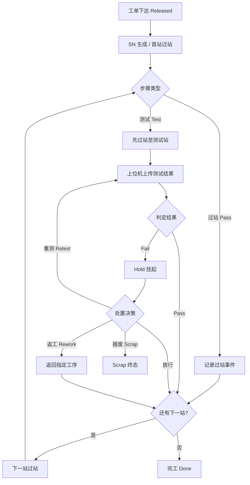

# 02.3 产品制造流程 UML 活动图

> 所属篇章：02_WhatToDo 应该执行什么 ｜ 状态：⏳ 骨架（待填充）

## 本篇要回答的业务问题

- 从工单下发到完工，主流程 + 异常分支如何用一张活动图表达？
- 判定节点（测试 Pass / Fail）之后的分支各走什么路径？
- 哪些活动是「记录」，哪些是「约束」？（对照：先记录、再约束、后分析）

## 1. 主流程活动图

<!-- 待填充：
- 每个节点的执行角色（操作员 / 上位机 / MES）
- M1 阶段先落地的路径：B→C→D/E→F→G(Pass)→H→N
-->

## 2. 异常分支说明

<!-- 待填充：Hold / Rework / Retest / Scrap 的详细流转见 05.4 -->

## 3. 与时序图的分工

- 本图回答「流程与分支」；参与者协作时序见 [04.4_MoveIn到MoveOut时序图](../04_WhatIsHappening_现在正在发生什么/04.4_MoveIn到MoveOut时序图.md)

## 关联文档

- 上游：[02.2_Routing与Operation模型](02.2_Routing与Operation模型.md)
- 全景版：[08.2_MES端到端业务活动图](../08_MES业务全景/08.2_MES端到端业务活动图.md)
- 实现参照：`design.md` §5.1 流程一（SN 过站 + 测试上传）
