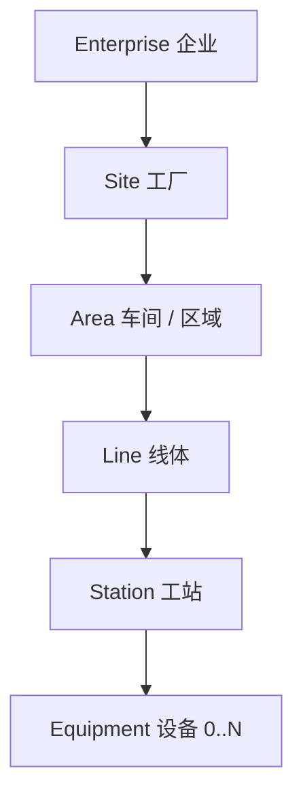
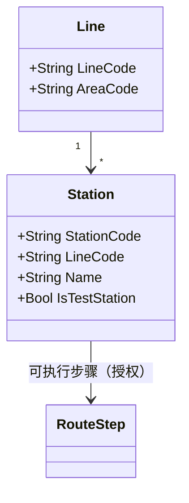
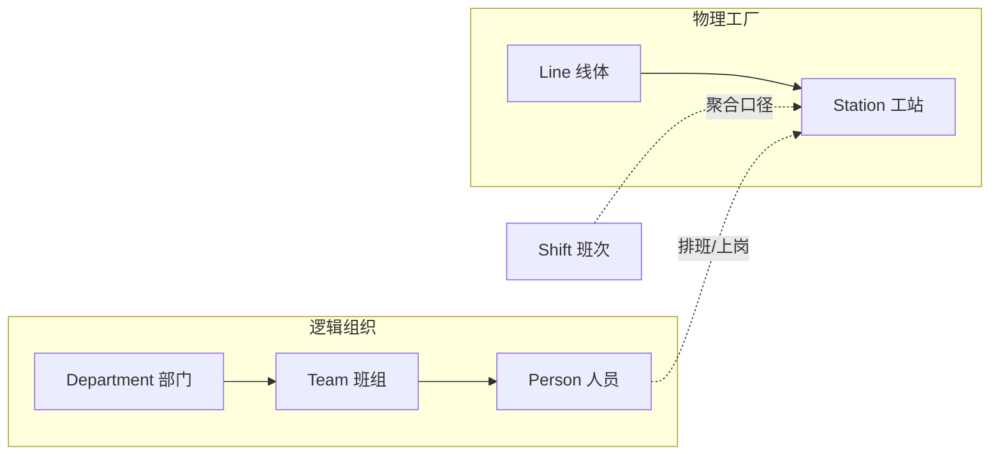

# 03.1 制造组织与物理工厂模型

> 所属篇章：03_WhoWhereWithWhat 谁在哪里用什么生产 ｜ 状态：✅ 已完成

## 本篇要回答的业务问题

- 企业 → 工厂 → 区域 → 线体 → 工站的物理层级如何建模？
- 逻辑组织（部门 / 班组 / 班次）与物理工厂（线体 / 工站）如何分离建模？
- 工站（Station）有哪些属性？与工序的授权关系如何表达？

## 1. 物理层级模型

与 ISA-95 物理资产层级（Enterprise → Site → Area → Production Line → Work Cell / Work Unit，详见 [`ISA-95学习指南.md`](../../架构和系统设计/ISA-95学习指南.md) §3）一致。两处实践取舍：

- **层级深度**：不必五个层级全部建模。本仓库单线体试点从 `Line → Station` 两级起步（`Station.LineCode` 直接挂线体编码），企业/工厂/区域作为字符串属性随多工厂扩展时再升级为实体。**先小后大**的又一次应用：层级是查询维度，不是业务规则的承载者，等规则需要（如多工厂权限隔离）再实体化。
- **命名责任**：每级编码在主数据管理中唯一，且层级变更（工站换线）是主数据变更事件，需留痕——因为历史事件里存的是 StationCode，工站档案变更会影响追溯解释（快照问题见 [03.4](03.4_5M1E制造上下文模型.md)）。

## 2. Station 工站模型

对照本仓库实现（`Station`：编码、线体、是否测试站）与 `MES-4003` 工站未授权：

| 属性 | 业务含义 | 门控用途 |
| --- | --- | --- |
| StationCode | 工站唯一编码 | 事件与记录的定位锚点（TraceEvent.StationCode） |
| LineCode | 所属线体 | 看板聚合维度、在制分布 |
| Name | 人类可读名称 | 展示 |
| IsTestStation | 是否测试站 | **步骤类型匹配校验**：`TestRequired` 步骤只允许在测试站执行 |

工站授权关系的表达：过站请求 `(sn, stationCode)` 到达时，MES 校验「stationCode 对应的步骤 = SN 的下一个待执行步骤」。`MES-4003` 拦截两种情形：工站不存在；工站存在但与步骤类型不符（如把 PassOnly 的组装步骤扫到测试站）。

**授权的粒度演进**：

| 阶段 | 授权模型 | 校验内容 |
| --- | --- | --- |
| M1（当前） | 步骤 ↔ 工站（编码级） | 工站编码出现在 RouteStep 中且类型匹配 |
| M2 演进 | 工站能力集（多个工站可执行同一步骤） | 线体内同类工站互为备份，任选其一过站 |
| M3+ 演进 | 工站 × 产品 × 程序/夹具 | 仪器能力匹配（该站是否具备当前型号所需程序与夹具版本） |

## 3. 逻辑组织模型

逻辑组织与物理层级**分离建模**——人属于班组（逻辑），干活在工站（物理），两者多对多：

| 逻辑对象 | 说明 | 与物理层的关系 | 数据用途 |
| --- | --- | --- | --- |
| Department 部门 | 行政归属（工艺部、质量部、制造部） | 无直接关系 | 权限、审批流 |
| Team 班组 | 执行单元（组装一组、测试二组） | 常驻某条线体 | 绩效归集、排班 |
| Shift 班次 | 时间维度（白班 / 夜班 / 中班） | 正交于物理层 | **SPC 统计周期与看板的天然分组维度** |

班次与统计的关系：`design.md` §5.3 的 SPC 统计周期按「小时 / 班次」——班次不是 HR 概念而是**数据聚合口径**。换班时刻的数据切分（一个测试跨班次完成算哪个班？）需要明确规则（建议：按测试完成时刻归属）。

## 4. 工作中心 WorkCenter

通用 MES 中 WorkCenter（工作中心）= 一组具备相同能力的工站/设备集合，承载产能（Capacity）与节拍（Takt）属性，是 APS 排产与产能负荷计算的单元。

**第一阶段是否需要？——否（YAGNI）**：

| 考虑 | 结论 |
| --- | --- |
| APS 排产需要 WorkCenter 的能力/产能模型 | 第一阶段明确不做 APS（`design.md` §2.2） |
| 看板需要「站别瓶颈」分析 | 用 `Station`（+事件时间戳计算节拍）即可，不必引入新实体 |
| 多工站互备需要能力分组 | M2 用「步骤 ↔ 工站集合」的授权表达成，仍不需要独立 WorkCenter |

判断方法：**当且仅当出现「按能力集合排产 / 负荷核算」需求时，才把 WorkCenter 实体化**。在此之前，它是概念存在、不是数据模型存在。

## 关联文档

- 平行：[03.2_人员与技能模型](03.2_人员与技能模型.md)、[03.3_设备工具物料资源模型](03.3_设备工具物料资源模型.md)
- 下游：[04.4_MoveIn到MoveOut时序图](../04_WhatIsHappening_现在正在发生什么/04.4_MoveIn到MoveOut时序图.md)（工站是执行点）
- 实现参照：`Station` + `/api/stations`；追溯问题「在哪个工厂？哪条线？哪个工位？」
