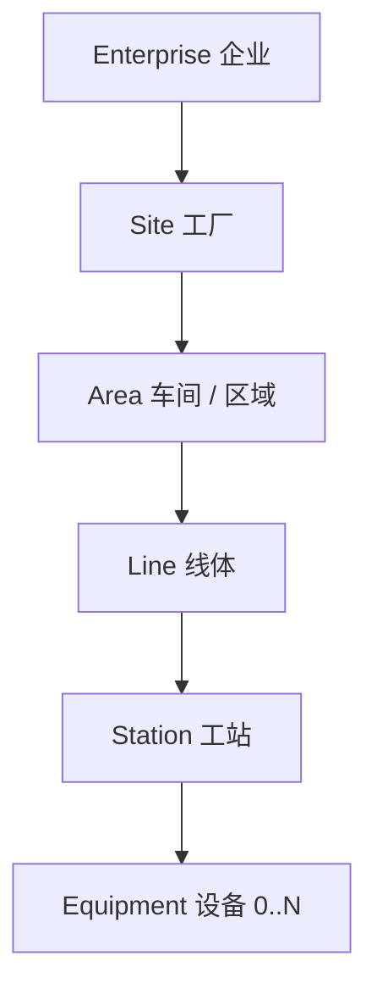
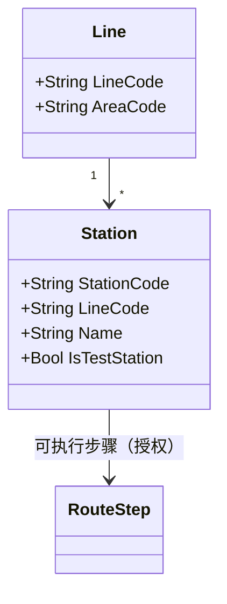

# 03.1 制造组织与物理工厂模型

> 所属篇章：03_WhoWhereWithWhat 谁在哪里用什么生产 ｜ 状态：⏳ 骨架（待填充）

## 本篇要回答的业务问题

- 企业 → 工厂 → 区域 → 线体 → 工站的物理层级如何建模？
- 逻辑组织（部门 / 班组 / 班次）与物理工厂（线体 / 工站）如何分离建模？
- 工站（Station）有哪些属性？与工序的授权关系如何表达？

## 1. 物理层级模型

<!-- 待填充：ISA-95 物理资产层级对照（见 ISA-95学习指南.md）；层级深度取舍 -->

## 2. Station 工站模型

<!-- 待填充：对照本项目 Station（编码、线体、是否测试站）与 MES-4003 工站未授权 -->

## 3. 逻辑组织模型

<!-- 待填充：部门、班组 Team、班次 Shift（白班 / 夜班）；班次与 SPC 统计周期、看板的关系 -->

## 4. 工作中心 WorkCenter

<!-- 待填充：能力（Capacity）、节拍；第一阶段是否需要（YAGNI 判断） -->

## 关联文档

- 平行：[03.2_人员与技能模型](03.2_人员与技能模型.md)、[03.3_设备工具物料资源模型](03.3_设备工具物料资源模型.md)
- 下游：[04.4_MoveIn到MoveOut时序图](../04_WhatIsHappening_现在正在发生什么/04.4_MoveIn到MoveOut时序图.md)（工站是执行点）
- 实现参照：`Station` + `/api/stations`；追溯问题「在哪个工厂？哪条线？哪个工位？」
