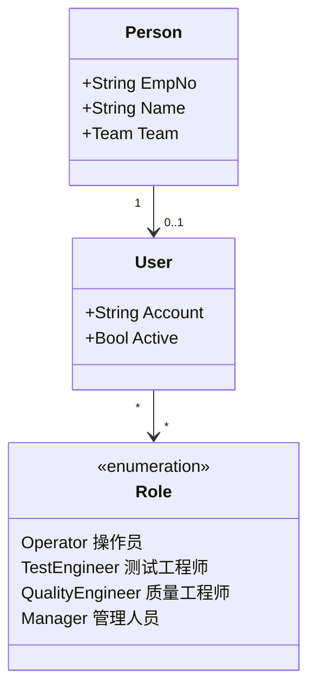

# 03.2 人员与技能模型

> 所属篇章：03_WhoWhereWithWhat 谁在哪里用什么生产 ｜ 状态：⏳ 骨架（待填充）

## 本篇要回答的业务问题

- 操作员 Person、账号 User、角色 Role 的关系是什么？
- 技能 / 资质如何与工站、工序绑定？（无资质不能上岗如何约束）
- 班组与班次如何影响数据归属？
- 审批权限（放行、报废）如何建模？（追溯问题：谁批准的？）

## 1. Person / User / Role

<!-- 待填充：JWT + RBAC 计划（design.md §9.3）；角色与 MES调研.md 角色表对照 -->

## 2. Skill / Qualification 资质模型

<!-- 待填充 -->

- Skill（技能项）── Certification（认证记录：有效期、发证人）
- 授权矩阵：Person × Station / Operation → 允许 / 拒绝
- 上岗校验时机：过站时校验当前操作员资质（第二阶段约束）

## 3. 班组与班次

<!-- 待填充：Team、Shift 的排班简化模型；班次作为 SPC 统计周期与看板维度 -->

## 4. 审批与电子签名

<!-- 待填充：审批动作（放行 Hold、批准报废）需记录审批人 + 时间 + 理由；对接 06.4 证据链 -->

## 关联文档

- 平行：[03.1_制造组织与物理工厂模型](03.1_制造组织与物理工厂模型.md)
- 下游：[05.4_Hold_Rework_Retest_Scrap状态模型](../05_WhatActuallyHappened_实际发生了什么/05.4_Hold_Rework_Retest_Scrap状态模型.md)（处置审批人）
- 追溯问题对照：「是谁做的？谁批准的？」
