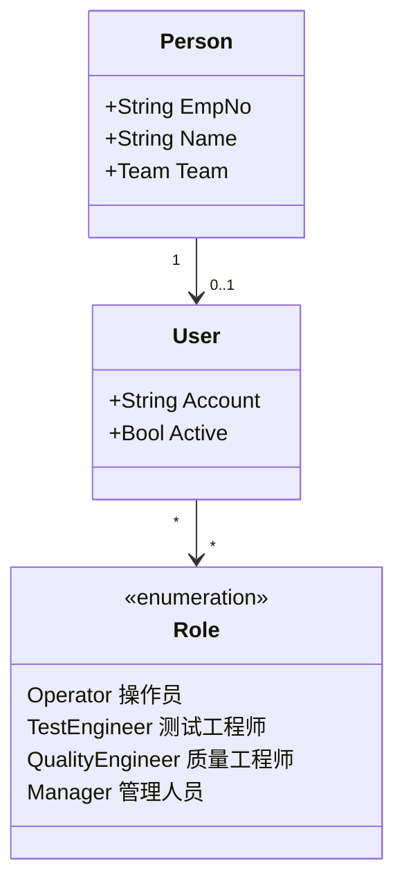
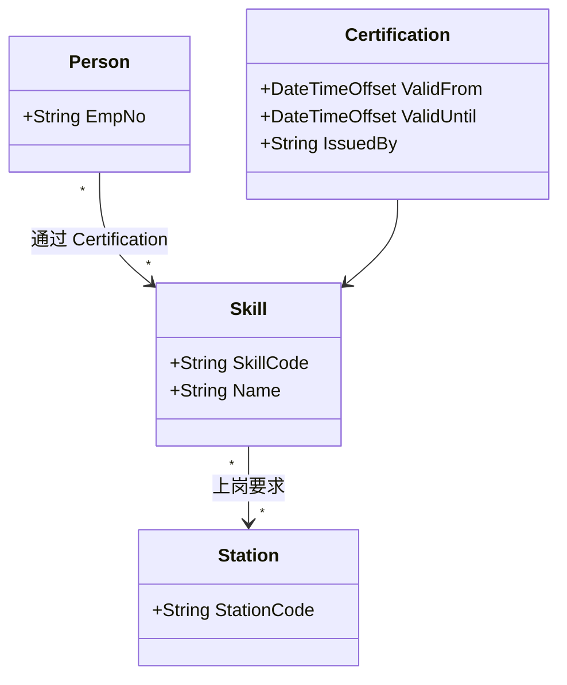

# 03.2 人员与技能模型

> 所属篇章：03_WhoWhereWithWhat 谁在哪里用什么生产 ｜ 状态：✅ 已完成

## 本篇要回答的业务问题

- 操作员 Person、账号 User、角色 Role 的关系是什么？
- 技能 / 资质如何与工站、工序绑定？（无资质不能上岗如何约束）
- 班组与班次如何影响数据归属？
- 审批权限（放行、报废）如何建模？（追溯问题：谁批准的？）

## 1. Person / User / Role



三对象分离的理由：

| 对象 | 回答 | 生命周期归属 |
| --- | --- | --- |
| Person | 「谁这个自然人」——工号、姓名、班组 | HR 系统（源头），MES 同步只读 |
| User | 「谁能登录系统」——账号、激活状态 | IT / MES 本地（或对接 AD/LDAP） |
| Role | 「能做什么」——权限集合 | MES 权限管理 |

Person 与 User 是 1 : 0..1：一个自然人可以没有账号（如纯手工工序的操作员，其身份通过扫码枪工牌识别）；一个账号必须对应一个自然人（**禁止共享账号**——共享账号让「谁做的」归因失效，直接破坏 ALCOA 可归因原则）。

对照本仓库：`TraceEvent.OperatorId` 是人的人员标识落点——第一阶段为字符串，JWT + RBAC（`design.md` §9.3）实现后，`OperatorId` 由鉴权上下文注入，禁止前端任意传值（否则「谁做的」可被伪造）。角色与 `MES调研.md` 角色表的对照：操作员（扫码/过站/输入）、工艺工程师（定义流程）、质量工程师（SPC/处置）、设备工程师（设备数据）、管理层（报表/KPI）——首期 RBAC 取最小角色集（Operator / TestEngineer / QualityEngineer / Manager），设备工程师角色后续按需增设。

## 2. Skill / Qualification 资质模型



- **Skill（技能项）── Certification（认证记录：有效期、发证人）**：认证是带时限的资质事实，过期即失效；复训产生新的 Certification（追加，不覆盖历史）。
- **授权矩阵**：Person × Station / Operation → 允许 / 拒绝。矩阵不必显式存储——由「工站要求技能集 ⊆ 人员有效认证集」推导。
- **上岗校验时机**：过站时校验当前操作员资质（第二阶段约束）。M1 先记录 OperatorId 不拦截——「先记录、再约束」的又一次应用：先积累「谁在操作」的事实，再启用「无资质拦截」。

| 阶段 | 行为 | 失败处理 |
| --- | --- | --- |
| M1 | 记录 OperatorId | — |
| M2 | 校验资质，无资质拦截 | 返回明确错误码 + 班长授权临时放行（留审计） |

## 3. 班组与班次

简化排班模型（复杂排班是 HR/WFM 系统职责，MES 只需「某时刻某工站是谁在岗」）：

```text
ShiftAssignment（排班记录）= Person + Station/Line + Shift + Date
```

- 数据归属：事件的 `OperatorId` + 排班记录联查 → 该事件归属哪个班组/班次；**班次是 SPC 统计周期与看板维度**（见 [03.1 §3](03.1_制造组织与物理工厂模型.md)）。
- 关键约束：**事件上只存 OperatorId 与发生时间，不冗余班组/班次快照**——班组归属随排班表推导；但主数据（人员离职、换组）变更后，历史事件的班次归属要稳定，推导时须使用**当时的排班表**（带生效日期），这是「排班也是版本化主数据」的原因。

## 4. 审批与电子签名

审批动作（放行 Hold、批准报废）的记录三要素——缺一即不构成有效证据：

| 要素 | 内容 | 对应追溯问题 |
| --- | --- | --- |
| 审批人 | 谁批准的（不可伪造，鉴权上下文注入） | 「谁批准的？」 |
| 时间 | 何时批准（审批时刻 ≠ 请求时刻） | 「什么时候做的？」 |
| 理由 | 为什么批准（放行原因、报废依据） | 「为何能证明？」 |

- **电子签名（E-Signature）**：比普通登录更强的身份确认（如二次密码/工牌）。光通信行业客诉审核中，放行与报废记录常要求可出示审批人身份凭据。落地形式：审批 API 强制鉴权 + 审批事件（AuditEvent）不可篡改。
- 与 06.4 证据链的对接：审批记录是证据链中「签名」层——事实（事件）+ 责任（签名）合起来才是完整证据。放行/报废若无审批人，追溯报告即出现「有结果、无责任」的断链。

## 关联文档

- 平行：[03.1_制造组织与物理工厂模型](03.1_制造组织与物理工厂模型.md)
- 下游：[05.4_Hold_Rework_Retest_Scrap状态模型](../05_WhatActuallyHappened_实际发生了什么/05.4_Hold_Rework_Retest_Scrap状态模型.md)（处置审批人）
- 追溯问题对照：「是谁做的？谁批准的？」
