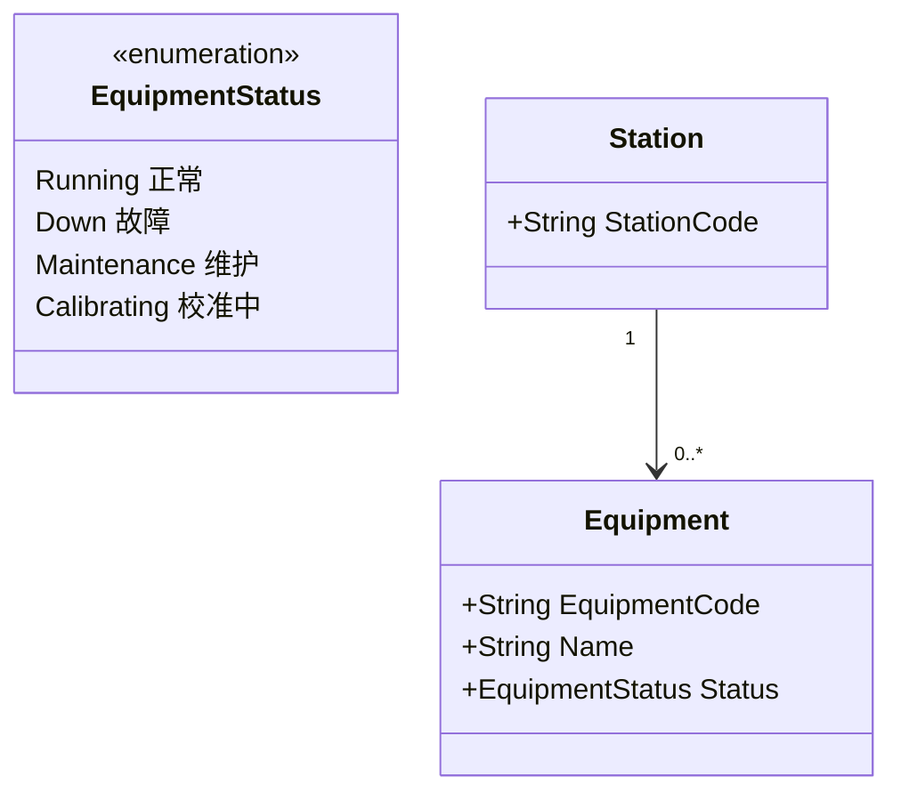
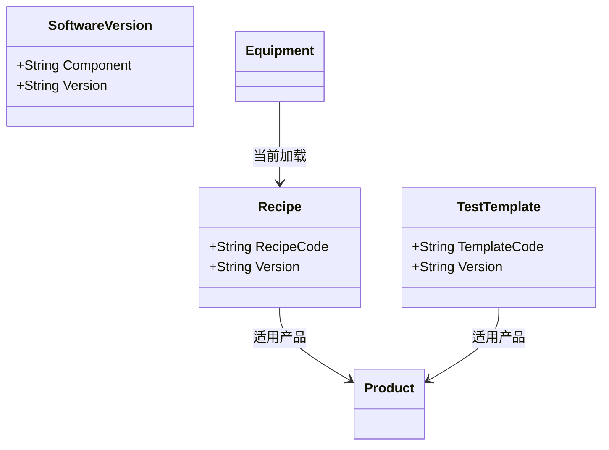

# 03.3 设备工具物料资源模型

> 所属篇章：03_WhoWhereWithWhat 谁在哪里用什么生产 ｜ 状态：✅ 已完成

## 本篇要回答的业务问题

- Equipment（设备）、Tool（治具/工具）如何建模？与工站是什么关系？
- Recipe / 程序 / 软件版本如何与设备、产品绑定？（追溯问题：用了哪个 Recipe / Software Version / Test Template？）
- 校准（Calibration）与维护状态如何影响设备可用性？

## 1. Equipment 设备



- **设备档案**：静态属性（型号、序列号、厂商、安装日期）+ 动态状态（EquipmentStatus）。设备档案由设备工程维护；MES 消费。
- **与上位机/测试仪的对应**：光通信工厂的典型结构是一台工控机（上位机）挂多台测试仪。MES 视角的「Equipment」是**上传结果时自报的设备标识**——设备上下文随测试结果一起上传（`TestRecord` 预留），而非 MES 反向控制。
- **设备不稳定假设下的接入策略**：设备接入不稳定是常态（`AGENTS.md` 业务原则 3）——上位机**本地缓存 + 服务端幂等 + 批量补传**：
  - 上位机断网时先把结果存本地队列；
  - 恢复后调用 `/api/test-results/batch` 补传，按发生时间（`TestedAt`）重排入库；
  - 服务端幂等键 `(sn, station_code, test_batch_id)` 保证补传不重复计数（`MES-4091`）。
- 设备状态对过站的影响：`Down` / `Maintenance` 状态的设备所在工站是否拦截过站，是 M2 门控扩展项（设备状态 → 工站可用性联动）。

## 2. Tool / Fixture 治具与工具

治具与设备的区别：**设备是「执行测试的仪器」（长期资产），治具是「定位/承载产品的工装」（消耗性资产）**。光通信场景中治具尤其关键——不同产品型号需要不同治具，治具磨损直接影响光路对准精度。

| 管控属性 | 说明 | 追溯意义 |
| --- | --- | --- |
| 治具寿命（次数） | 装夹 N 次后强制维护 | 定位「某段时期该治具装夹的产品」 |
| 维护周期 | 按时间间隔的预防性维护 | 同上 |
| 与工站绑定 / 换型 | 治具当前装在哪个工站、适用哪个产品 | 换型记录是「为何这批产品参数漂移」的常见解释 |

治具使用记录（哪个 SN 在哪个治具上测过）是事件上下文的一部分——参数异常分析时，「先查这批产品共用的治具」是标准排查路径。

## 3. Recipe / 程序 / 软件版本



三者语义区分（光通信测试站视角）：

| 对象 | 是什么 | 谁维护 | 变更管控 |
| --- | --- | --- | --- |
| Recipe | 设备/仪器执行时使用的一组参数或配方（如温控曲线、驱动电流设置） | 测试工程师 | 版本化，变更走审批 |
| TestTemplate（测试模板） | 测试仪上运行的测试程序与参数集（测什么参数、什么顺序、什么条件） | 测试工程师 | 版本化，与产品绑定 |
| SoftwareVersion | 上位机 / 固件的软件版本（Component + Version 记录每个组件） | 设备 / 软件工程 | 随设备升级变化 |

- **版本变更管控**：Recipe / TestTemplate 变更等同工艺变更（ECN），需评估对在制品的影响（同 [00.3 §3](../00_MES业务建模总纲/00.3_产品生命周期模型.md) 的切割策略）。
- **事件记录中如何快照**：测试结果上传时，设备、Recipe、TestTemplate、软件版本随载荷一并提供或从可信上下文解析，并作为**当时值快照**存入事件上下文（`TraceEvent` 上下文 / `TestRecord` 关联）——不能只存 ID 后按当前主数据解释，否则「软件升级后，历史记录显示新版本」的证据失真（快照原则见 [03.4 §2](03.4_5M1E制造上下文模型.md)）。

对照本仓库：`TestRecord.RawPayload` 保留原始报文，原始报文中天然包含设备与程序版本信息——这是「原始层」与「结构化上下文」互补的又一例证。

## 4. 校准与维护

校准记录模型：

```text
CalibrationRecord = Equipment + 校准时间 + 校准结果 + 校准单位 + 下次校准到期日
```

- **校准记录**（时间、结果、校准单位）：校准不合格意味着**校准有效期内的所有测试结果可信度存疑**——这正是设备维度正向追溯（06.3）的经典场景：查某仪器两次校准之间测试过的全部 SN。
- **超期未校准 → 设备不可用 → 工站拦截**：门控规则（M2+ 演进，对照战略文档「光通信建议额外演进门控」：仪器能力匹配、环境条件）。

| 状态 | 对过站的影响 | 对历史数据的影响 |
| --- | --- | --- |
| 校准有效 | 正常 | — |
| 超期未校准 | 拦截该工站过站（M2+） | 触发数据回顾：超期期间的测试结果需要复评 |
| 校准不合格 | 立即停用 | 正向追溯该设备上一有效期内的所有 SN，评估风险 |

## 关联文档

- 平行：[03.1_制造组织与物理工厂模型](03.1_制造组织与物理工厂模型.md)、[03.4_5M1E制造上下文模型](03.4_5M1E制造上下文模型.md)
- 下游：[05.2_Expected与Actual模型](../05_WhatActuallyHappened_实际发生了什么/05.2_Expected与Actual模型.md)（TestTemplate 定义期望）
- 追溯问题对照：「用了什么设备？哪个 Recipe？哪个 Software Version？哪个 Test Template？」
