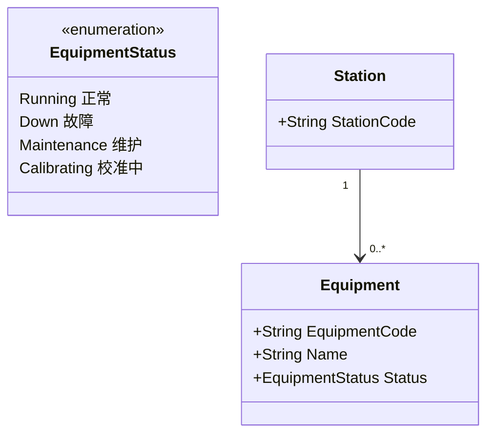
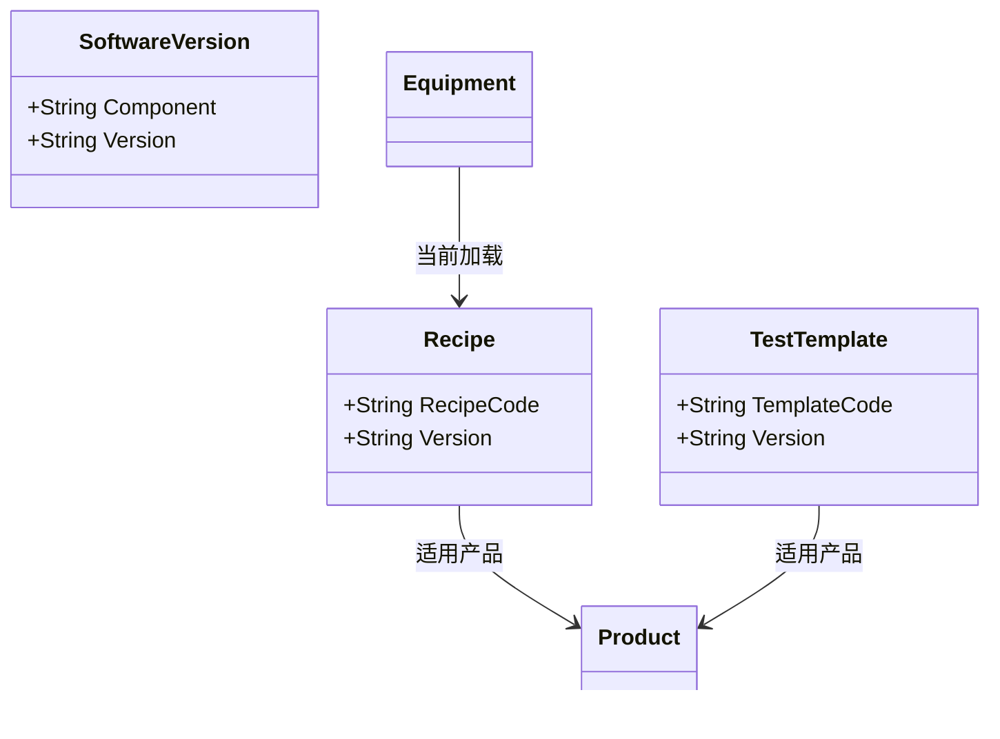

# 03.3 设备工具物料资源模型

> 所属篇章：03_WhoWhereWithWhat 谁在哪里用什么生产 ｜ 状态：⏳ 骨架（待填充）

## 本篇要回答的业务问题

- Equipment（设备）、Tool（治具/工具）如何建模？与工站是什么关系？
- Recipe / 程序 / 软件版本如何与设备、产品绑定？（追溯问题：用了哪个 Recipe / Software Version / Test Template？）
- 校准（Calibration）与维护状态如何影响设备可用性？

## 1. Equipment 设备

<!-- 待填充：设备档案、与上位机/测试仪的对应；设备不稳定假设下的接入策略（本地缓存 + 补传） -->

## 2. Tool / Fixture 治具与工具

<!-- 待填充：治具寿命（次数）、维护周期；与工站的绑定/换型 -->

## 3. Recipe / 程序 / 软件版本

<!-- 待填充：测试仪上运行的测试模板与参数集；版本变更管控；事件记录中如何快照 -->

## 4. 校准与维护

<!-- 待填充：校准记录（时间、结果、校准单位）；超期未校准 → 设备不可用 → 工站拦截 -->

## 关联文档

- 平行：[03.1_制造组织与物理工厂模型](03.1_制造组织与物理工厂模型.md)、[03.4_5M1E制造上下文模型](03.4_5M1E制造上下文模型.md)
- 下游：[05.2_Expected与Actual模型](../05_WhatActuallyHappened_实际发生了什么/05.2_Expected与Actual模型.md)（TestTemplate 定义期望）
- 追溯问题对照：「用了什么设备？哪个 Recipe？哪个 Software Version？哪个 Test Template？」
