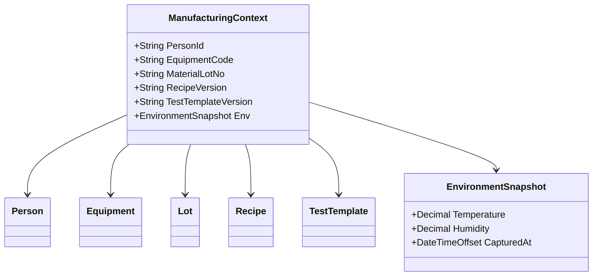

# 03.4 5M1E 制造上下文模型

> 所属篇章：03_WhoWhereWithWhat 谁在哪里用什么生产 ｜ 状态：⏳ 骨架（待填充）

## 本篇要回答的业务问题

- 任何一次制造行为发生时，需要记录哪些上下文才能支撑事后追溯？
- 5M1E（人机料法环测）如何统一建模为「制造上下文快照」？
- 上下文在事件（05.1）中如何被引用？

## 1. 5M1E 分解

| 维度 | 对象 | 详细模型 |
| --- | --- | --- |
| Man 人 | Person / Team / Shift | 03.2 |
| Machine 机 | Equipment / Tool | 03.3 |
| Material 料 | Material / Lot（上料记录） | 01.2 |
| Method 法 | Routing / Recipe / TestTemplate | 02.2 / 03.3 |
| Measurement 测 | TestRecord / Spec | 05.2 |
| Environment 环 | 温湿度等环境数据 | 本篇 |

## 2. 制造上下文快照

<!-- 待填充 -->

- 事件发生时刻，对 5M1E 各引用的「值快照」而非仅 ID 引用（防止主数据事后变更破坏证据）
- 对照本项目 `TraceEvent`：事件类型、人员、设备、站点、时间、上下文
- 快照粒度的取舍：全量快照（存储大）vs 引用 + 版本号（查询需回溯）

## 3. 环境数据采集

<!-- 待填充：车间级 / 工站级温湿度；采集频率；与测试结果关联（失效分析维度） -->

## 关联文档

- 汇总前序：[03.1](03.1_制造组织与物理工厂模型.md) / [03.2](03.2_人员与技能模型.md) / [03.3](03.3_设备工具物料资源模型.md)
- 下游：[05.1_ManufacturingEvent制造事件](../05_WhatActuallyHappened_实际发生了什么/05.1_ManufacturingEvent制造事件.md)（上下文挂在事件上）
- 追溯问题对照：「环境是什么？」
