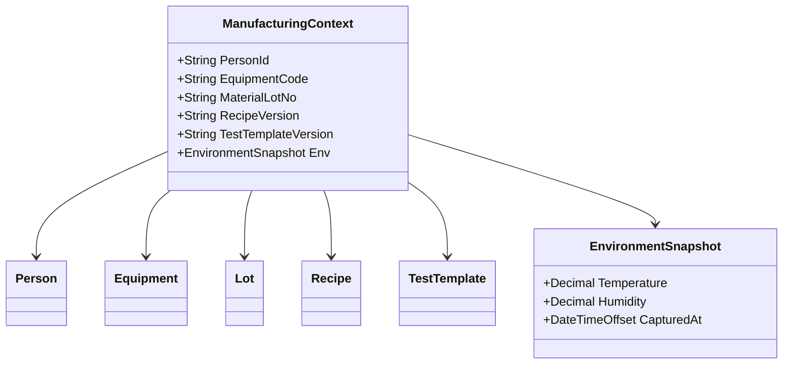
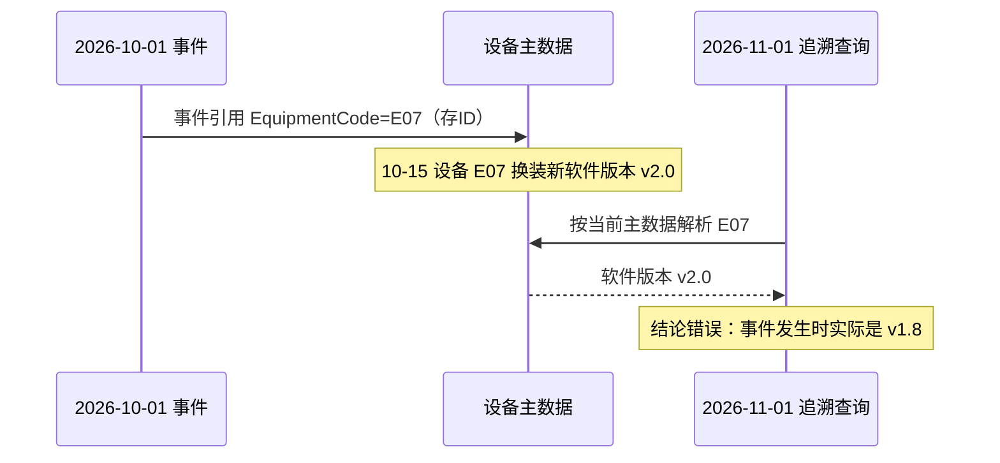

# 03.4 5M1E 制造上下文模型

> 所属篇章：03_WhoWhereWithWhat 谁在哪里用什么生产 ｜ 状态：✅ 已完成

## 本篇要回答的业务问题

- 任何一次制造行为发生时，需要记录哪些上下文才能支撑事后追溯？
- 5M1E（人机料法环测）如何统一建模为「制造上下文快照」？
- 上下文在事件（05.1）中如何被引用？

## 1. 5M1E 分解

| 维度 | 对象 | 详细模型 |
| --- | --- | --- |
| Man 人 | Person / Team / Shift | 03.2 |
| Machine 机 | Equipment / Tool | 03.3 |
| Material 料 | Material / Lot（上料记录） | 01.2 |
| Method 法 | Routing / Recipe / TestTemplate | 02.2 / 03.3 |
| Measurement 测 | TestRecord / Spec | 05.2 |
| Environment 环 | 温湿度等环境数据 | 本篇 |

5M1E 的价值不是「每次都全采」而是**完整性检查框架**：评估某个关键工站的数据采集范围时，逐维问「这一维对失效分析有没有用」。取舍原则（`MES系统概览学习.md` §4）：纯人工外观检验没有仪器（Machine 空）；辅料装配不需要环测（Environment 空）；但关键测试站的人、机、料、法、测、环通常都重要——**采集范围由追溯和质量风险决定，而不是为了字段齐全无差别增加表单**。

## 2. 制造上下文快照

- 事件发生时刻，对 5M1E 各引用的「值快照」而非仅 ID 引用（防止主数据事后变更破坏证据）。
- 对照本项目 `TraceEvent`：事件类型、人员、设备、站点、时间、上下文——当前实现的 `OperatorId` / `StationCode` / `OccurredAt` 已覆盖 Man / Where / When 三维；Equipment、Recipe、Lot、环境维度随 M2 上下文扩展逐步补齐。

**为什么必须快照**——反例推演：

- 快照粒度的取舍：

| 方案 | 存储 | 优点 | 缺点 |
| --- | --- | --- | --- |
| 全量值快照 | 事件内嵌各维度当时的值 | 查询快、证据自足 | 存储大、冗余多 |
| 引用 + 版本号 | 事件存 (ID, Version)，按版本解析 | 存储小 | 查询需回溯主数据版本链；主数据版本管理必须健全 |
| 仅 ID（错误示范） | 事件只存当前 ID | 最省 | 历史被当前主数据「污染」 |

实践建议：**高频查询的维度（设备编号、操作员、工站）用值快照；结构复杂的维度（完整 BOM、完整 Recipe 参数）用「引用 + 版本号」**。本仓库 M1 的 `TraceEvent`（OperatorId、StationCode 直存值）即第一种方案的体现。

## 3. 环境数据采集

- **采集层级**：车间级（中央空调温湿度）vs 工站级（测试仪台面温湿度）。追溯关心的是**测试发生位置的**环境——车间级数据只作参考，关键测试站应装工站级传感器。
- **采集频率**：环境是连续量，事件是离散时刻。落地方式：环境数据按时序存储（如每 5 分钟一条），事件通过「工站 + 时间窗就近匹配」关联环境读数（`EnvironmentSnapshot.CapturedAt` 记录取数时刻，供匹配校验）。
- **与测试结果关联（失效分析维度）**：光通信器件参数对温度敏感（插损随温度漂移是常见失效模式）。当 SPC 发现某时段参数整体漂移，标准排查路径之一就是叠加同时段环境曲线——「先看环境、再看设备、再看物料」。

| 采集项 | 频率 | 关联方式 | 用途 |
| --- | --- | --- | --- |
| 温度 / 湿度（工站级） | 5 分钟 | 事件时间就近匹配 | 参数漂移归因 |
| 温循 / 老化房的温度曲线 | 按流程事件窗 | 随测试批次整段提取 | 环境适应工序的证据 |
| 洁净度 / 静电 | 异常时记录 | 事件附注 | 质量事件调查 |

## 关联文档

- 汇总前序：[03.1](03.1_制造组织与物理工厂模型.md) / [03.2](03.2_人员与技能模型.md) / [03.3](03.3_设备工具物料资源模型.md)
- 下游：[05.1_ManufacturingEvent制造事件](../05_WhatActuallyHappened_实际发生了什么/05.1_ManufacturingEvent制造事件.md)（上下文挂在事件上）
- 追溯问题对照：「环境是什么？」
