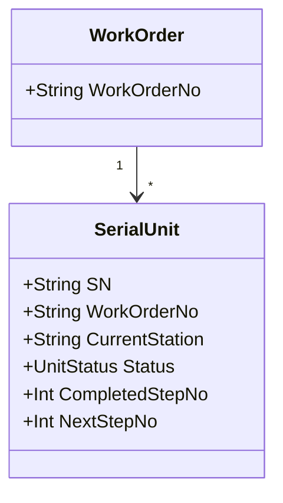

# 04.1 WIP 业务模型

> 所属篇章：04_WhatIsHappening 现在正在发生什么 ｜ 状态：⏳ 骨架（待填充）

## 本篇要回答的业务问题

- WIP（在制品）如何定义？SN / SerialUnit / Lot 之间什么关系？
- WIP 的「当前位置」「当前工序」「进度」如何表达？
- WIP 视图能回答哪些管理问题（在制量、分布、瓶颈）？

## 1. WIP 的标识

<!-- 待填充：单件流（SN 级 WIP）与批量流（Lot 级 WIP）的取舍；本仓库采用单件 SN 模型 -->

## 2. 位置与进度

<!-- 待填充 -->

- 当前位置：CurrentStation（最后过站工站）
- 进度：已完成步骤序号集合 vs 待测步骤序号（对照 `SerialUnit` 字段）
- 核心不变量：下一站必须等于流程中的下一个未完成步骤（防跳站，`MES-4002`）

## 3. WIP 查询视图

<!-- 待填充 -->

- 按工单 / 按工站 / 按线体的在制分布
- 产出指标：良率、一次通过率（FPY）、在制停留时间
- 对照看板需求（design.md §8.3 `GET /api/dashboard/realtime`）

## 关联文档

- 上游：[02.1_生产订单模型](../02_WhatToDo_应该执行什么/02.1_生产订单模型.md)
- 下游：[04.2_SN生命周期状态机](04.2_SN生命周期状态机.md)、[04.3_Operation执行状态机](04.3_Operation执行状态机.md)
- 实现参照：`SerialUnit`（AGENTS.md 核心领域概念）
