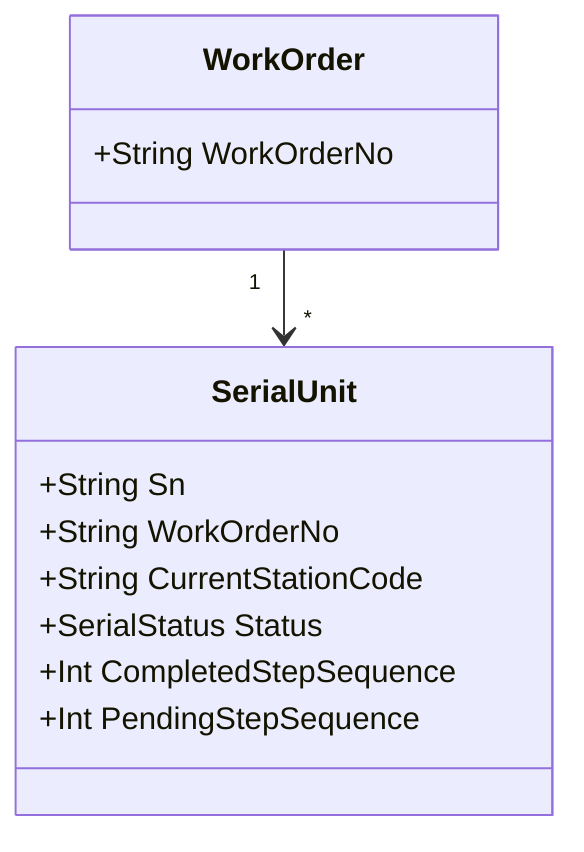

# 04.1 WIP 业务模型

> 所属篇章：04_WhatIsHappening 现在正在发生什么 ｜ 状态：✅ 已完成

## 本篇要回答的业务问题

- WIP（在制品）如何定义？SN / SerialUnit / Lot 之间什么关系？
- WIP 的「当前位置」「当前工序」「进度」如何表达？
- WIP 视图能回答哪些管理问题（在制量、分布、瓶颈）？

## 1. WIP 的标识



**单件流（SN 级 WIP）与批量流（Lot 级 WIP）的取舍**：

| 模式 | 标识 | 适用 | 追溯粒度 | 本仓库 |
| --- | --- | --- | --- | --- |
| 单件流 | SN | 光通信等高价值、单件测试的离散制造 | 单件 | ✅ 采用 |
| 批量流 | Lot（一组 SN） | 大批量、批次处理（如烘烤、清洗整批进出） | 批次 + 单件 | ⏳ 可在单件模型上「叠加批次分组」实现 |

选择依据：光通信产品的价值密度与测试复杂度使**单件状态管理是刚需**（每一件在哪一步、能不能过站，逐件回答）。批量工序（温循/老化）可以用「批次分组」作为查询视图叠在单件模型上，而不必让 WIP 的核心状态以批次为载体——**SN 是状态主体，批次是分组视图**。这就是本仓库采用单件 SN 模型的理由。

## 2. 位置与进度

- **当前位置**：`CurrentStationCode`（最后过站工站）——回答「它现在在哪」。
- **进度**：`CompletedStepSequence`（已完成步骤序号）+ `PendingStepSequence`（待测步骤序号）——回答「它走到哪一步、下一步做什么」。

进度推进规则（对照 `RouteStep.StepNo` 全序）：

```text
过站成功：PendingStepSequence → CompletedStepSequence（该步骤完成），Pending 指向下一未完成步骤
测试步骤：先过站（进站）→ 待测状态 → 结果上传后步骤完成
```

- 核心不变量：**下一站必须等于流程中的下一个未完成步骤（防跳站，`MES-4002`）**。完整表述：设 SN 已完成步骤集合 S，请求过站工站对应步骤 k，则合法当且仅当 k = min{ StepNo | StepNo ∉ S }。跳站（k > 待执行步骤）与「回头重扫已完成站」（k < 已完成步骤）同样非法。

状态与位置的组合回答管理问题：

| 问题 | 查询 | 依赖字段 |
| --- | --- | --- |
| 它在哪？ | `CurrentStationCode` | 位置 |
| 它到哪一步了？ | `CompletedStepSequence` / `PendingStepSequence` | 进度 |
| 它能不能过下一站？ | 状态机（04.2）+ 下一步骤 | 状态 + 进度 |
| 它卡了多久？ | 最后 TraceEvent 时间 vs 当前时刻 | 事件时间线 |

## 3. WIP 查询视图

- **按工单 / 按工站 / 按线体的在制分布**：

| 视图 | 维度 | 回答的管理问题 |
| --- | --- | --- |
| 工单在制视图 | WorkOrder × Status 计数 | 这张工单还剩多少没完成？（对账，02.1 §3） |
| 工站在制视图 | Station × Status 计数 | 哪个工站堆货？（瓶颈识别） |
| 线体在制视图 | Line × 状态汇总 | 线体负载是否均衡？ |

- **产出指标：良率、一次通过率（FPY）、在制停留时间**：
  - 良率 / FPY 的定义必须先约定口径（统计对象、分子分母、重复上传处理——见 `MES系统概览学习.md` §9 指标模板表），否则看板数字与现场管理口径对不上（`design.md` §14 检查清单明确要求）；
  - 在制停留时间 = 末次过站事件至今的时长；跨站停留时间 = 相邻两次过站事件间隔——两者都由事件流推导，不需要额外存储（状态是投影的又一体现）。
- 对照看板需求（`design.md` §8.3 `GET /api/dashboard/realtime`）：WIP 视图是实时看板的数据底座之一；M3 看板以 5 秒内反映最新聚合为目标。

## 关联文档

- 上游：[02.1_生产订单模型](../02_WhatToDo_应该执行什么/02.1_生产订单模型.md)
- 下游：[04.2_SN生命周期状态机](04.2_SN生命周期状态机.md)、[04.3_Operation执行状态机](04.3_Operation执行状态机.md)
- 实现参照：`SerialUnit`（AGENTS.md 核心领域概念）
