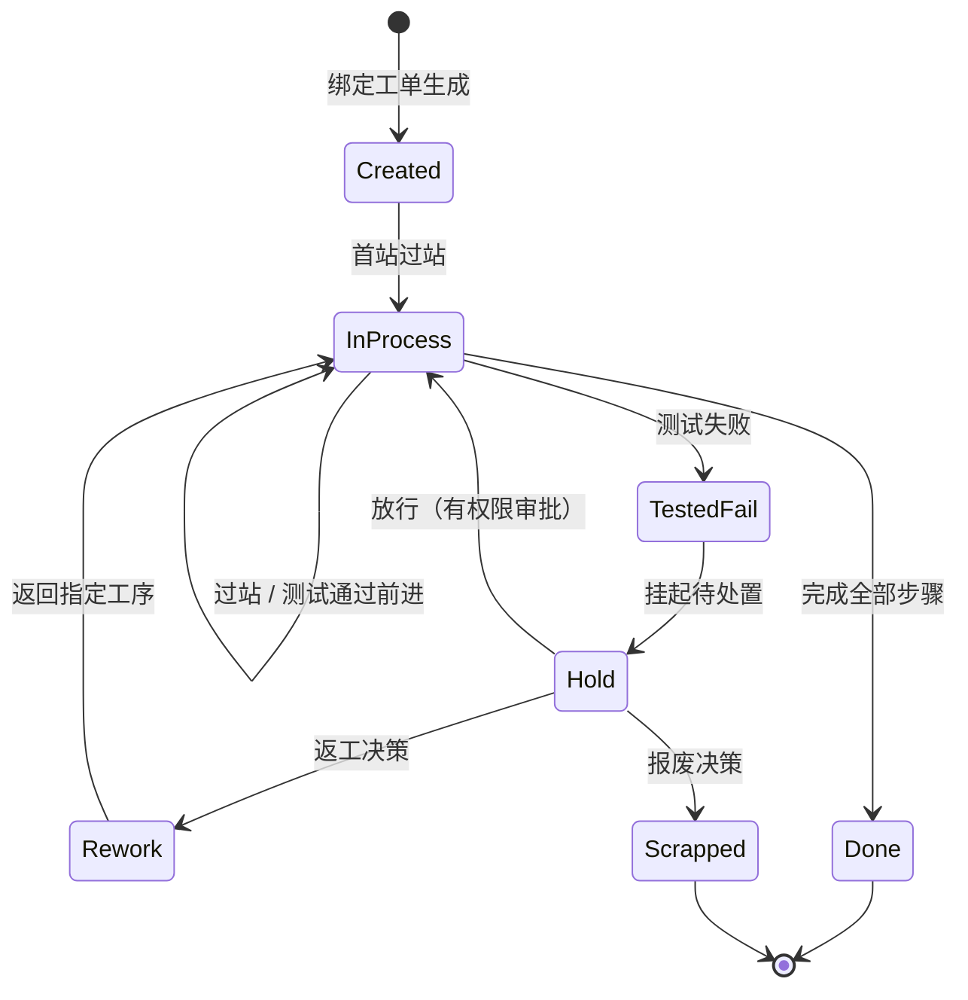

# 04.2 SN 生命周期状态机

> 所属篇章：04_WhatIsHappening 现在正在发生什么 ｜ 状态：✅ 已完成

## 本篇要回答的业务问题

- 一个 SN 从生成到终态有哪些状态？哪些流转是合法的？
- 测试 Pass / Fail 如何驱动状态变化？
- 返工后状态如何回退？终态有哪些（Done / Scrapped）？

## 1. 状态机总图

对照 `design.md` §4.2 与代码 `SerialStatus` 枚举（Created=0, InProcess=1, TestedPass=2, TestedFail=3, Rework=4, Scrapped=5, Done=6）。每个迁移的触发事件、执行角色、副作用：

| 迁移 | 触发 | 执行角色 | 副作用（同事务） |
| --- | --- | --- | --- |
| → Created | 首次过站按工单生成 | 操作员（扫码） | 创建 `SerialUnit`、写 TraceEvent |
| Created → InProcess | 首站过站成功 | MES（Domain） | `CompletedStepSequence` 推进、写 TraceEvent |
| InProcess → InProcess | 过站 / 测试 Pass 前进 | 操作员 / 上位机 | 步骤推进、写 TraceEvent / TestRecord |
| InProcess → TestedPass | 测试步骤结果 Pass | 上位机上传 | `LastTestPassed=true`、步骤完成 |
| InProcess → TestedFail | 测试步骤结果 Fail | 上位机上传 | `LastTestPassed=false`、**进入拦截状态** |
| TestedFail → Hold | 挂起待处置 | 质量工程师 | 处置事件（05.4） |
| Hold → Rework | 返工决策（审批） | 质量工程师 | 步骤序号回退、`SerialStatus=Rework` |
| Hold → Scrapped | 报废决策（审批） | 质量工程师 | 终态、工单 ScrapQty+1 |
| Hold → InProcess | 放行（有权限审批） | 质量工程师 | 恢复主流程、放行事件留痕 |
| Rework → InProcess | 返工完成返回主流程 | 操作员过站 | 从指定工序重走 |
| InProcess → Done | 完成全部步骤 | MES（末步过站） | 终态、工单 CompletedQty+1 |

注意 `TestedPass` 的语义：它是**测试结果标记**（`LastTestPassed`），不是流程意义上的停留状态——Pass 后 SN 仍是 `InProcess` 继续前进。`TestedFail` 则相反，必须经处置闭环才能离开。这是「Pass 通行、Fail 冻结」不对称设计的体现。

## 2. 状态与事件的关系

- 原则：**状态是事件的结果**——每次状态迁移必须对应一条制造事件（05.1）。
- 状态可由事件流重放推导（事件溯源思想）：给定 SN 的事件序列（生成 → 过站 → 过站 → 测试 Fail → 处置 → …），按状态机重放即可重建当前状态。`SerialUnit.Status` 本质上是事件流的**缓存投影**——它的存在是为了过站校验的 O(1) 查询，但事实的权威来源永远是事件流。
- 校验推论：若「当前状态」与「事件流重放结果」不一致，即为数据完整性 Bug（应告警并人工介入，而不是悄悄改状态）。

## 3. 状态机不变量

- **失败品未处置（Hold 未闭环）不得继续过站**（`MES-4002`，不可弱化）。表述为不变量：`LastTestPassed == false` 且无有效处置记录时，任何过站请求必须被拒绝。这是 M1 已落地的底线约束（`AGENTS.md` Things to Avoid：不要删除或弱化 `MES-4091` 重复检测逻辑与失败品拦截）。
- **状态只能沿合法迁移前进，不允许隐式回退**：不存在「数据库直改状态」的运维通道；所有变更必须经由状态机定义的迁移（每次迁移伴随事件）。
- **终态（Done / Scrapped）不可再变更，只能通过新事件追加**（如售后场景的退回检验、返修入库是新的生命周期事件，不推翻原终态记录）。
- 合法迁移的封闭集：上图中出现的边即全部合法迁移——**没有出现在图上的迁移（如 Done → InProcess）默认非法**，这是「白名单式」状态机设计：新增迁移需要模型评审，而非靠约定俗成。

## 4. 与处置状态模型的衔接

- Hold / Rework / Retest / Scrap 的完整处置流程见 [05.4](../05_WhatActuallyHappened_实际发生了什么/05.4_Hold_Rework_Retest_Scrap状态模型.md)。分工：本篇是 **SN 全生命周期视角**（纵向，回答「这件产品到哪个阶段了」）；05.4 是**单次失败处置视角**（横向，回答「这次失败怎么处理的」）。一个 SN 的一生可能经历多次失败处置循环（TestedFail → Hold → Rework → …），每次循环在时间线上独立成段。

## 关联文档

- 上游：[04.1_WIP业务模型](04.1_WIP业务模型.md)
- 平行：[04.3_Operation执行状态机](04.3_Operation执行状态机.md)（父子状态机）
- 全景版：[08.3_MES全局状态模型](../08_MES业务全景/08.3_MES全局状态模型.md)
