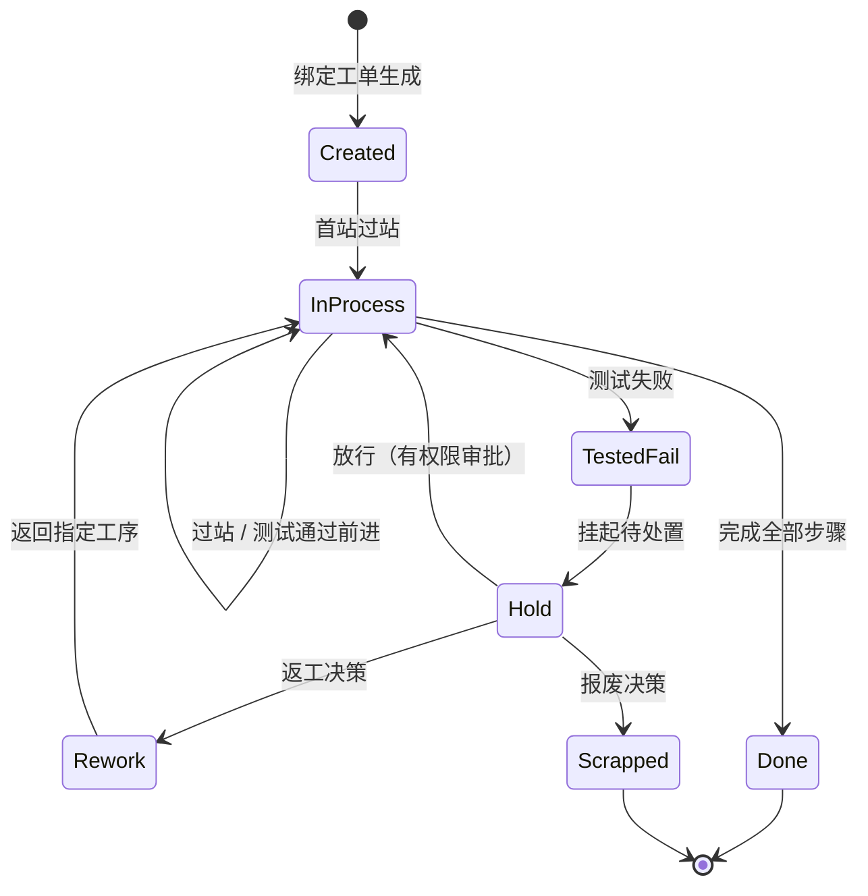

# 04.2 SN 生命周期状态机

> 所属篇章：04_WhatIsHappening 现在正在发生什么 ｜ 状态：⏳ 骨架（待填充）

## 本篇要回答的业务问题

- 一个 SN 从生成到终态有哪些状态？哪些流转是合法的？
- 测试 Pass / Fail 如何驱动状态变化？
- 返工后状态如何回退？终态有哪些（Done / Scrapped）？

## 1. 状态机总图

<!-- 待填充：对照 design.md §4.2（Created → InProcess → TestedPass / TestedFail → Rework / Scrapped → Done）；每个迁移的触发事件、执行角色、副作用 -->

## 2. 状态与事件的关系

<!-- 待填充 -->

- 原则：**状态是事件的结果**——每次状态迁移必须对应一条制造事件（05.1）
- 状态可由事件流重放推导（事件溯源思想）

## 3. 状态机不变量

<!-- 待填充 -->

- 失败品未处置（Hold 未闭环）不得继续过站（`MES-4002`，不可弱化）
- 状态只能沿合法迁移前进，不允许隐式回退
- 终态（Done / Scrapped）不可再变更，只能通过新事件追加（如售后场景）

## 4. 与处置状态模型的衔接

- Hold / Rework / Retest / Scrap 的完整处置流程见 [05.4](../05_WhatActuallyHappened_实际发生了什么/05.4_Hold_Rework_Retest_Scrap状态模型.md)

## 关联文档

- 上游：[04.1_WIP业务模型](04.1_WIP业务模型.md)
- 平行：[04.3_Operation执行状态机](04.3_Operation执行状态机.md)（父子状态机）
- 全景版：[08.3_MES全局状态模型](../08_MES业务全景/08.3_MES全局状态模型.md)
