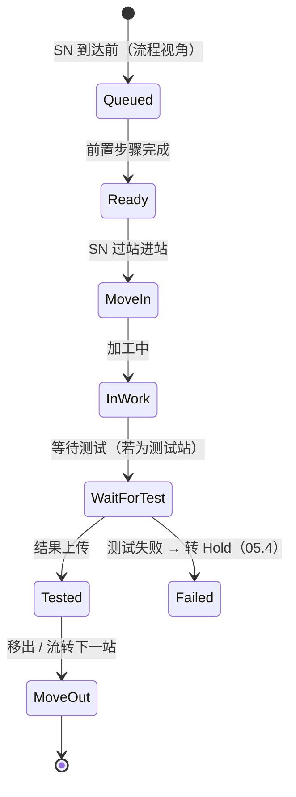

# 04.3 Operation 执行状态机

> 所属篇章：04_WhatIsHappening 现在正在发生什么 ｜ 状态：✅ 已完成

## 本篇要回答的业务问题

- 工序级执行状态（排队 → 开工 → 在制 → 待测 → 完成）如何流转？
- Operation 状态与 SN 状态如何联动（父子状态机协同）？
- MoveIn / MoveOut 与开工 / 完工的对应关系？

## 1. Operation 状态机

各状态语义：

| 状态 | 语义 | 谁把对象带入该状态 |
| --- | --- | --- |
| Queued | 流程视角的「未来步骤」——SN 还没走到 | 流程定义（隐含） |
| Ready | 前置步骤全部完成，本步骤可执行 | MES（前一步 MoveOut 后自动） |
| MoveIn | SN 扫码进站 | 操作员 |
| InWork | 工站在执行（装配 / 调试） | 操作员 |
| WaitForTest | 测试站已进站，等上位机结果 | 操作员（过站后） |
| Tested | 结果已上传，本步骤有结论 | 上位机 |
| MoveOut | 步骤闭环，流转下一站 | MES（Pass 后自动） |
| Failed | 测试失败，等待处置 | 上位机（Fail） |

**本仓库的简化映射**——过站（`station/pass`）即 **MoveIn + MoveOut 的合并动作**；测试步骤拆分为「过站（进站 MoveIn）+ 结果上传（Tested / Failed）」两步：

| 通用状态 | 本仓库映射 | 说明 |
| --- | --- | --- |
| Queued / Ready | `PendingStepSequence > CompletedStepSequence`（隐含于步骤序号） | 不实例化存储，由序号推导 |
| MoveIn + MoveOut | PassOnly 步骤：一次 `station/pass` 完成 | 过站即离开 |
| MoveIn | TestRequired 步骤：过站进测试站 | SN 处于「待测」 |
| Tested / Failed | `test-results` 上传后 `LastTestPassed` | Tested 后隐含 MoveOut（Pass）或转 Hold（Fail） |
| InWork | （未实例化） | 装配/调试过程暂不建模，如需工时分析再扩展 |

为什么可以简化？M1 的执行闭环只关心**两个决策点**：能不能进站（顺序与授权校验）、测试过没过（结果门控）。中间的 InWork 细分对这两个决策不增加信息——「先小后大」，待节拍分析、工时统计需求出现再实例化。

## 2. 父子状态机协同

- SerialUnit 状态机（04.2）是「纵向」全生命周期；Operation 状态机是「横向」单工序视角。
- 一个 SN × 一个 RouteStep = 一个 OperationInstance。SN 每前进一个步骤，就「结算」上一个 OperationInstance 并「创建」下一个（在本仓库的简化中，OperationInstance 不落库，由 TraceEvent + 步骤序号推导）。

协同规则示例：

| 事件 | Operation 层动作 | SN 层动作 | 工单层动作 |
| --- | --- | --- | --- |
| 过站成功（PassOnly） | 当前步骤 MoveOut，下一步骤 Ready | InProcess、步骤序号推进 | 首件过站 → InProgress |
| 测试结果 Pass | 当前步骤 Tested → MoveOut | InProcess（LastTestPassed=true）、步骤序号推进 | — |
| 测试结果 Fail | 当前步骤停在 Failed | TestedFail → Hold | — |
| 末步 MoveOut（Pass） | 最后 OperationInstance 完成 | **Done**（终态） | 全部 SN 终态 → Completed |
| 报废审批 | 当前步骤冻结于 Failed | Scrapped（终态） | ScrapQty + 1，全部 SN 终态时评估 Completed |

**协同的核心规则：状态迁移自下而上传播终局，自上而下传播冻结**——操作层的失败向上冻结 SN（Hold），SN 层的终态向上推动工单完成；反过来，工单暂停向下冻结所有 SN 的过站（若采用全面冻结语义，见 [02.1 §4](../02_WhatToDo_应该执行什么/02.1_生产订单模型.md)）。

## 3. 异常分支

- **Fail 后 Operation 停在 Failed**，等待处置指令（Hold → Release / Rework / Retest / Scrap，见 05.4）。Failed 不是一个「可自愈」的状态——没有质量决策，状态机不会前进。
- **返工重新激活同一步骤的实例**：Rework 决策指定返回步骤 k 后，步骤 k 的 OperationInstance 重新经历 Ready → MoveIn → …（生成新事件与测试记录；旧 Failed 实例保留在时间线上）。即：**同一 SN × 同一步骤可以有多个（历史）OperationInstance，按时间排列**——这也是为什么 OperationInstance 的唯一标识应含「执行轮次」或以事件序列隐式表达。

## 关联文档

- 上游：[02.2_Routing与Operation模型](../02_WhatToDo_应该执行什么/02.2_Routing与Operation模型.md)
- 平行：[04.2_SN生命周期状态机](04.2_SN生命周期状态机.md)
- 下游：[04.4_MoveIn到MoveOut时序图](04.4_MoveIn到MoveOut时序图.md)
