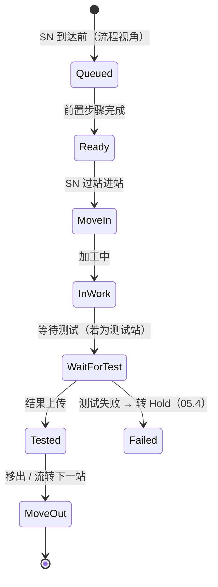

# 04.3 Operation 执行状态机

> 所属篇章：04_WhatIsHappening 现在正在发生什么 ｜ 状态：⏳ 骨架（待填充）

## 本篇要回答的业务问题

- 工序级执行状态（排队 → 开工 → 在制 → 待测 → 完成）如何流转？
- Operation 状态与 SN 状态如何联动（父子状态机协同）？
- MoveIn / MoveOut 与开工 / 完工的对应关系？

## 1. Operation 状态机

<!-- 待填充：本仓库的简化映射——过站（station/pass）即 MoveIn+MoveOut 的合并动作；测试步骤拆分为过站 + 结果上传两步 -->

## 2. 父子状态机协同

<!-- 待填充 -->

- SerialUnit 状态机（04.2）是「纵向」全生命周期；Operation 状态机是「横向」单工序视角
- 一个 SN × 一个 RouteStep = 一个 OperationInstance
- 协同规则示例：末步 Operation MoveOut → SN 进入 Done

## 3. 异常分支

<!-- 待填充：Fail 后 Operation 停在 Failed，等待处置指令；返工重新激活同一步骤的实例 -->

## 关联文档

- 上游：[02.2_Routing与Operation模型](../02_WhatToDo_应该执行什么/02.2_Routing与Operation模型.md)
- 平行：[04.2_SN生命周期状态机](04.2_SN生命周期状态机.md)
- 下游：[04.4_MoveIn到MoveOut时序图](04.4_MoveIn到MoveOut时序图.md)
