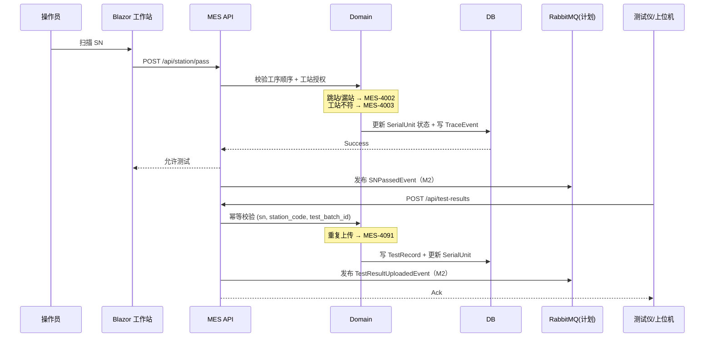

# 04.4 MoveIn 到 MoveOut 时序图

> 所属篇章：04_WhatIsHappening 现在正在发生什么 ｜ 状态：⏳ 骨架（待填充）

## 本篇要回答的业务问题

- 一次完整过站中，操作员 / 上位机 / MES / 数据库如何协作？
- 工序顺序与工站授权的校验发生在哪个时点？
- 测试结果上传的幂等校验时序是什么？重复上传如何被拦截？

## 1. 过站 + 测试上传时序图

<!-- 待填充：对照 design.md §5.1；标注 M1 已实现 / M2 计划的参与者 -->

## 2. 关键时序约束

<!-- 待填充 -->

- 测试结果上传前必须有同工站的过站记录（先过站后测试，不可绕过）
- 幂等键：业务唯一键 + 计划中的 Idempotency-Key Header
- 离线补传：按发生时间重排入库（设备不稳定假设）

## 3. 异常路径时序

<!-- 待填充：校验失败返回错误码的时序；网络超时重试（指数退避） -->

## 关联文档

- 上游：[04.3_Operation执行状态机](04.3_Operation执行状态机.md)
- 下游：[05.1_ManufacturingEvent制造事件](../05_WhatActuallyHappened_实际发生了什么/05.1_ManufacturingEvent制造事件.md)、[05.2_Expected与Actual模型](../05_WhatActuallyHappened_实际发生了什么/05.2_Expected与Actual模型.md)
- 实现参照：`design.md` §5.1 流程一
