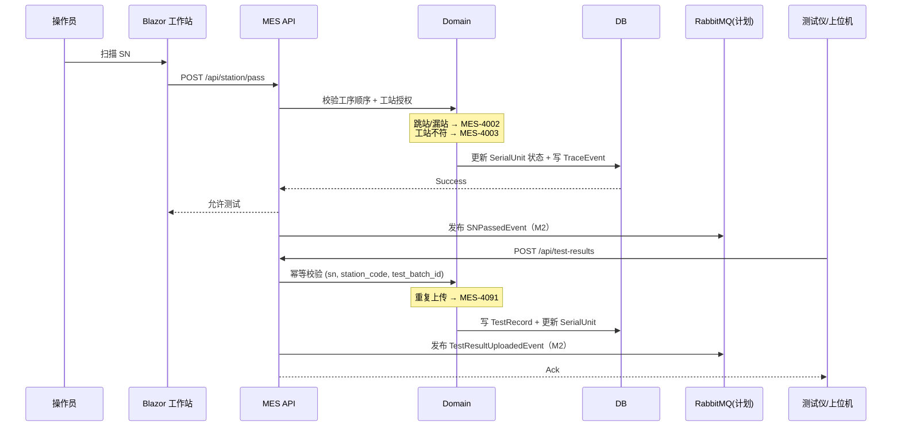
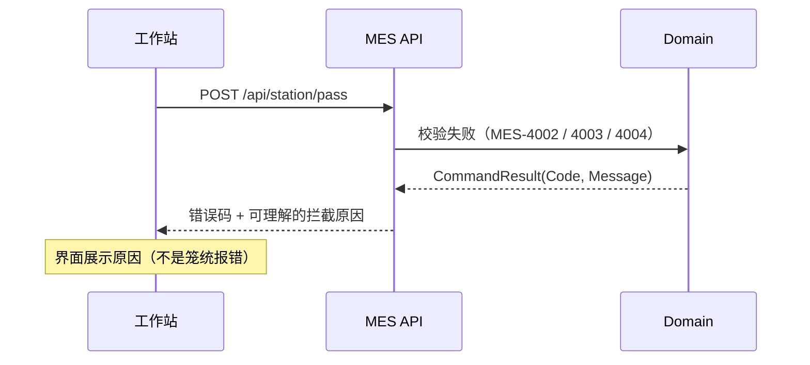
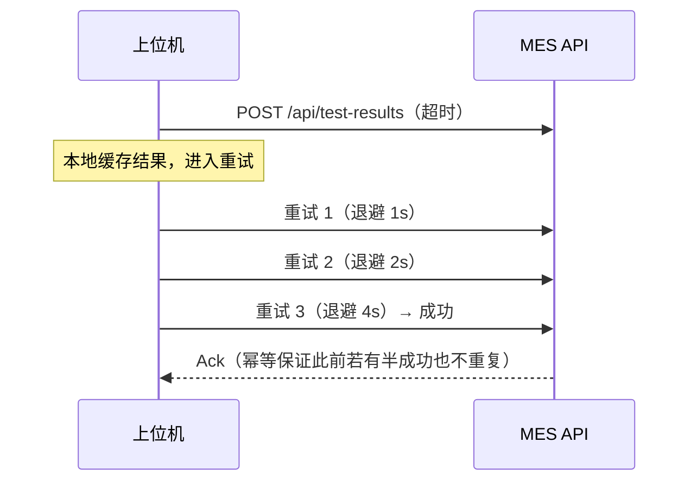

# 04.4 MoveIn 到 MoveOut 时序图

> 所属篇章：04_WhatIsHappening 现在正在发生什么 ｜ 状态：✅ 已完成

## 本篇要回答的业务问题

- 一次完整过站中，操作员 / 上位机 / MES / 数据库如何协作？
- 工序顺序与工站授权的校验发生在哪个时点？
- 测试结果上传的幂等校验时序是什么？重复上传如何被拦截？

## 1. 过站 + 测试上传时序图

对照 `design.md` §5.1，参与者实现状态：

| 参与者 | M1 现状 | 备注 |
| --- | --- | --- |
| 操作员 / Blazor 工作站 | ✅ 工站模拟前端 | `dotnet run --project src/frontend/MES.Web` |
| MES API / Domain | ✅ Minimal API + 内存仓储 | 事务边界随 EF Core 持久化补齐 |
| DB | ⏳ 内存 → PostgreSQL / SQL Server | 数据可信三件套之「事务」 |
| RabbitMQ | ⏳ M2 | 领域事件发布、死信队列 |
| 测试仪 / 上位机 | ✅ HTTP/REST 契约 | 幂等键 + 双轨载荷 + 补传 |

关键时点说明：

1. **校验发生在写库之前**——先 `DOM` 校验（4002/4003），通过才更新状态并写事件；校验失败直接返回错误码，**不产生任何数据副作用**。这是「约束先行」在时序上的落点。
2. **「允许测试」应答的含义**：过站成功 = 该 SN 在该站的执行上下文已建立（进站记录存在），后续上传结果才被接受。**先过站后测试**由此在时序上闭环。
3. **幂等校验发生在唯一索引/查重之后**：`(sn, station_code, test_batch_id)` 命中已有记录 → 直接返回 `MES-4091`，不重复计数。

## 2. 关键时序约束

- **测试结果上传前必须有同工站的过站记录（先过站后测试，不可绕过）**。上传时校验：SN 当前所在工站 = 上传工站 且 SN 处于待测状态；否则 `MES-4002`（SN 未进站）。
- **幂等键**：业务唯一键 `(sn, station_code, test_batch_id)` + 计划中的 `Idempotency-Key` Header（传输层重试去重）。两层幂等的关系：业务键防「同一测试重复入库」，传输键防「同一 HTTP 请求重复执行」——补传与网络重试都兜住。
- **离线补传：按发生时间重排入库（设备不稳定假设）**。补传数据带 `TestedAt`（发生时间），入库时：
  - 按 `TestedAt` 排入时间线（而非到达顺序）；
  - 若补传的测试早于 SN 后续步骤的过站时间——正常接受（时间线还原为「先测试后过站」），但**状态机以事件流重放为准**（04.2 §2）；
  - 补传使用与实时上传完全相同的幂等规则（防止「重试一次就重复一条」）。

## 3. 异常路径时序

**校验失败的时序**（同步返回，无副作用）：

- 拦截原因必须**业务可理解**（「该 SN 终测未通过、尚未处置」而非「Internal Error」）——`CommandResult`（Success / Code / Message）契约的由来（`AGENTS.md` API 约定）。

**网络超时重试的时序（指数退避）**：

- 应答三分类（`design.md` §5.1 流程一）：**成功 / 可重试失败（超时、5xx）/ 不可重试失败（4001 参数、4091 重复、4002 业务不匹配）**。上位机只对可重试失败重试，避免盲重试放大流量（`从MIMS到MES` §5.1-C「明确 Ack」）。

## 关联文档

- 上游：[04.3_Operation执行状态机](04.3_Operation执行状态机.md)
- 下游：[05.1_ManufacturingEvent制造事件](../05_WhatActuallyHappened_实际发生了什么/05.1_ManufacturingEvent制造事件.md)、[05.2_Expected与Actual模型](../05_WhatActuallyHappened_实际发生了什么/05.2_Expected与Actual模型.md)
- 实现参照：`design.md` §5.1 流程一
