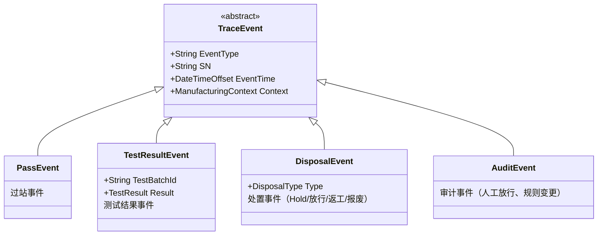

# 05.1 ManufacturingEvent 制造事件

> 所属篇章：05_WhatActuallyHappened 实际发生了什么 ｜ 状态：⏳ 骨架（待填充）

## 本篇要回答的业务问题

- 什么是制造事件？过站 / 测试 / 处置 / 放行如何统一为事件模型？
- 事件的结构是什么：类型、时间、主体（SN）、上下文（5M1E）、结果？
- 事件与状态变更、事件与追溯的关系？（事件溯源思想）

## 1. 事件分类学

<!-- 待填充：对照本项目 TraceEvent（事件类型、人员、设备、站点、时间、上下文）与 TestRecord 的分工 -->

## 2. 事件结构三要素

<!-- 待填充 -->

1. **事实（What）**：发生了什么、结果如何
2. **时间（When）**：事件时间 vs 记录时间（离线补传场景两者不同）
3. **上下文（Who/Where/WithWhat）**：5M1E 快照（03.4）

## 3. 事件溯源（Event Sourcing）思想

<!-- 待填充 -->

- 原则：事件是不可变事实，只追加不修改
- 状态 = 事件的累积结果；追溯时间线 = 事件的排序投影
- 对照「先记录、再约束、后分析」：M1 先把事件记全，约束与分析随后叠加

## 4. 事件与消息

<!-- 待填充：RabbitMQ 事件发布（计划中）；领域事件 vs 集成事件的区别 -->

## 关联文档

- 上游：[03.4_5M1E制造上下文模型](../03_WhoWhereWithWhat_谁在哪里用什么生产/03.4_5M1E制造上下文模型.md)、[04.2_SN生命周期状态机](../04_WhatIsHappening_现在正在发生什么/04.2_SN生命周期状态机.md)
- 平行：[05.2_Expected与Actual模型](05.2_Expected与Actual模型.md)
- 下游：[06.1_Traceability业务模型](../06_CanWeProveIt_能否证明/06.1_Traceability业务模型.md)
