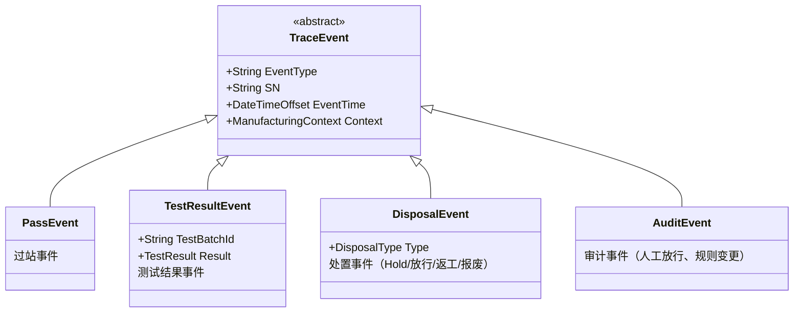
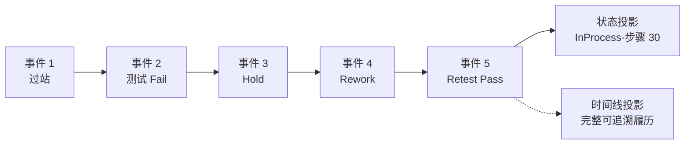

# 05.1 ManufacturingEvent 制造事件

> 所属篇章：05_WhatActuallyHappened 实际发生了什么 ｜ 状态：✅ 已完成

## 本篇要回答的业务问题

- 什么是制造事件？过站 / 测试 / 处置 / 放行如何统一为事件模型？
- 事件的结构是什么：类型、时间、主体（SN）、上下文（5M1E）、结果？
- 事件与状态变更、事件与追溯的关系？（事件溯源思想）

## 1. 事件分类学

| 事件类型 | 记录什么 | 谁产生 | 本仓库落点 |
| --- | --- | --- | --- |
| PassEvent 过站 | SN 在某工站的经过 | 操作员扫码 | `TraceEvent`（EventType=过站） |
| TestResultEvent 测试结果 | 测试结论 + 指标 + 原始报文 | 上位机上传 | `TestRecord`（专表）+ `TraceEvent`（时间线锚点） |
| DisposalEvent 处置 | Hold / 放行 / 返工 / 报废决策 | 质量工程师 | ⏳ 处置工作流（M2） |
| AuditEvent 审计 | 手动放行、工单状态变更、规则变更 | 各角色（敏感操作） | ⏳ 审计日志（`design.md` §9.3） |

**本项目 `TraceEvent` 与 `TestRecord` 的分工**：`TraceEvent` 是时间线的「索引层」——轻量、统一结构（SN、EventType、StationCode、OperatorId、OccurredAt、Message），任何事件都进时间线；`TestRecord` 是测试事实的「详情层」——重量、专表（幂等三元组、Metrics、RawPayload）。时间线查「发生了什么」，详情表查「具体数据是什么」；两层通过 `(Sn, StationCode, 时间邻近)` 关联。这个分工让追溯查询先走轻量索引，按需下钻详情。

## 2. 事件结构三要素

1. **事实（What）**：发生了什么、结果如何——事件类型 + 结果字段（Pass/Fail、处置类型）。
2. **时间（When）**：**事件时间（OccurredAt / TestedAt）vs 记录时间**——离线补传场景两者不同（`MES系统概览学习.md` §4 快照与双时间）。缺了这对双时间，补传数据会「伪装」成迟到时刻发生的事。
3. **上下文（Who / Where / WithWhat）**：5M1E 快照（03.4）——人（OperatorId）、地点（StationCode）、设备与程序版本（随 M2 扩展）。

三要素齐全，事件才能独立成为证据；缺任何一项，事件只是「日志」。

## 3. 事件溯源（Event Sourcing）思想

- **原则：事件是不可变事实，只追加不修改**。发现错误时通过**补偿事件**（correction / disposal）修正业务结论，原始事件保留（`从MIMS到MES` §6.1：事实层不可被「改写历史」糊弄——纠错通过补偿事件，而不是静默覆盖）。
- **状态 = 事件的累积结果**：`SerialUnit.Status` 可由事件流重放推导（04.2 §2）；
- **追溯时间线 = 事件的排序投影**：`GET /api/traceability/{sn}` 本质是「按 OccurredAt 排序的事件流 + 详情关联」。

- 对照「先记录、再约束、后分析」：M1 先把事件记全（过站事件 + 测试记录已实现），约束与分析随后叠加——事件流是三者共同的地基：约束需要它校验前置条件，分析需要它做数据源。

## 4. 事件与消息

- **RabbitMQ 事件发布（M2 计划）**：过站 / 测试上传成功后发布领域事件（`SNPassedEvent`、`TestResultUploadedEvent`），供 SPC、看板、告警等下游消费（`design.md` §5.1）。
- **领域事件 vs 集成事件的区别**：

| 维度 | 领域事件（Domain Event） | 集成事件（Integration Event） |
| --- | --- | --- |
| 消费者 | 同进程内（跨聚合解耦） | 跨系统（SPC 服务、未来 ERP 通知） |
| 传输 | 进程内总线 / 内存 | RabbitMQ（带死信队列兜底） |
| 语义 | 「聚合内发生了 X」 | 「向外界宣布 X」 |
| 可靠性要求 | 随业务事务 | 至少一次投递 + 消费端幂等 |

- 原则：**消息是事件的传播方式，不是事件本身**。事实先落库（TraceEvent / TestRecord），消息只是把「已发生」广播出去——即使 MQ 故障，事实不丢（这是「先记录」对消息可靠性的降维解放：分析层可重放）。

## 关联文档

- 上游：[03.4_5M1E制造上下文模型](../03_WhoWhereWithWhat_谁在哪里用什么生产/03.4_5M1E制造上下文模型.md)、[04.2_SN生命周期状态机](../04_WhatIsHappening_现在正在发生什么/04.2_SN生命周期状态机.md)
- 平行：[05.2_Expected与Actual模型](05.2_Expected与Actual模型.md)
- 下游：[06.1_Traceability业务模型](../06_CanWeProveIt_能否证明/06.1_Traceability业务模型.md)
