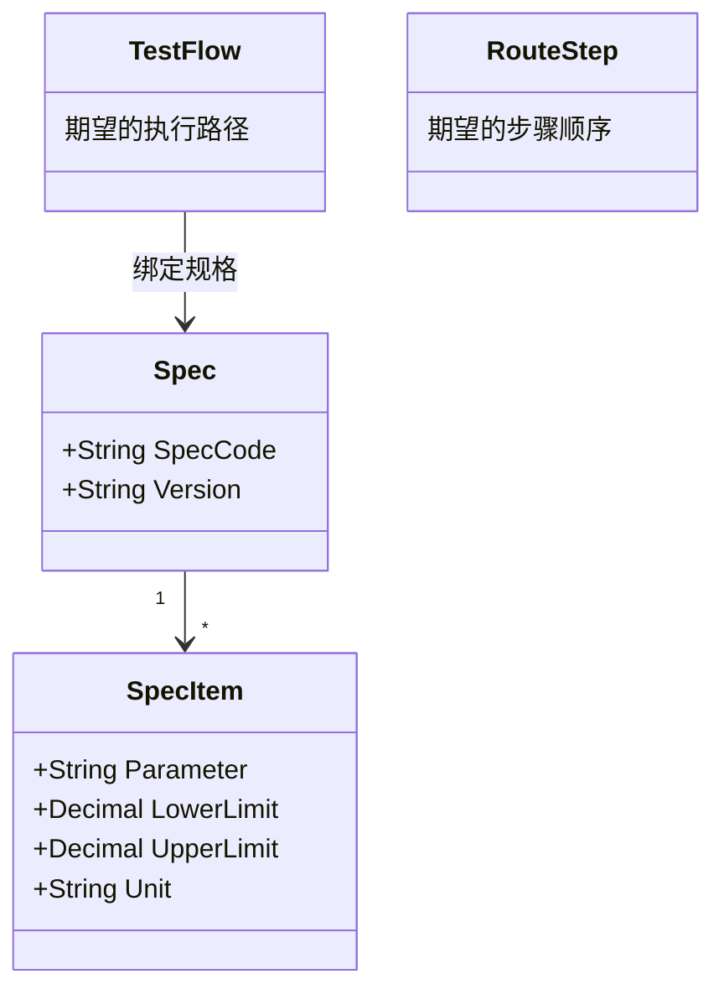
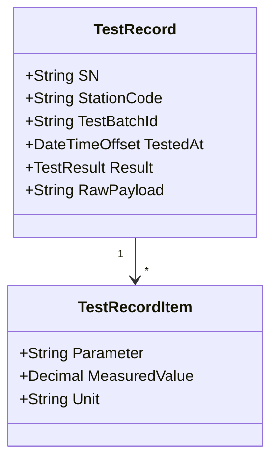

# 05.2 Expected 与 Actual 模型

> 所属篇章：05_WhatActuallyHappened 实际发生了什么 ｜ 状态：⏳ 骨架（待填充）

## 本篇要回答的业务问题

- 「应该是什么」（Expected：路线、规格、上下限）与「实际是什么」（Actual：实测值、实际路径）如何成对建模？
- 规格 Specification（参数 / 上下限 / 单位）如何定义与版本化？
- 判定逻辑（In / Out of Spec）应该放在哪一层执行？

## 1. Expected：计划与规格

<!-- 待填充：规格与 TestTemplate（03.3）的关系；规格版本与流程版本如何同步 -->

## 2. Actual：实测与实际路径

<!-- 待填充：原始报文（RawPayload）保留的必要性——判定规则可能变化，需可重判 -->

## 3. 判定模型

<!-- 待填充 -->

- 判定输入：SpecItem（上下限） × TestRecordItem（实测值）
- 判定输出：Pass / Fail / Conditional（让步接收）
- 判定层级：设备侧初判 + MES 侧终判；以 MES 判定为准（Domain 层规则）
- 幂等：`TestRecord` 以 `(sn, station_code, test_batch_id)` 唯一，重复上传 → `MES-4091`

## 4. 期望与实际的偏差分析

<!-- 待填充：参数趋势（SPC 的数据基础，design.md §5.3）；路径偏差（实际过站 vs 计划路线） -->

## 关联文档

- 上游：[05.1_ManufacturingEvent制造事件](05.1_ManufacturingEvent制造事件.md)、[02.2_Routing与Operation模型](../02_WhatToDo_应该执行什么/02.2_Routing与Operation模型.md)
- 下游：[05.3_质量与异常业务模型](05.3_质量与异常业务模型.md)
- 实现参照：`TestRecord` + `POST /api/test-results`（AGENTS.md API 表）
