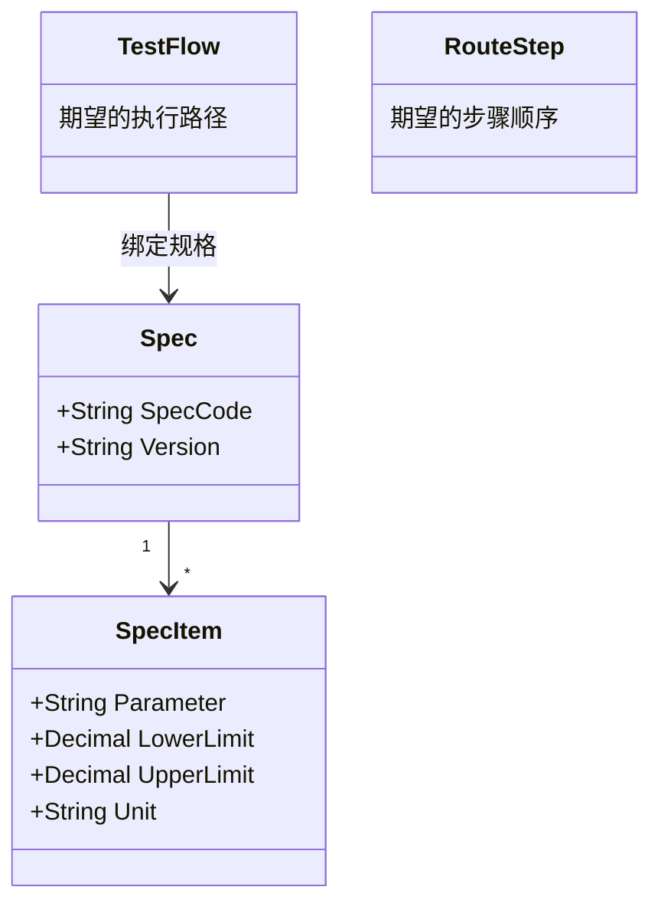
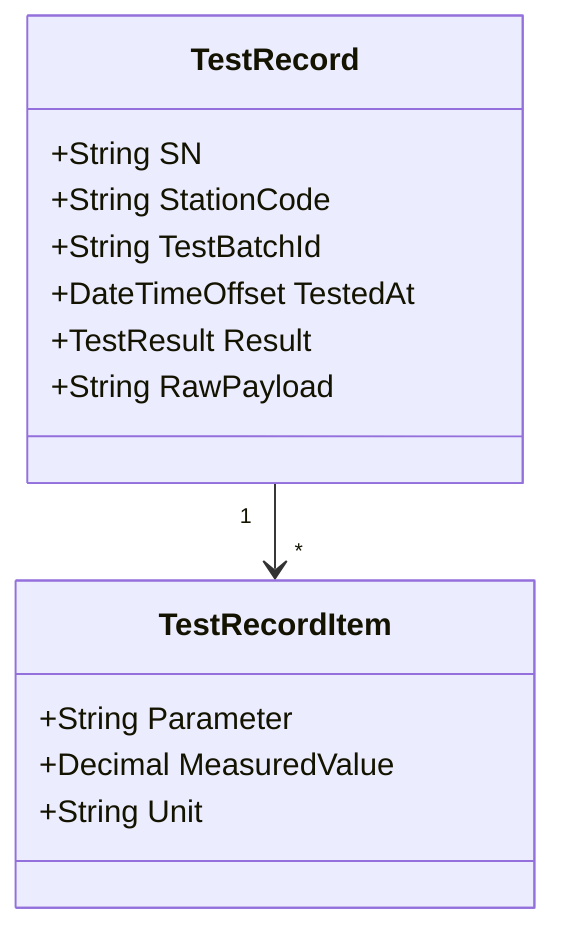
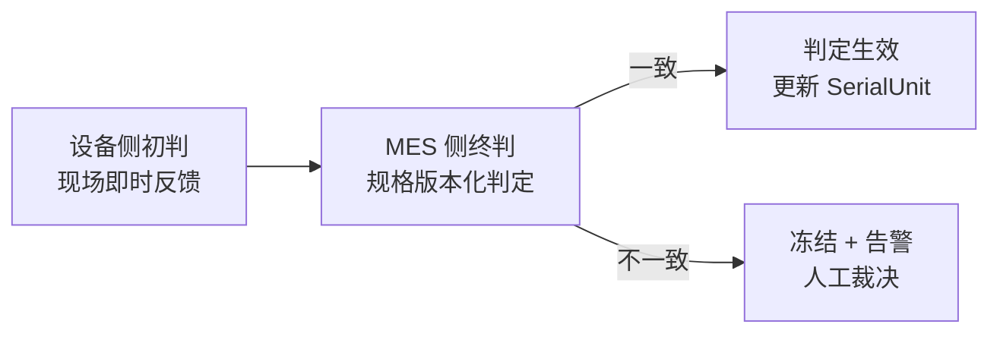

# 05.2 Expected 与 Actual 模型

> 所属篇章：05_WhatActuallyHappened 实际发生了什么 ｜ 状态：✅ 已完成

## 本篇要回答的业务问题

- 「应该是什么」（Expected：路线、规格、上下限）与「实际是什么」（Actual：实测值、实际路径）如何成对建模？
- 规格 Specification（参数 / 上下限 / 单位）如何定义与版本化？
- 判定逻辑（In / Out of Spec）应该放在哪一层执行？

## 1. Expected：计划与规格

Expected 的两个层面：

| 层面 | 模型 | 回答 |
| --- | --- | --- |
| 期望路径 | TestFlow / RouteStep | 这件产品应该按什么顺序经过哪些站 |
| 期望数值 | Spec / SpecItem | 每个参数应该在什么范围内 |

- **规格与 TestTemplate（03.3）的关系**：TestTemplate 定义「怎么测」（程序、条件、顺序——设备侧视角）；Spec 定义「怎么判」（上下限——质量侧视角）。两者是设备能力与质量要求的分界，一个测试模板可能配套多版规格（规格收紧不换程序）。
- **规格版本与流程版本如何同步**：独立版本化（SpecVersion 与 TestFlowVersion 各自演进），**在工单 / 事件层面绑定对**——即测试记录同时保存「流程版本 + 规格版本」引用，判定按事件当时的版本解释（快照原则，03.4）。禁止「改规格后重新判定历史测试」。

## 2. Actual：实测与实际路径

- 实际路径：SN 真实走过的站序（TraceEvent 流水）——与期望路径的偏差即「路径偏差」（漏站、跳站、返工绕行）。
- **原始报文（RawPayload）保留的必要性——判定规则可能变化，需可重判**：
  - 规格版本升级后，可用原始 Metrics 按新规格**重新评估**（评估影响范围，而非改写历史判定，见 §3）；
  - 客户审核时出示仪器原始输出，排除「解析环节出错」的质疑；
  - 排查「上位机解析 Bug 导致数值错误」时唯一的还原手段。
  - 落地方式（本仓库）：`TestRecord.Metrics`（结构化，查询判定用）+ `RawPayload`（原始报文，复核用）**双轨并存**（`从MIMS到MES` §5.1-C）。

## 3. 判定模型

- **判定输入**：SpecItem（上下限）× TestRecordItem（实测值）。
- **判定输出**：Pass / Fail / Conditional（让步接收——需审批，不是「软 Pass」）。
- **判定层级：设备侧初判 + MES 侧终判；以 MES 判定为准（Domain 层规则）**：

  设备判定的价值是**即时性**（毫秒级反馈给操作员），MES 判定的价值是**权威性**（按发布规格、可解释、可重演）。两者不一致时（`MES系统概览学习.md` §5 的边界问题 4）：冻结该结果、告警、由质量人员裁决——不允许静默取其一。
- **幂等**：`TestRecord` 以 `(sn, station_code, test_batch_id)` 唯一，重复上传 → `MES-4091`。这是判定的**计数底线**：判定可以晚到、可以重评，但不能重复生效。
- 规格版本变化后的处理原则：**不悄悄用新规格改写历史测试的判定依据**（`MES系统概览学习.md` §5）。历史记录保持原判定；重评结果作为新事件追加（如「按 Spec v2 复评：影响 3 台」），决策与证据分离。

## 4. 期望与实际的偏差分析

期望与实际的「差」就是质量与效率改进的全部原料：

| 偏差类型 | 比较 | 产出 | 模型支撑 |
| --- | --- | --- | --- |
| **参数偏差** | SpecItem 限值 vs Metrics 实测值 | 超差品（Fail）、临界品（趋势预警） | TestRecord + Spec |
| **参数趋势** | 历史实测分布 vs 控制限 | SPC 越界告警、漂移预警（M2） | TestRecord 时序 + SpcRule |
| **路径偏差** | TestFlow 期望路径 vs 实际过站序列 | 跳站 / 漏站 / 重复过站异常清单 | TraceEvent 流水 vs RouteStep 序列 |

- 参数趋势是 **SPC 的数据基础**（`design.md` §5.3：统计周期按小时/班次；指标为良率、一次通过率、关键参数均值与波动）——SPC 本质上是「Expected（控制限）对 Actual（实测序列）的持续比较」。
- 路径偏差的典型查询：「找出所有未按流程顺序过站的 SN」——即事件流重放与流程定义的 diff；这是审计与流程治理（M2 防跳站门控）的验证手段。

## 关联文档

- 上游：[05.1_ManufacturingEvent制造事件](05.1_ManufacturingEvent制造事件.md)、[02.2_Routing与Operation模型](../02_WhatToDo_应该执行什么/02.2_Routing与Operation模型.md)
- 下游：[05.3_质量与异常业务模型](05.3_质量与异常业务模型.md)
- 实现参照：`TestRecord` + `POST /api/test-results`（AGENTS.md API 表）
