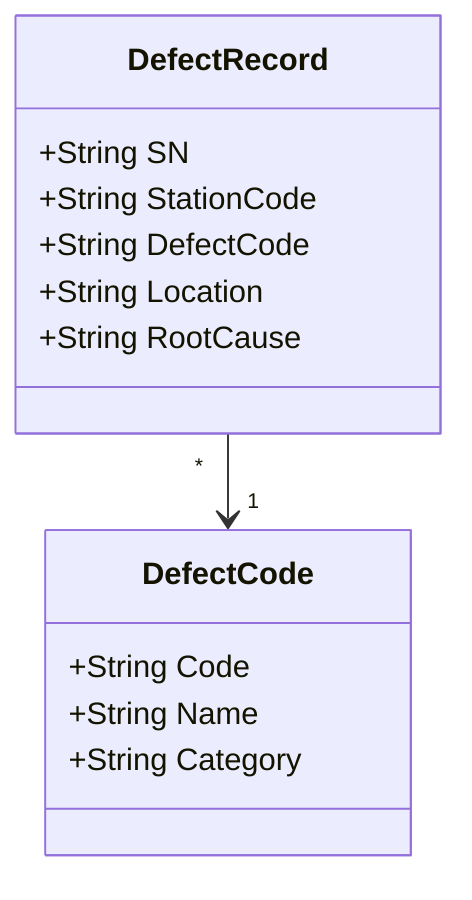
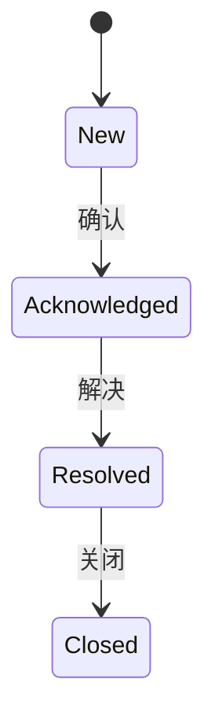
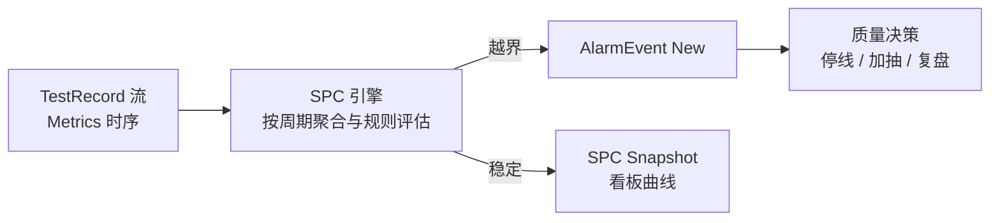

# 05.3 质量与异常业务模型

> 所属篇章：05_WhatActuallyHappened 实际发生了什么 ｜ 状态：✅ 已完成

## 本篇要回答的业务问题

- 质量结果（Pass / Fail）与不良代码（DefectCode）如何建模？
- 异常 NC（Non-Conformance）与告警 AlarmEvent 的区别是什么？
- SPC 与质量数据是什么关系？（越界 → 告警 → 停线决策）

## 1. 质量结果模型

- 结果层级：**TestRecord 级（单参数 / 单批次）→ SN 级（综合判定）→ 工单级（统计）**：

| 层级 | 判定对象 | 判定规则 | 用途 |
| --- | --- | --- | --- |
| TestRecord 级 | 一次测试（或其中某参数） | SpecItem 限值 | 单次事实，追溯明细 |
| SN 级 | 一件产品 | 当前步骤测试结论（`LastTestPassed`） | 过站门控（04.2） |
| 工单级 | 一批产品 | 完工数 / 投产数等统计口径 | 良率、FPY 报表 |

- 结果类型：Pass / Fail / **Conditional（让步，需审批）**——Conditional 不是「软 Pass」：它是带审批记录的例外决策（谁、为什么、影响评估），在时间线上独立可见。让步接收的产品在客诉复盘时是重点检查对象（「当时为什么放行」）。

## 2. 不良与缺陷

- **不良代码体系（按产品族维护）**：分类维度建议「站别 × 失效模式 × 责任部门」三轴，例如光通信 VOA：
  - 站别：组装 / 调试 / 终测 / 外观；
  - 失效模式：插损超标（IL-HIGH）、回损不良（RL-LOW）、衰减精度漂移（ATT-DRIFT）、通道串扰（XTALK）、外观划伤（SCRATCH）；
  - 编码格式建议：`{站别缩写}-{失效模式}`，如 `FT-IL-HIGH`（终测-插损超标）。
- **缺陷位置（位号 / 通道）**：`DefectRecord.Location` 与 BOM 位号共用一套位置编码（[01.2 §2](../01_What_应该生产什么/01.2_BOM与物料模型.md)）——「4 通道产品只有 CH2 插损超标」这种模式只有靠位置编码才能从统计上显形（定位到该位置的物料批次 / 装配工位）。
- **原因分类**：RootCause 分层记录（现象 → 直接原因 → 根本原因），是帕累托分析（Top 不良）与 CAPA 的数据入口。

## 3. NC 异常与 CAPA

- **NC（Non-Conformance，不合格）单**：面向「问题」的闭环工作流——发现 → 分析（根因）→ 处置（纠正）→ 验证 → 关闭。
- **与单件处置（05.4）的关系——NC 面向问题，处置面向实物**：

| 维度 | NC 异常单 | SN 处置（05.4） |
| --- | --- | --- |
| 对象 | 一个质量问题（可能是批次性的） | 一件具体产品 |
| 回答 | 为什么会发生？怎么防止再发？ | 这件产品怎么处理？ |
| 生命周期 | 发现 → 分析 → 纠正 → 验证 → 关闭 | Hold → Release / Rework / Retest / Scrap |
| 关联 | 一个 NC 可关联多个 SN 的处置 | 一个 SN 的处置可关联一个 NC |

典型场景：终测连续 Fail → 开 NC 单分析（根因：某批次准直器来料不良）→ NC 纪录「纠正措施」→ 受影响 SN 各自走处置（Rework 换料）。**实物处理与问题解决分离，但通过 NC 编号互链**——客诉时既能回答「这件怎么处理的」，也能回答「这个问题后来根治了吗」。

- **CAPA（Corrective and Preventive Action，纠正预防措施）**：NC 的后续延伸——纠正（Corrective，消除已发生问题的措施：换料、返工）+ 预防（Preventive，消除再发原因的措施：加 IQC 抽检、修改工艺参数）。CAPA 记录措施、责任人、验证结果，是质量体系审核的标配。

## 4. 告警模型

对照 `AlarmEvent`（级别、来源、内容、确认状态、处理人）：

| 属性 | 说明 |
| --- | --- |
| 级别 | 信息 / 警告 / 严重（严重级推送到看板与责任人） |
| 来源 | SPC 越界 / 连续失败 / 设备异常 / 数据完整性异常 |
| 内容 | 什么指标、什么工站、何时、越界幅度 |
| 确认状态 | New → Acknowledged → Resolved → Closed（`design.md` §4.2） |
| 处理人 | 谁确认、谁解决（责任闭环） |

告警状态机的价值：**告警不允许被静默丢弃**——New 状态的告警必须有人 Acknowledged 才能推进；这保证「系统发现了问题」必然转化为「有人处理了问题」。

## 5. SPC 模型

对照 `SpcRule`（指标名、控制上下限、告警策略）与 `design.md` §5.3：

| 要素 | 说明 | 本仓库落点 |
| --- | --- | --- |
| 监控对象 | 指标（Metrics 中的参数名）——**指标字典治理是前提**（[01.3 INV-6](../01_What_应该生产什么/01.3_产品定义UML类图.md)） | `SpcRule.MetricName` |
| 控制限 | 控制上限 / 下限（UCL / LCL——注意与规格限 USL/LSL 区分：规格限判个体合格，控制限判过程稳定） | `SpcRule` 字段 |
| 统计周期 | 按小时 / 班次聚合 | M2 汇总任务 |
| 告警策略 | 越限规则（首期阈值型：超出控制限；后续 Western Electric 规则：连续偏移、趋势） | `SpcRule.AlarmPolicy` |

SPC 与质量数据的关系——**SPC 消费 TestRecord 流，输出 AlarmEvent**：

- 「越界 → 告警 → 停线决策」：SPC 告警本身不停线——**停线是人的决策**（质量工程师 Acknowledged 后判断影响范围，决定停线/加抽/继续）。MES 的职责是让决策「快且有据」（告警即达 + 一键下钻受影响 SN 列表）。M2 首期先做阈值告警（`design.md` §7.1），复杂规则引擎后置。
- 关键口径：良率、一次通过率的分母必须先约定（`MES系统概览学习.md` §9）——统计口径分歧是看板「没人信」的第一原因。

## 关联文档

- 上游：[05.2_Expected与Actual模型](05.2_Expected与Actual模型.md)
- 下游：[05.4_Hold_Rework_Retest_Scrap状态模型](05.4_Hold_Rework_Retest_Scrap状态模型.md)
- 案例参照：[07.3_异常与质量案例](../07_综合案例/07.3_异常与质量案例.md)
- 实现参照：`AlarmEvent` / `SpcRule`（design.md §4.1）
