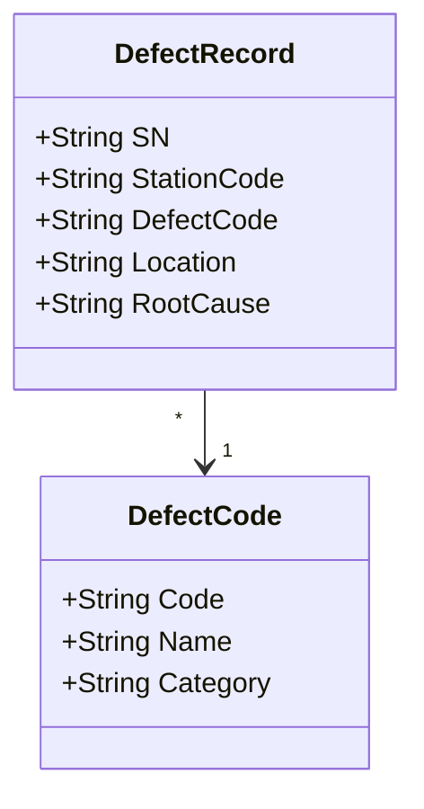
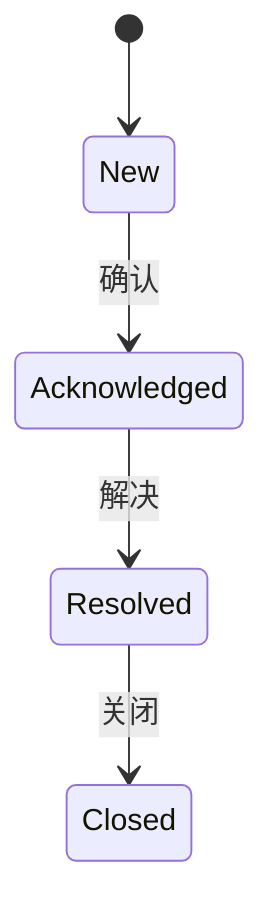

# 05.3 质量与异常业务模型

> 所属篇章：05_WhatActuallyHappened 实际发生了什么 ｜ 状态：⏳ 骨架（待填充）

## 本篇要回答的业务问题

- 质量结果（Pass / Fail）与不良代码（DefectCode）如何建模？
- 异常 NC（Non-Conformance）与告警 AlarmEvent 的区别是什么？
- SPC 与质量数据是什么关系？（越界 → 告警 → 停线决策）

## 1. 质量结果模型

<!-- 待填充 -->

- 结果层级：TestRecord 级（单参数 / 单批次）→ SN 级（综合判定）→ 工单级（统计）
- 结果类型：Pass / Fail / Conditional（让步，需审批）

## 2. 不良与缺陷

<!-- 待填充：不良代码体系（按产品族维护）；缺陷位置（位号 / 通道）；原因分类 -->

## 3. NC 异常与 CAPA

<!-- 待填充：NC 单（发现 → 分析 → 处置 → 关闭）；与单件处置（05.4）的关系——NC 面向问题，处置面向实物；CAPA 纠正预防措施 -->

## 4. 告警模型

<!-- 待填充：对照 AlarmEvent（级别、来源、内容、确认状态、处理人）；来源：SPC 越界 / 连续失败 / 设备异常 -->

## 5. SPC 模型

<!-- 待填充：对照 SpcRule（指标名、控制上下限、告警策略）；统计周期（小时 / 班次）；指标（良率、FPY、参数均值与波动） -->

## 关联文档

- 上游：[05.2_Expected与Actual模型](05.2_Expected与Actual模型.md)
- 下游：[05.4_Hold_Rework_Retest_Scrap状态模型](05.4_Hold_Rework_Retest_Scrap状态模型.md)
- 案例参照：[07.3_异常与质量案例](../07_综合案例/07.3_异常与质量案例.md)
- 实现参照：`AlarmEvent` / `SpcRule`（design.md §4.1）
