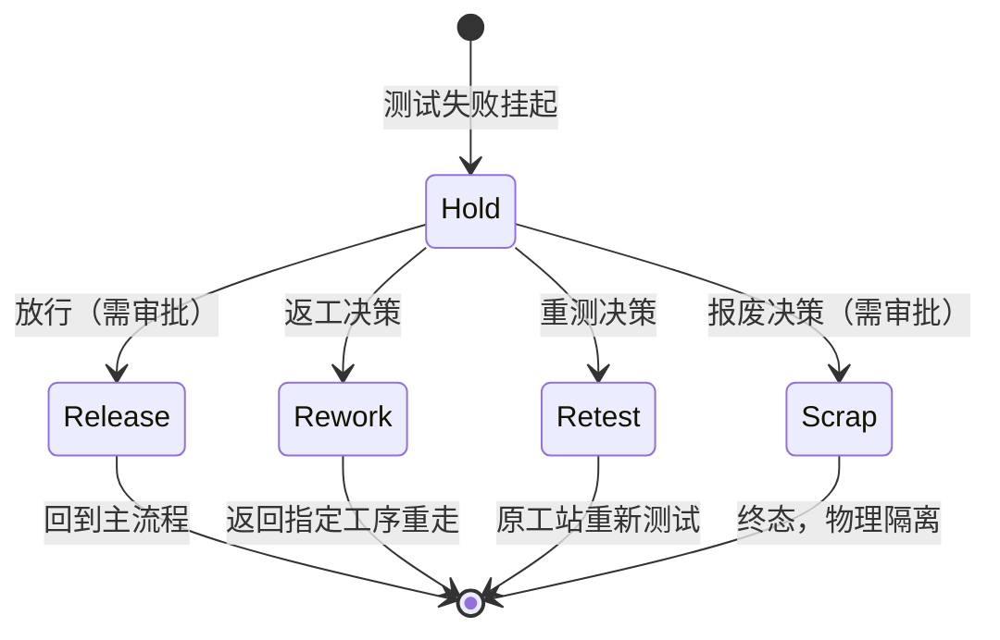

# 05.4 Hold / Rework / Retest / Scrap 状态模型

> 所属篇章：05_WhatActuallyHappened 实际发生了什么 ｜ 状态：⏳ 骨架（待填充）

## 本篇要回答的业务问题

- 测试失败品的处置路径如何建模？四种处置（Hold / Rework / Retest / Scrap）的边界？
- Hold → 放行 / 返工 / 报废，谁有权决定？（审批与电子签名）
- 返工返回哪道工序？重测在哪个工站？处置后状态如何恢复？
- 处置过程本身如何被追溯？（处置也是事件）

## 1. 处置状态机

<!-- 待填充：对照 04.2 SN 状态机中 TestedFail → Hold → Rework/Scrapped 分支的关系 -->

## 2. 处置类型对比

| 处置 | 触发 | 语义 | 对流程的影响 |
| --- | --- | --- | --- |
| Hold 挂起 | 测试失败 / 人工怀疑 | 冻结流转 | 拦截后续过站（`MES-4002`） |
| Release 放行 | 质量工程决策 | 让步接收 | 回到主流程继续 |
| Rework 返工 | 可修复缺陷 | 回退指定工序 | CompletedStepNo 回退，重走后续步骤 |
| Retest 重测 | 疑似误判 | 原地重测 | 不回退步骤，生成新 TestRecord（新批次） |
| Scrap 报废 | 不可修复 | 终态 | 物理隔离 + 审计 |

<!-- 待填充：每种的详细规则 -->

## 3. 审批与电子签名

<!-- 待填充：放行 / 报废必须记录：审批人、时间、理由（对照「谁批准的？」）；审计事件 AuditEvent；RBAC 权限门控 -->

## 4. 处置与追溯

<!-- 待填充 -->

- 每次处置动作生成 DisposalEvent，进入 SN 时间线（06.1）
- 追溯问题对照：「返修过没有？谁批准的？」
- 返工历史在追溯视图中必须可见（不可覆盖原始失败记录）

## 5. 与本仓库约束的对照

- 「失败品未处置」拦截过站 → `MES-4002`（**不可删除或弱化**，AGENTS.md Things to Avoid）
- 手动放行需审计日志（实现鉴权后落地）

## 关联文档

- 上游：[04.2_SN生命周期状态机](../04_WhatIsHappening_现在正在发生什么/04.2_SN生命周期状态机.md)、[05.3_质量与异常业务模型](05.3_质量与异常业务模型.md)
- 下游：[06.1_Traceability业务模型](../06_CanWeProveIt_能否证明/06.1_Traceability业务模型.md)
- 案例参照：[07.3_异常与质量案例](../07_综合案例/07.3_异常与质量案例.md)
