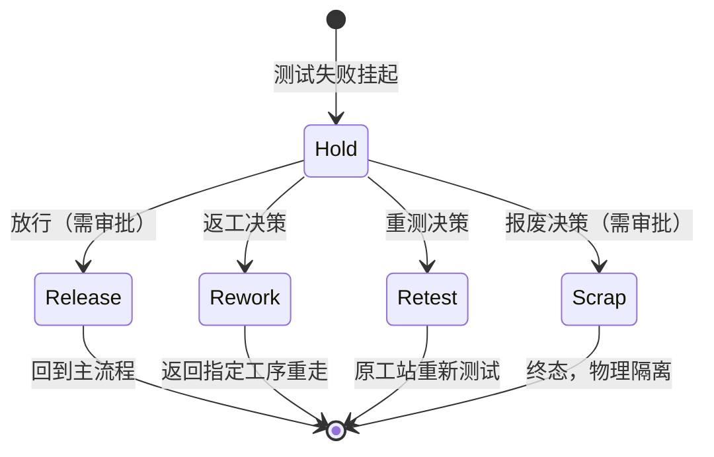

# 05.4 Hold / Rework / Retest / Scrap 状态模型

> 所属篇章：05_WhatActuallyHappened 实际发生了什么 ｜ 状态：✅ 已完成

## 本篇要回答的业务问题

- 测试失败品的处置路径如何建模？四种处置（Hold / Rework / Retest / Scrap）的边界？
- Hold → 放行 / 返工 / 报废，谁有权决定？（审批与电子签名）
- 返工返回哪道工序？重测在哪个工站？处置后状态如何恢复？
- 处置过程本身如何被追溯？（处置也是事件）

## 1. 处置状态机



与 [04.2 SN 状态机](../04_WhatIsHappening_现在正在发生什么/04.2_SN生命周期状态机.md) 的关系：04.2 是 SN 全生命周期的纵向视角（`TestedFail → Hold → Rework/Scrapped` 分支嵌在主状态机中）；本篇把「失败处置」展开为独立的横向子状态机——一次失败从 Hold 开始、以四种出口之一结束，每个出口对 SN 主状态机的影响不同。**SN 一生可嵌套多次处置循环**，每次循环是时间线上独立的一段。

## 2. 处置类型对比

| 处置 | 触发 | 语义 | 对流程的影响 |
| --- | --- | --- | --- |
| Hold 挂起 | 测试失败 / 人工怀疑 | 冻结流转 | 拦截后续过站（`MES-4002`） |
| Release 放行 | 质量工程决策 | 让步接收 | 回到主流程继续 |
| Rework 返工 | 可修复缺陷 | 回退指定工序 | CompletedStepNo 回退，重走后续步骤 |
| Retest 重测 | 疑似误判 | 原地重测 | 不回退步骤，生成新 TestRecord（新批次） |
| Scrap 报废 | 不可修复 | 终态 | 物理隔离 + 审计 |

每种处置的详细规则：

- **Hold**：冻结一切过站（不区分下一站是哪站）；等待质量决策，无超时自愈——**系统不得自动放行**，超时只产生提醒（告警）。挂起期间 SN 物理上应在隔离区（如红框料车），系统状态与物理状态由处置 SOP 对齐。
- **Release（放行）**：判定「失败不影响交付」或「误判已确认」。**原失败记录不删除**——放行是叠加事件（审批人 + 理由 + 时间），SN 时间线上「Fail → 放行」永远可见。放行后 SN 回到主流程，从被拦截的步骤继续。
- **Rework（返工）**：修复动作需要回到**指定工序**重做。规则三要素：返回到哪步（处置决策指定，通常在失败站之前的可修复步骤，如调试）、哪些步骤需重走（从返回点到失败点的所有 TestRequired 步骤必须重测——防止「换料后只重测不重调」）、换料事实（换上去的子件/批次记入谱系，06.2）。返工次数建议设上限（如同一 SN 最多 2 次返工），超过强制报废评估——无限返工的产品可靠性存疑。
- **Retest（重测）**：不改产品、不回退步骤，**原工站重新测试**。必须使用**新的 TestBatchId**（旧批次已消费，幂等键保证同一批次不可重复写入）；首次失败与重测结果都保留——「最终合格」与「一次通过」是不同的质量事实（FPY vs 最终良率的区别来源）。
- **Scrap（报废）**：终态。物理隔离（不得流入良品流）+ 审批 + 报废原因。工单数量模型中 ScrapQty+1（02.1 §3）。报废件建议保留 SN 记录（含报废原因）——它是「这批料为什么报废了」的分析数据，且防止报废 SN 被重新投入使用。

## 3. 审批与电子签名

放行 / 报废必须记录（对照「谁批准的？」）：

```text
DisposalEvent = 处置类型 + SN + 决策人（鉴权注入，不可前端传值）+ 时间 + 理由 + （关联 NC 单号）
```

- 审批权限门控（RBAC）：Release / Scrap 仅 QualityEngineer（或更高）角色可执行；Rework / Retest 可由 TestEngineer 提议、质量确认（按工厂权责约定）。
- 手动放行是审计重点（`design.md` §9.3 操作审计清单：工单状态变更、手动放行、规则变更）——实现鉴权后，每次放行/报废自动写审计日志（AuditEvent）。
- 电子签名的强化（03.2 §4）：关键处置要求二次确认身份。**没有审批人的放行记录 = 无效放行**，追溯时视为断链。

## 4. 处置与追溯

- 每次处置动作生成 DisposalEvent，进入 SN 时间线（06.1）——**处置是事件，不是状态标签**。时间线上能看到：什么时候 Fail、什么时候挂起、谁在何时决定返工、换过什么料、重测几次、结果如何。
- 追溯问题对照：「返修过没有？谁批准的？」——查询路径：SN 时间线过滤 DisposalEvent；谱系中可见换料记录（Rework 换上的新批次）。
- **返工历史在追溯视图中必须可见（不可覆盖原始失败记录）**——系统不允许「重测通过后把首次 Fail 删掉/改掉」。原因：
  1. 首次 Fail 是质量统计（FPY）的分子事件；
  2. 客诉分析时「曾经 Fail 过的产品」是风险信号；
  3. 覆盖历史 = 证据链断裂（ALCOA Original/Accurate 原则）。

## 5. 与本仓库约束的对照

- 「失败品未处置」拦截过站 → `MES-4002`（**不可删除或弱化**，`AGENTS.md` Things to Avoid）。当前 M1 已实现：`LastTestPassed == false` 的 SN 无法继续过站。
- 完整的 Hold → 处置决策工作流（审批界面、处置事件、返工步骤回退）是 M2 交付；当前 Rework / Scrapped 枚举值已就位（`SerialStatus.Rework = 4`、`Scrapped = 5`），状态机骨架已定义（`design.md` §4.2）。
- 手动放行需审计日志（实现鉴权后落地）。

## 关联文档

- 上游：[04.2_SN生命周期状态机](../04_WhatIsHappening_现在正在发生什么/04.2_SN生命周期状态机.md)、[05.3_质量与异常业务模型](05.3_质量与异常业务模型.md)
- 下游：[06.1_Traceability业务模型](../06_CanWeProveIt_能否证明/06.1_Traceability业务模型.md)
- 案例参照：[07.3_异常与质量案例](../07_综合案例/07.3_异常与质量案例.md)
