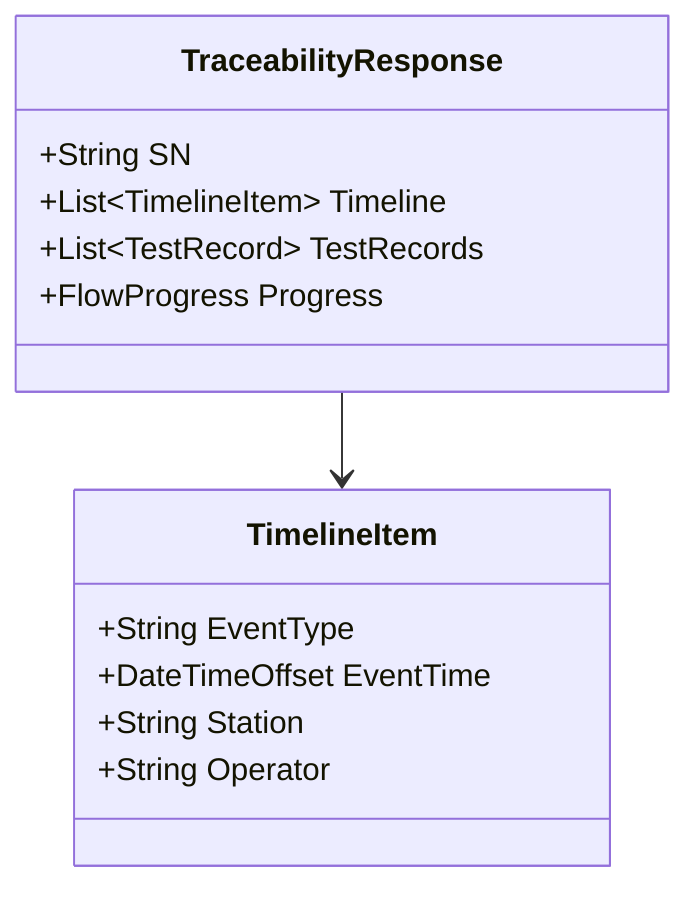

# 06.1 Traceability 业务模型

> 所属篇章：06_CanWeProveIt 能否证明 ｜ 状态：⏳ 骨架（待填充）

## 本篇要回答的业务问题

- 追溯要能回答哪些问题？（完整问题清单）
- 追溯的数据基础是什么？（事件 + 记录 + 5M1E 上下文）
- 追溯查询的输出形态与性能要求？

## 1. 追溯问题清单

来自 [`MES系统概览学习.md`](../MES系统概览学习.md)：

| # | 问题 | 数据来源 | 模型篇目 |
| --- | --- | --- | --- |
| 1 | 是谁做的？ | 事件上下文（Man） | 03.2 |
| 2 | 什么时候做的？ | EventTime | 05.1 |
| 3 | 在哪个工厂 / 线 / 工位？ | Station 层级 | 03.1 |
| 4 | 用了什么设备？ | Equipment | 03.3 |
| 5 | 用了什么原材料？哪个 Lot？ | 上料记录 | 01.2 / 06.2 |
| 6 | 用了哪个 Recipe / Software Version / Test Template？ | 版本快照 | 03.3 |
| 7 | 测了哪些参数？结果如何？ | TestRecord | 05.2 |
| 8 | 环境是什么？ | EnvironmentSnapshot | 03.4 |
| 9 | 质量结果是什么？返修过没有？ | 处置事件 | 05.3 / 05.4 |
| 10 | 谁批准的？ | 审批记录 | 03.2 / 05.4 |
| 11 | 最终去了哪里？ | 入库 / 发货事件 | 待扩展 |

<!-- 待填充：每个问题对应的查询路径 -->

## 2. 追溯数据模型

<!-- 待填充：追溯响应 = 时间线 + 测试记录 + 流程进度；索引设计（trace_events(sn, event_time)） -->

## 3. 追溯查询视图

<!-- 待填充 -->

- 输入 SN → 输出完整时间线（对照 `GET /api/traceability/{sn}` 与 `/timeline`）
- 性能目标：95% 查询 ≤ 2 秒（design.md §5.2 / §9.1）
- 冷热分层与聚合快照（追溯数据增长应对，design.md §12）

## 4. 追溯的完整性边界

<!-- 待填充：哪些环节当前覆盖、哪些断链（如：入库去向、外部返修）；断链的补齐计划 -->

## 关联文档

- 上游：[05.1_ManufacturingEvent制造事件](../05_WhatActuallyHappened_实际发生了什么/05.1_ManufacturingEvent制造事件.md)（追溯的数据基础）
- 平行：[06.2_Genealogy谱系模型](06.2_Genealogy谱系模型.md)
- 下游：[06.3_正向与反向追溯](06.3_正向与反向追溯.md)
- 实现参照：`TraceEvent` + 追溯 API（AGENTS.md API 表）
