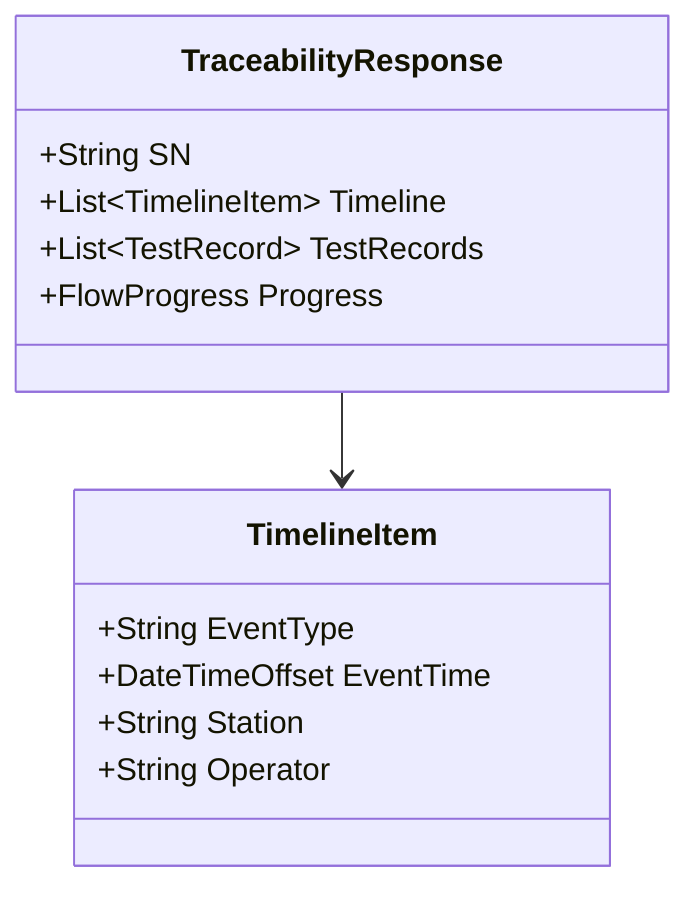

# 06.1 Traceability 业务模型

> 所属篇章：06_CanWeProveIt 能否证明 ｜ 状态：✅ 已完成

## 本篇要回答的业务问题

- 追溯要能回答哪些问题？（完整问题清单）
- 追溯的数据基础是什么？（事件 + 记录 + 5M1E 上下文）
- 追溯查询的输出形态与性能要求？

## 1. 追溯问题清单

来自 [`MES系统概览学习.md`](../MES系统概览学习.md)：

| # | 问题 | 数据来源 | 模型篇目 |
| --- | --- | --- | --- |
| 1 | 是谁做的？ | 事件上下文（Man） | 03.2 |
| 2 | 什么时候做的？ | EventTime | 05.1 |
| 3 | 在哪个工厂 / 线 / 工位？ | Station 层级 | 03.1 |
| 4 | 用了什么设备？ | Equipment | 03.3 |
| 5 | 用了什么原材料？哪个 Lot？ | 上料记录 | 01.2 / 06.2 |
| 6 | 用了哪个 Recipe / Software Version / Test Template？ | 版本快照 | 03.3 |
| 7 | 测了哪些参数？结果如何？ | TestRecord | 05.2 |
| 8 | 环境是什么？ | EnvironmentSnapshot | 03.4 |
| 9 | 质量结果是什么？返修过没有？ | 处置事件 | 05.3 / 05.4 |
| 10 | 谁批准的？ | 审批记录 | 03.2 / 05.4 |
| 11 | 最终去了哪里？ | 入库 / 发货事件 | 待扩展 |

每个问题对应的查询路径：

| # | 查询路径（当前实现） |
| --- | --- |
| 1–3 | `TraceEvent.OperatorId / StationCode / OccurredAt`（✅ 已覆盖） |
| 4–6 | 事件上下文扩展（⏳ M2：设备/程序版本随上下文入事件；RawPayload 可先行人工解析） |
| 5 | GenealogyLink 反查（⏳ 待实现） |
| 7 | `TestRecord.Metrics`（✅ 已覆盖） |
| 8 | 环境快照关联（⏳ 待实现） |
| 9 | 处置事件（⏳ M2 处置工作流） |
| 10 | 审批 / 审计记录（⏳ 随 RBAC） |
| 11 | 出 MES 边界（见 §4） |

## 2. 追溯数据模型

- **追溯响应 = 时间线 + 测试记录 + 流程进度**三段式（对照 `Responses.cs` 的 `TraceabilityResponse`）：
  - 时间线（Timeline）：按时间排序的事件流——「发生了什么」；
  - 测试记录（TestRecords）：测试明细与指标——「数据是什么」；
  - 流程进度（Progress）：期望路径 vs 实际进度的对照——「走到哪了」。
- **索引设计**：`trace_events(sn, event_time)` 复合索引（`design.md` §7.1）——单 SN 时间线查询是最高频路径，索引按查询模式建；`test_records(sn, station_code, test_batch_id)` 唯一索引兼做幂等约束与详情查询入口。

## 3. 追溯查询视图

- 输入 SN → 输出完整时间线（对照 `GET /api/traceability/{sn}` 与 `/timeline`）。
- **性能目标：95% 查询 ≤ 2 秒**（`design.md` §5.2 / §9.1）——对应战略北极星「任意 SN 在 2 分钟内讲清制造经历」（`从MIMS到MES` §11：查询本身秒级，剩余时间是打开系统与解读）；当前内存实现的查询已满足，接数据库后靠索引维持。
- **冷热分层与聚合快照**（追溯数据增长应对，`design.md` §12）：

| 层 | 内容 | 存储策略 |
| --- | --- | --- |
| 热数据 | 近 3–6 个月事件与测试记录 | 主库 + 索引 |
| 冷数据 | 更早的完整记录 | 归档存储（可按 SN 回溯查询） |
| 快照 | 班次/日聚合（SPC 汇总、看板缓存） | 分析层可重建（`从MIMS到MES` §6.1） |

原则：**事实层坏了不可接受，分析层可重算**——冷热迁移只影响查询速度，不能造成事实丢失。

## 4. 追溯的完整性边界

诚实声明「能证明什么、不能证明什么」，比夸大的追溯页面更有价值：

| 环节 | 当前状态 | 断链风险 | 补齐计划 |
| --- | --- | --- | --- |
| 工单 → 过站 → 测试 → SN 时间线 | ✅ M1 已覆盖 | — | — |
| 物料批次 / 谱系 | ⏳ 未覆盖 | 无法回答「用了哪个 Lot」 | 上料记录 + GenealogyLink（M2+） |
| 设备 / 程序版本上下文 | ⏳ 部分（RawPayload 内含） | 结构化查询不可用 | 事件上下文扩展（M2） |
| 处置与审批 | ⏳ 未覆盖 | 无法回答「谁批准的」 | 处置工作流 + RBAC（M2） |
| 入库 / 发货去向 | ❌ 出边界 | 无法回答「最终去了哪里」 | 对接 WMS / ERP（明确后置） |
| 外部返修（发到厂外修） | ❌ 出边界 | 履历断层 | 事件模型预留（返修出/回站事件） |

关键原则：**不要把尚未接入的数据误认为系统已经能够证明**（`MES系统概览学习.md` §7）——首期追溯的终点要明确声明；超出边界的问题（如入库去向）回答「数据在 WMS，MES 未接入」，而不是留空或猜。

## 关联文档

- 上游：[05.1_ManufacturingEvent制造事件](../05_WhatActuallyHappened_实际发生了什么/05.1_ManufacturingEvent制造事件.md)（追溯的数据基础）
- 平行：[06.2_Genealogy谱系模型](06.2_Genealogy谱系模型.md)
- 下游：[06.3_正向与反向追溯](06.3_正向与反向追溯.md)
- 实现参照：`TraceEvent` + 追溯 API（AGENTS.md API 表）
