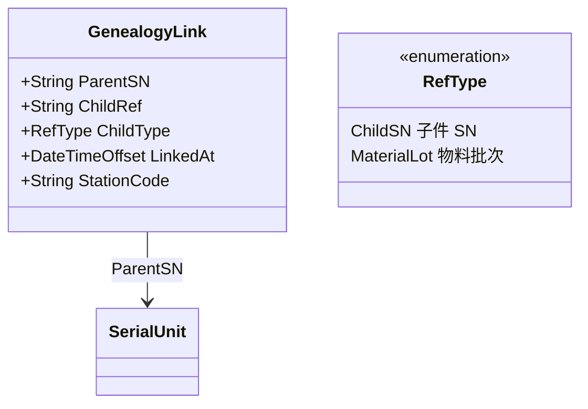

# 06.2 Genealogy 谱系模型

> 所属篇章：06_CanWeProveIt 能否证明 ｜ 状态：⏳ 骨架（待填充）

## 本篇要回答的业务问题

- as-designed BOM 与 as-built Genealogy 的区别是什么？
- SN 与子料（子 SN / Lot）的父子关系如何记录？（上料 / 组装 / 绑定）
- 多层谱系树如何存储与查询？

## 1. as-designed vs as-built

| 维度 | as-designed（BOM） | as-built（Genealogy） |
| --- | --- | --- |
| 回答 | 应该用什么料 | 实际用了哪个料、哪个批次 |
| 来源 | 工艺定义（01.2） | 上料 / 组装事件 |
| 粒度 | 物料编码 + 用量 | 具体实例（SN / LotNo） |
| 用途 | 计划与校验 | 追溯与召回 |

<!-- 待填充：两者的校验关系——上料时校验「所上之料在 BOM 允许范围内」 -->

## 2. 谱系关系模型

<!-- 待填充：绑定时机（组装工站过站时 / 上料时）；谁负责写谱系（过站事件带出） -->

## 3. 多层谱系树

<!-- 待填充 -->

- 存储选型：邻接表（GenealogyLink 表）+ 递归查询
- 树的深度：成品 → 组件 → 元件 / 物料批次（一般 2–4 层）
- 查询场景：给定根 SN，展开完整 as-built 树（正反向共用同一份数据，见 06.3）

## 4. 谱系与召回

<!-- 待填充：谱系是召回（正向追溯）的数据底座；受影响范围 = 谱系树的正向展开 -->

## 关联文档

- 上游：[01.2_BOM与物料模型](../01_What_应该生产什么/01.2_BOM与物料模型.md)、[06.1_Traceability业务模型](06.1_Traceability业务模型.md)
- 下游：[06.3_正向与反向追溯](06.3_正向与反向追溯.md)
- 案例参照：[07.2_VOA产品生命周期业务建模](../07_综合案例/07.2_VOA产品生命周期业务建模.md)
