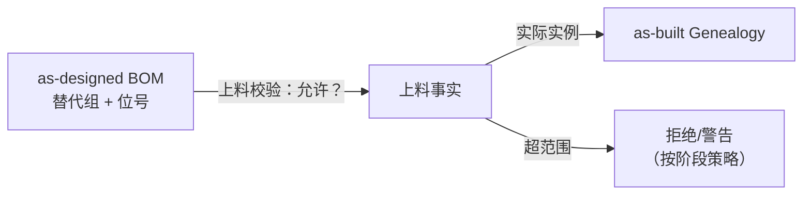
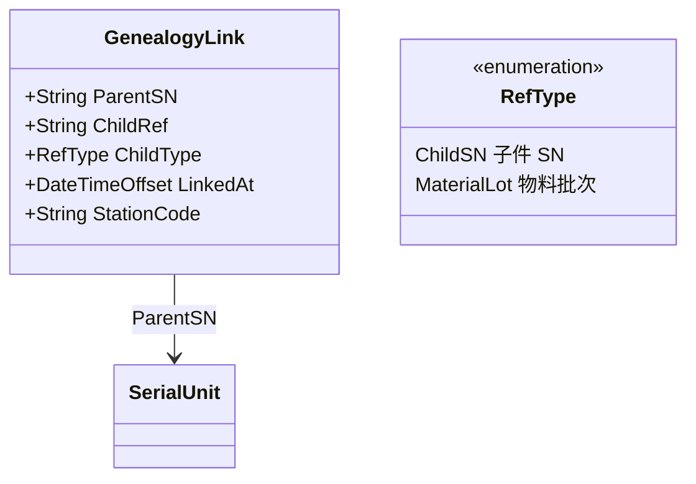
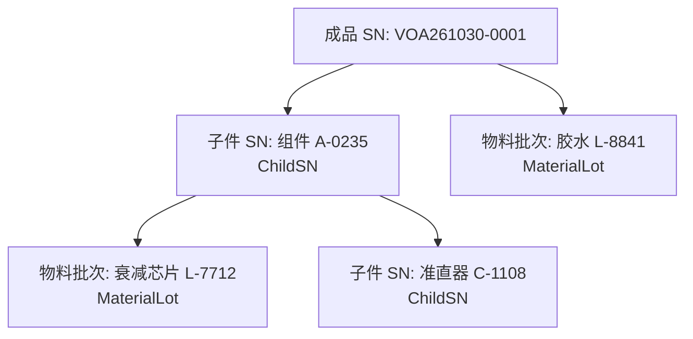

# 06.2 Genealogy 谱系模型

> 所属篇章：06_CanWeProveIt 能否证明 ｜ 状态：✅ 已完成

## 本篇要回答的业务问题

- as-designed BOM 与 as-built Genealogy 的区别是什么？
- SN 与子料（子 SN / Lot）的父子关系如何记录？（上料 / 组装 / 绑定）
- 多层谱系树如何存储与查询？

## 1. as-designed vs as-built

| 维度 | as-designed（BOM） | as-built（Genealogy） |
| --- | --- | --- |
| 回答 | 应该用什么料 | 实际用了哪个料、哪个批次 |
| 来源 | 工艺定义（01.2） | 上料 / 组装事件 |
| 粒度 | 物料编码 + 用量 | 具体实例（SN / LotNo） |
| 用途 | 计划与校验 | 追溯与召回 |

**两者的校验关系——上料时校验「所上之料在 BOM 允许范围内」**：



- 校验方向是单向的：BOM 约束上料合法性，上料事实构成谱系；**谱系永远不从 BOM 生成**——用 BOM「算」出来的谱系是伪造的 as-built（召回时会把没用过的批次也拉进来、漏掉实际用了的）。
- 典型偏差场景（说明为什么必须记 as-built）：替代料生效（同版本产品用了不同供应商的料）、Rework 换料（换上的新批次必须入谱系）、上料错误后纠正（错料记录 + 换料记录都保留）。

## 2. 谱系关系模型



- **绑定时机**：组装工站过站时 / 上料时——谱系链接是**事件的副产物**，不独立录入。上料事件（01.2 §3）携带 (SN, LotNo/子件SN, 工站, 时间)，落库时同步生成 GenealogyLink。谁负责写谱系：过站/上料用例（Application 层）负责，保证谱系与过站事件**同事务**。
- **Link 上的关键属性**：
  - `ChildType`：子件是单件（有 SN，如准直器组件）还是批次（无 SN，如胶水）——对应 Material 上的 `SerialTraced` / `LotControlled` 开关（01.2 §1）；
  - `LinkedAt` + `StationCode`：何时何站装的——返工换料的时间与位置（换料发生在 Rework 流程中，时间线可对照）；
  - 位号信息建议随 Link 存（CH1/CH2——位置维度的谱系是「某通道故障查该通道的料」的前提）。

## 3. 多层谱系树

- **存储选型：邻接表（GenealogyLink 表）+ 递归查询**。每行记录一条父子边，整棵树 = 边的集合；查树用递归 CTE（SQL）或应用层遍历。
- **树的深度**：成品 → 组件 → 元件 / 物料批次（一般 2–4 层）。半成品（01.1 §4）使深度超 2 层：成品 VOA ← 半成品组件（有自己的 SN 与履历）← 物料批次。**半成品的 SN 追溯与谱系追溯由此打通**——查成品谱系时，半成品子节点可继续展开其自身时间线。
- **查询场景**：给定根 SN，展开完整 as-built 树（正反向共用同一份数据，见 06.3）。



设计要点：**邻接表天然支持任意深度与双向查询**（反向：从 C3 找到 P 需要的是「同一张表反着查」），而「父表 + 子表」两栏式设计（如把子件列表内嵌在父记录 JSON 中）在正向查询方便但反向索引困难——召回是反向刚需，所以邻接表 + 索引（`genealogy_links(child_ref)` 与 `(parent_sn)` 双向索引）是稳妥选型。

## 4. 谱系与召回

- **谱系是召回（正向追溯）的数据底座**；受影响范围 = 谱系树的正向展开：

```text
召回查询模板：
输入：嫌疑物料 LotNo（如衰减芯片 L-7712）
查询：genealogy_links WHERE child_ref = 'L-7712' → 得到使用批次的所有父 SN（第一层）
      递归向上直到根（成品 SN）
输出：受影响成品 SN 清单 + 各自当前状态（在制/在库/已发货）
```

- 输出还必须带**状态与位置**（受影响 SN 清单 + 风险分级：已发货 > 在库 > 在制——处置成本与紧急度不同），见 [06.3 §3](06.3_正向与反向追溯.md) 与 [07.3 案例 B](../07_综合案例/07.3_异常与质量案例.md)。
- 前提条件再强调：**谱系完整性由现场上料事实采集质量决定**（`MES系统概览学习.md` §7：如果某工位绕过系统领料或私下改库，系统无法准确列出受影响产品——追溯能力的上限由现场事实采集质量决定）。

## 关联文档

- 上游：[01.2_BOM与物料模型](../01_What_应该生产什么/01.2_BOM与物料模型.md)、[06.1_Traceability业务模型](06.1_Traceability业务模型.md)
- 下游：[06.3_正向与反向追溯](06.3_正向与反向追溯.md)
- 案例参照：[07.2_VOA产品生命周期业务建模](../07_综合案例/07.2_VOA产品生命周期业务建模.md)
