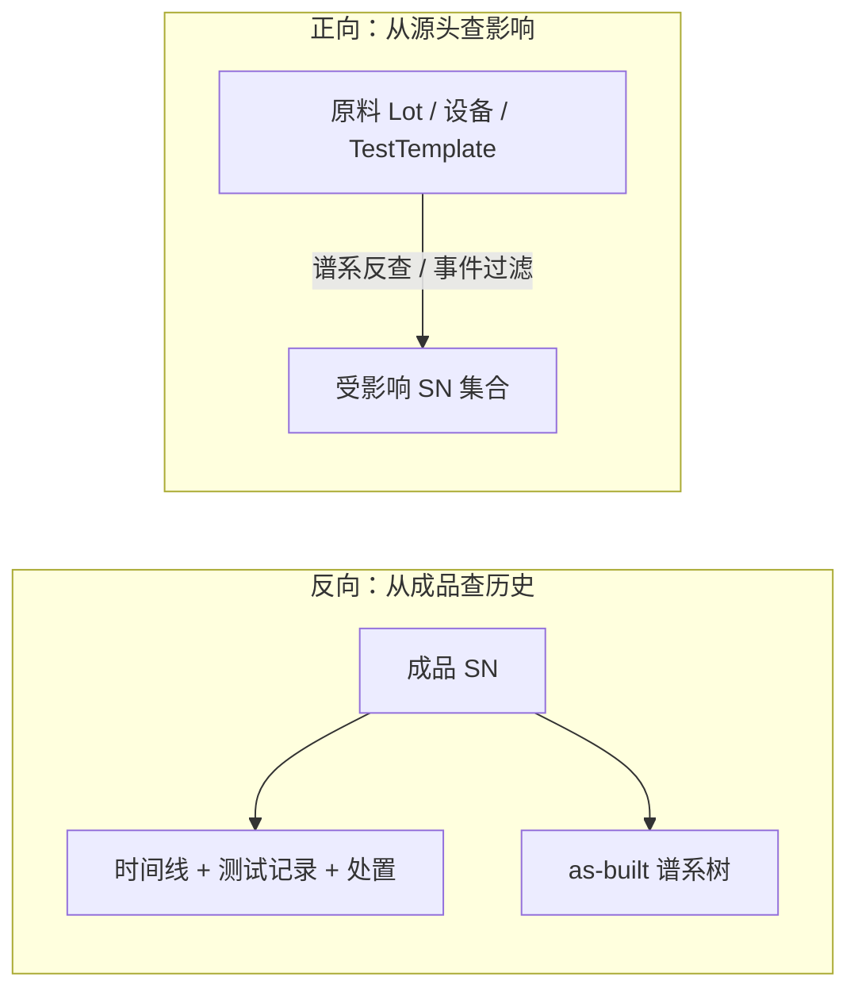
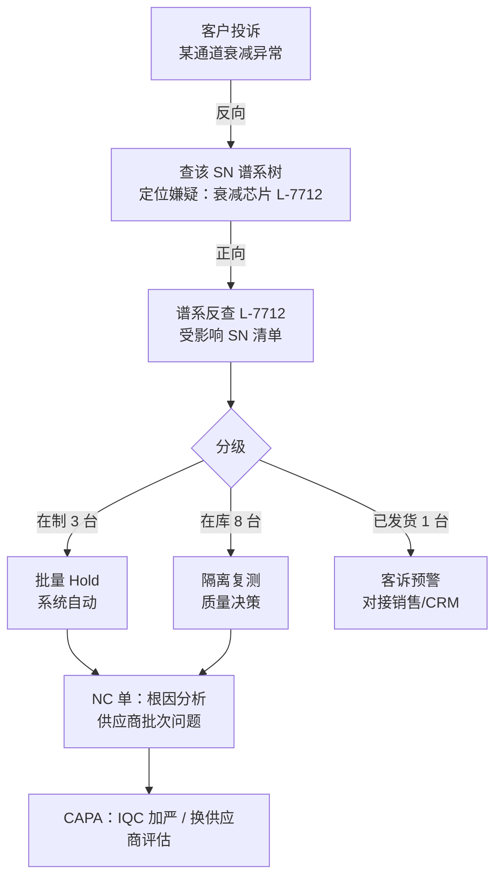

# 06.3 正向与反向追溯

> 所属篇章：06_CanWeProveIt 能否证明 ｜ 状态：✅ 已完成

## 本篇要回答的业务问题

- 反向追溯：给定一个成品 SN，能否查出它的完整制造历史与全部用料？
- 正向追溯：给定一个原料批次 / 一台设备 / 一套参数模板，能否找出所有受影响的成品 SN？
- 召回场景下，两种追溯如何配合？

## 1. 双向追溯总览

**两种追溯的查询模式差异（单点深挖 vs 集合扩散）**：

| 维度 | 反向追溯 | 正向追溯 |
| --- | --- | --- |
| 起点 | 一个 SN（已知 suspect） | 一个源头（Lot / 设备 / 模板 / 时间窗） |
| 查询形态 | 单点深挖（一棵树、一条时间线） | 集合扩散（一个集合的并集/过滤） |
| 数据形态 | 「拉」出完整履历 | 「推」出受影响清单 |
| 典型场景 | 客诉：这件产品怎么了 | 召回：哪些产品受牵连 |
| 性能特征 | 单 SN 索引查询，快 | 集合运算，需防组合爆炸（分层 + 分批） |

## 2. 反向追溯（SN → 历史）

- 入口：`GET /api/traceability/{sn}`。
- 输出：时间线（过站 / 测试 / 处置 / 审批）+ 谱系树 + 流程进度——三段式响应（06.1 §2）。
- 已覆盖：过站、测试（M1 已实现——`TraceEvent` 时间线 + `TestRecord` 明细 + 流程进度）；处置与审批事件随 M2 补齐。

反向追溯的「还原度自检」——回答不出下列问题即有断链：

| 自检问题 | 支撑数据 |
| --- | --- |
| 它经过哪些站、各站谁操作的？ | TraceEvent 流水 |
| 每次测试测了什么值、依据哪版规格？ | TestRecord + 版本引用 |
| 它失败过吗？怎么处置的？谁批准的？ | 处置事件 + 审批记录 |
| 它用了哪些料、哪个批次？ | GenealogyLink 树 |
| 中途换过料吗？ | 谱系树中的时间戳对比（换料后新增 Link） |

## 3. 正向追溯（源头 → SN 集合）

三类起点，各有专用查询路径：

| 起点 | 查询路径 | 典型问题 |
| --- | --- | --- |
| 原料批次 Lot | **谱系反查**（06.2 §4）：child_ref = LotNo 递归向上到根 | 「这批嫌疑料装进了哪些产品？」（经典召回） |
| 设备 / TestTemplate / Recipe 版本 | **按事件上下文过滤**：该设备/版本出现在哪些测试事件中 → 时间窗口内受测 SN | 「这台仪器校准发现超差，期间测过哪些产品？」（03.3 §4） |
| 参数异常（SPC 越界） | **按批次 / 时间过滤**：越界时段内该工站的全部 SN | 「这个时段参数整体漂移，涉及多少产品？」 |

- 输出：受影响 SN 清单 + **风险分级（已发货 / 在库 / 在制）**——同一清单内三种状态的处置动作完全不同：

| 分级 | 处置 | 依赖数据 |
| --- | --- | --- |
| 已发货 | 客诉预警、必要时召回通知 | 出货记录（MES 边界外，需 WMS/ERP 数据） |
| 在库 | 隔离 + 复测 / 复检 | 库存状态 |
| 在制 | Hold 拦截（系统自动批量挂起） | `SerialStatus`（✅ MES 可直接执行） |

在制拦截是 MES 唯一能**自动执行**的分级——正向追溯输出直接对接批量 Hold 操作（M2 处置工作流）。

## 4. 召回场景演练

完整剧本（客户投诉 → 反向定位嫌疑料 → 正向扩散受影响范围 → 分级处置）：

演练要点（对照 [07.3 案例 B](../07_综合案例/07.3_异常与质量案例.md)）：

1. **双向接力是标配动作**：客诉（反向）→ 风险（正向），单独任何一个方向都不构成完整应对；
2. **第一步的关键是「定位到批次/单件」而非「猜到原因」**——追溯给的是嫌疑范围（数据事实），根因分析（NC）是后续质量动作；
3. **时间就是风险敞口**：从客诉到受影响清单的时间，直接决定召回成本（`从MIMS到MES` §11 北极星：2 分钟讲清）；
4. **闭环**：召回处置完不等于结束——NC 根因（为什么来料不良流入了产线）与 CAPA（预防再发）才是体系性收口。

## 关联文档

- 上游：[06.1_Traceability业务模型](06.1_Traceability业务模型.md)、[06.2_Genealogy谱系模型](06.2_Genealogy谱系模型.md)
- 案例参照：[07.3_异常与质量案例](../07_综合案例/07.3_异常与质量案例.md)（案例 B：批次异常正向追溯）
