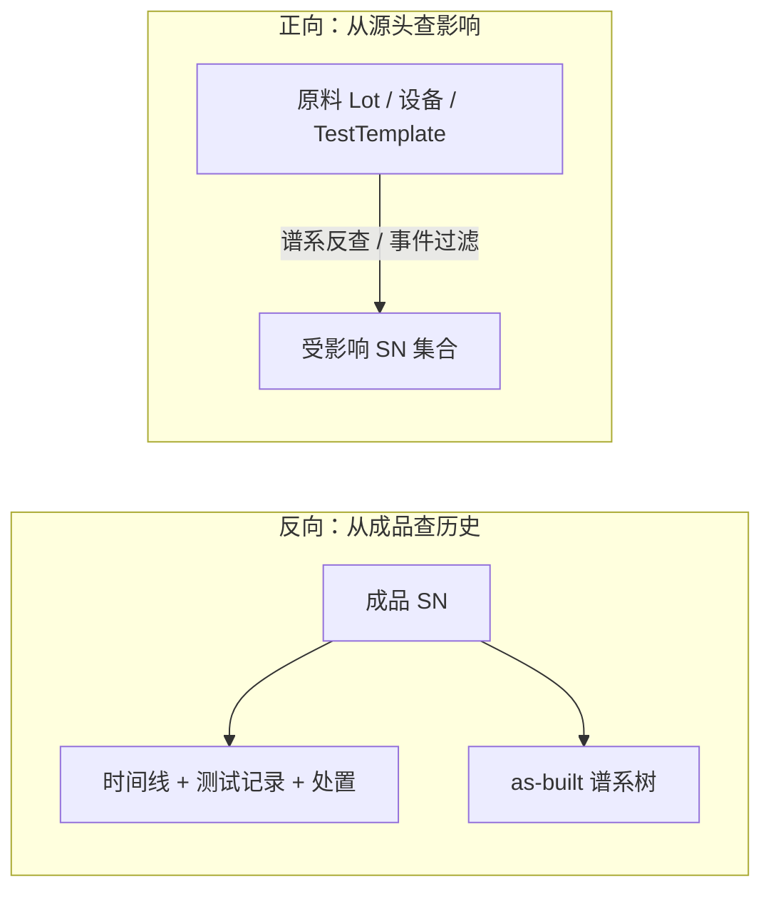

# 06.3 正向与反向追溯

> 所属篇章：06_CanWeProveIt 能否证明 ｜ 状态：⏳ 骨架（待填充）

## 本篇要回答的业务问题

- 反向追溯：给定一个成品 SN，能否查出它的完整制造历史与全部用料？
- 正向追溯：给定一个原料批次 / 一台设备 / 一套参数模板，能否找出所有受影响的成品 SN？
- 召回场景下，两种追溯如何配合？

## 1. 双向追溯总览

<!-- 待填充：两种追溯的查询模式差异（单点深挖 vs 集合扩散） -->

## 2. 反向追溯（SN → 历史）

<!-- 待填充 -->

- 入口：`GET /api/traceability/{sn}`
- 输出：时间线（过站 / 测试 / 处置 / 审批）+ 谱系树 + 流程进度
- 已覆盖：过站、测试、（处置待补）

## 3. 正向追溯（源头 → SN 集合）

<!-- 待填充 -->

- 三类起点：
  - 原料批次 Lot → 谱系反查 → SN 集合（经典召回场景）
  - 设备 / TestTemplate / Recipe 版本 → 按事件上下文过滤 → 时间窗口内的 SN
  - 参数异常（SPC 越界）→ 按批次 / 时间过滤
- 输出：受影响 SN 清单 + 风险分级（已发货 / 在库 / 在制）

## 4. 召回场景演练

<!-- 待填充：客户投诉 → 反向定位嫌疑料 → 正向扩散受影响范围 → 分级处置（复测 / 隔离 / 召回） -->

## 关联文档

- 上游：[06.1_Traceability业务模型](06.1_Traceability业务模型.md)、[06.2_Genealogy谱系模型](06.2_Genealogy谱系模型.md)
- 案例参照：[07.3_异常与质量案例](../07_综合案例/07.3_异常与质量案例.md)（案例 B：批次异常正向追溯）
