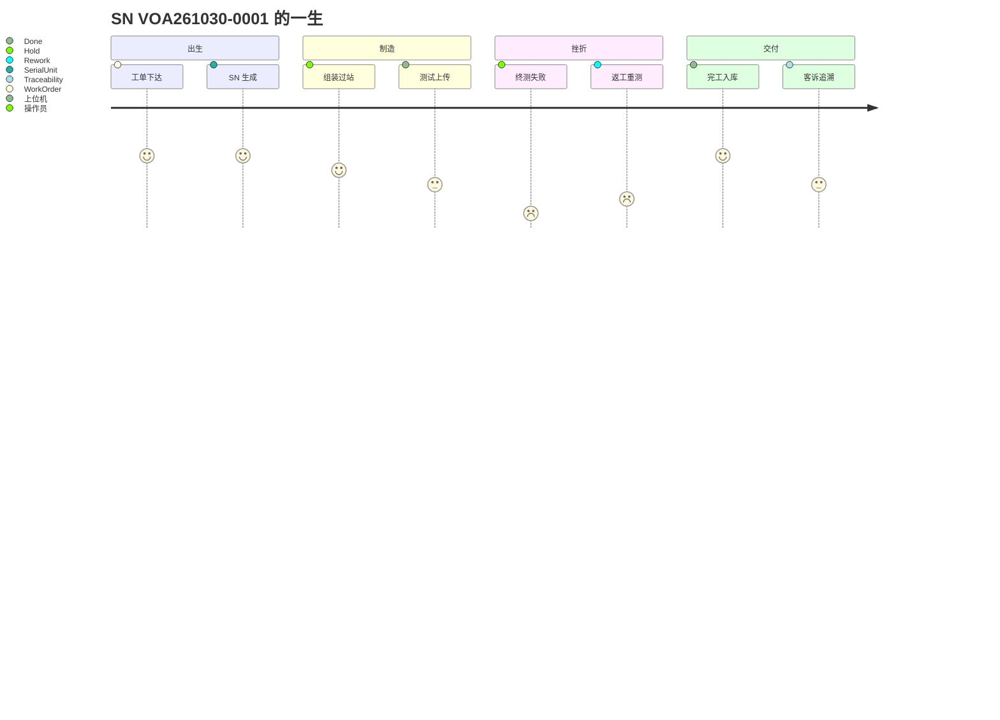

# 07.1 一个产品的一生

> 所属篇章：07_综合案例 ｜ 状态：⏳ 骨架（待填充）

## 本篇要回答的业务问题

- 用一个虚构 SN 的完整旅程，把六问模型（00.2）串联成故事？
- 每个故事节点分别踩到哪些模型篇目？

## 设定

<!-- 待填充：案例参数 -->

- 产品：VOA-100G-C（示例）
- SN：`VOA261030-0001`
- 工单：`WO-20261030-001`，计划数量 100
- 线体：示例线体（组装 → 调试 → 终测 → 外观 → 包装）

## 旅程骨架

### 第 1 章：出生（What / WhatToDo）

<!-- 待填充：工单下达 → 产品定义与测试流程启用 → SN 生成 -->

- 模型参照：[02.1_生产订单模型](../02_WhatToDo_应该执行什么/02.1_生产订单模型.md)、[01.1_产品Product模型](../01_What_应该生产什么/01.1_产品Product模型.md)

### 第 2 章：上料与组装（WhoWhereWithWhat）

<!-- 待填充：操作员上岗校验、物料批次上料、组装工站过站、谱系绑定 -->

- 模型参照：[03.2_人员与技能模型](../03_WhoWhereWithWhat_谁在哪里用什么生产/03.2_人员与技能模型.md)、[01.2_BOM与物料模型](../01_What_应该生产什么/01.2_BOM与物料模型.md)、[06.2_Genealogy谱系模型](../06_CanWeProveIt_能否证明/06.2_Genealogy谱系模型.md)

### 第 3 章：测试（WhatIsHappening）

<!-- 待填充：过站进测试站 → 上位机上传结果 → 判定 Pass -->

- 模型参照：[04.4_MoveIn到MoveOut时序图](../04_WhatIsHappening_现在正在发生什么/04.4_MoveIn到MoveOut时序图.md)、[05.2_Expected与Actual模型](../05_WhatActuallyHappened_实际发生了什么/05.2_Expected与Actual模型.md)

### 第 4 章：一次失败（WhatActuallyHappened）

<!-- 待填充：终测 Fail → Hold → 原因分析（插损超标）→ Rework 返回调试站 → Retest 通过 -->

- 模型参照：[05.4_Hold_Rework_Retest_Scrap状态模型](../05_WhatActuallyHappened_实际发生了什么/05.4_Hold_Rework_Retest_Scrap状态模型.md)

### 第 5 章：完工与入库

<!-- 待填充：末站过站 → Done → 数量对账 → 入库去向 -->

- 模型参照：[04.2_SN生命周期状态机](../04_WhatIsHappening_现在正在发生什么/04.2_SN生命周期状态机.md)

### 第 6 章：一个月后的客诉（CanWeProveIt）

<!-- 待填充：客户反馈某通道衰减异常 → 反向追溯 → 定位到某原料批次 → 正向扩散受影响 SN 清单 -->

- 模型参照：[06.3_正向与反向追溯](../06_CanWeProveIt_能否证明/06.3_正向与反向追溯.md)

## 旅程总图

## 关联文档

- 框架：[00.2_MES六问模型](../00_MES业务建模总纲/00.2_MES六问模型.md)
- 光通信实例版：[07.2_VOA产品生命周期业务建模](07.2_VOA产品生命周期业务建模.md)
