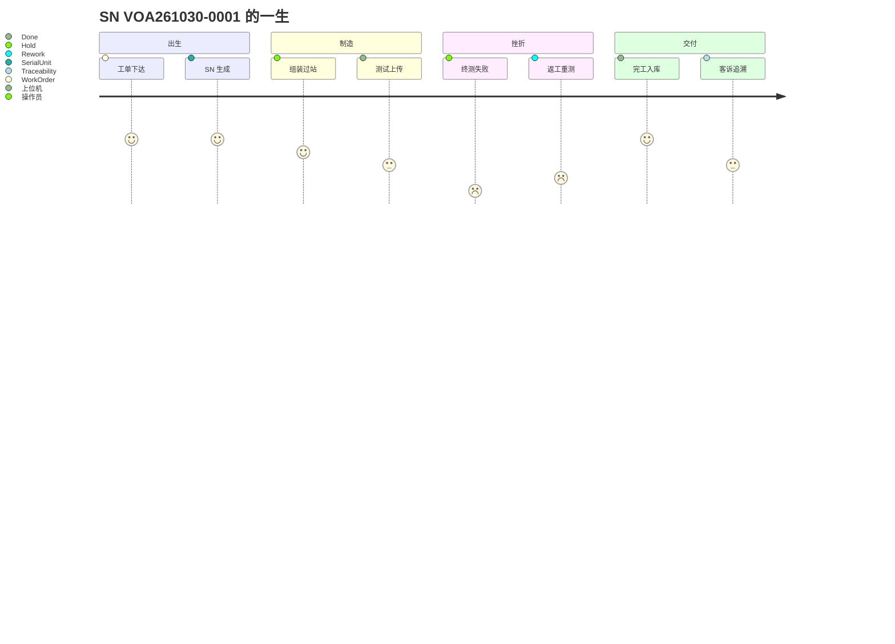

# 07.1 一个产品的一生

> 所属篇章：07_综合案例 ｜ 状态：✅ 已完成

## 本篇要回答的业务问题

- 用一个虚构 SN 的完整旅程，把六问模型（00.2）串联成故事？
- 每个故事节点分别踩到哪些模型篇目？

## 设定

| 参数 | 值 |
| --- | --- |
| 产品 | VOA-100G-C（100G 可变光衰减器 C 型，示例） |
| SN | `VOA261030-0001` |
| 工单 | `WO-20261030-001`，计划数量 100 |
| 测试流程 | `TF-VOAC-V1`（已激活）：组装 → 调试 → 终测 → 外观 → 包装 |
| 工站 | ASSY-01（组装）、TUNE-01（调试）、FT-01（终测）、VIS-01（外观）、PKG-01（包装） |
| 班次 | 白班，操作员 OP-102（组装）、OP-205（测试工位） |

## 旅程骨架

### 第 1 章：出生（What / WhatToDo）

10:00，计划员创建工单 `WO-20261030-001`（`POST /api/work-orders`）。MES 校验：VOA-100G-C 存在启用流程 `TF-VOAC-V1`（否则 `MES-4004`）、工单号未占用（`MES-4091`）。工单进入 Created → Released，锁定产品与流程版本引用。

10:05，首件投产。操作员 OP-102 在 ASSY-01 扫码，MES 生成 `SerialUnit VOA261030-0001`（绑定工单），完成首站过站（`POST /api/station/pass`）：校验工序顺序与工站授权（`MES-4002` / `MES-4003`），写第一条 TraceEvent。工单随之进入 InProgress。

- 模型参照：[02.1_生产订单模型](../02_WhatToDo_应该执行什么/02.1_生产订单模型.md)、[01.1_产品Product模型](../01_What_应该生产什么/01.1_产品Product模型.md)
- 踩到的六问：What（产品定义已就绪）、WhatToDo（工单 + 流程激活）

### 第 2 章：上料与组装（WhoWhereWithWhat）

10:06，OP-102 扫描衰减芯片批次 `L-7712`、准直器子件 `C-1108` 上料（M1 尚未实现上料记录，此处为模型目标态）。MES 校验所上之料在 BOM 替代组内（01.2 §3），生成谱系链接：`VOA261030-0001 → L-7712 / C-1108`（在组装工站、由谁、何时）。

组装完成，SN 离开 ASSY-01。此时它已经有了「身份 + 出身」：属于哪张工单、用了什么料、谁装的。

- 模型参照：[03.2_人员与技能模型](../03_WhoWhereWithWhat_谁在哪里用什么生产/03.2_人员与技能模型.md)、[01.2_BOM与物料模型](../01_What_应该生产什么/01.2_BOM与物料模型.md)、[06.2_Genealogy谱系模型](../06_CanWeProveIt_能否证明/06.2_Genealogy谱系模型.md)
- 踩到的六问：WhoWhereWithWhat（人、机、料、法在组装工站的组合）

### 第 3 章：测试（WhatIsHappening）

11:20，调试完成，SN 进入 FT-01 终测站。

1. OP-205 扫码过站：MES 校验下一待执行步骤 = 终测（步骤 30）且 FT-01 是测试站——通过，SN 进入待测状态；
2. 上位机调用测试程序（TestTemplate `TT-VOAC-01 v3`），测试仪测得：`IL=1.8dB`（限值 ≤2.0）、`RL=52dB`（限值 ≥50）、衰减精度 `+0.05dB`（限值 ±0.1）；
3. 上位机 `POST /api/test-results`：携带 `(sn, station_code, test_batch_id)`、Metrics 与 RawPayload。MES 幂等校验通过（无同键记录），写 TestRecord，判定 Pass，SN 步骤推进至外观检验。

网络在此刻抖了一下——上位机超时重发。MES 返回 `MES-4091`（重复上传），不重复计数。虚惊一场，这正是幂等存在的意义。

- 模型参照：[04.4_MoveIn到MoveOut时序图](../04_WhatIsHappening_现在正在发生什么/04.4_MoveIn到MoveOut时序图.md)、[05.2_Expected与Actual模型](../05_WhatActuallyHappened_实际发生了什么/05.2_Expected与Actual模型.md)
- 踩到的六问：WhatIsHappening（过站门控 + 待测状态）→ WhatActuallyHappened（测试事实落库）

### 第 4 章：一次失败（WhatActuallyHappened）

同批的 `VOA261030-0017` 没这么顺利：终测 `IL=2.4dB` 超标，Fail。它的状态变为 TestedFail → Hold，**任何过站被拦截**（`MES-4002`）。

质量工程师 QE-301 分析：该件调试记录显示衰减器偏调，属可修复缺陷。决策：Rework 返回调试站（步骤 20）。`VOA261030-0017` 回到 TUNE-01 重新调试，随后重走终测——**新的 TestBatchId，新的 TestRecord**；首次 Fail 记录完整保留在时间线上。

15:40，复测 Pass，恢复主流程。当天日报统计：FPY = 96/100（4 件首测失败），最终良率 = 100/100（全部经处置后合格）——两个数字都真实，回答不同的问题。

- 模型参照：[05.4_Hold_Rework_Retest_Scrap状态模型](../05_WhatActuallyHappened_实际发生了什么/05.4_Hold_Rework_Retest_Scrap状态模型.md)
- 踩到的六问：WhatActuallyHappened（失败事实 + 处置事件 + 审批留痕）

### 第 5 章：完工与入库

16:50，`VOA261030-0001` 依次通过外观（VIS-01）、包装（PKG-01）过站。末步完成，SN 进入终态 **Done**，工单 CompletedQty +1。

17:00，当日全部 100 件走到终态（Done × 99，Scrapped × 1——第 42 件因外壳损伤报废，QE-301 审批留痕）。工单满足完成条件（全部 SN 终态），进入 Completed。数量对账：99 + 1 = 100 = PlannedQty ✓。

成品入库。**入库去向在 MES 边界之外**（WMS 未接入）——追溯到「Done」为止，这是当前声明的追溯终点（06.1 §4）。

- 模型参照：[04.2_SN生命周期状态机](../04_WhatIsHappening_现在正在发生什么/04.2_SN生命周期状态机.md)
- 踩到的六问：WhatIsHappening（终态推进 + 工单完成联动，见 04.3 §2）

### 第 6 章：一个月后的客诉（CanWeProveIt）

11 月 25 日，客户反馈某台 VOA 通道衰减异常。序列号正是 `VOA261030-0001`。

质量部输入 SN 查询追溯（`GET /api/traceability/VOA261030-0001`）：

- **时间线**：每个过站（谁、何站、何时）、终测记录（含指标与原始报文）、无任何处置记录（它是一次通过的那 96 件之一）；
- **谱系树**：它用了衰减芯片批次 `L-7712`、准直器 `C-1108`；
- **流程进度**：按 `TF-VOAC-V1` 完整走完。

反向定位嫌疑：`L-7712` 批次。**正向扩散**：谱系反查 `L-7712` → 12 台成品使用过（含在制 3 台、在库 8 台、已发货 1 台）。分级处置：在制 3 台系统批量 Hold（自动拦截），在库 8 台隔离复测，已发货 1 台通知客户协商。NC 单开立，根因指向供应商该批次一致性——CAPA：IQC 加严抽检该供应商批次。

从输入 SN 到受影响清单，用了 3 分钟。

- 模型参照：[06.3_正向与反向追溯](../06_CanWeProveIt_能否证明/06.3_正向与反向追溯.md)
- 踩到的六问：CanWeProveIt（双向追溯 + 证据链 + 谱系）

## 旅程总图

> 注：第 4 章的挫折发生在同批的 `VOA261030-0017` 上——案例刻意让主角「一次通过」、同伴「经历挫折」，以覆盖正常与异常两条路径。完整复盘请对照 [07.3 异常与质量案例](07.3_异常与质量案例.md)。

## 关联文档

- 框架：[00.2_MES六问模型](../00_MES业务建模总纲/00.2_MES六问模型.md)
- 光通信实例版：[07.2_VOA产品生命周期业务建模](07.2_VOA产品生命周期业务建模.md)
